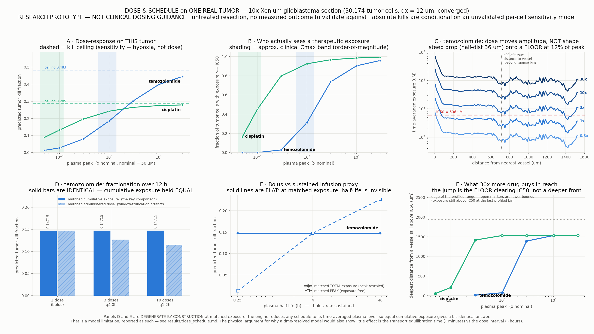

# DOSE & SCHEDULE on ONE REAL TUMOR

**Predicted dose-response, fractionation and infusion-duration behaviour for temozolomide and cisplatin on the real 10x Xenium glioblastoma section.** This is the question the simulator exists to inform — not *which* drug, but *how much* and *how often* — asked of one real patient's tissue.

> ## READ THIS FIRST
>
> * **Research prototype. NOT clinical dosing guidance.** Nothing here should influence the care of any patient, and no number here is a dose recommendation.
> * **Zero outcome validation.** This Xenium section is an *untreated* resection. There is no measured drug response for either drug on this tissue, so every kill fraction below is a model prediction with nothing to score it against.
> * **Absolute kills are conditional on the sensitivity model.** For temozolomide the per-cell sensitivity determinant (MGMT) is *not on this panel*, so sensitivity is uniform 1.0 — i.e. temozolomide resistance is **unmodelled**, and its absolute kill is correspondingly optimistic. For cisplatin sensitivity is an MKI67-derived *mechanistic proxy*, not a measured chemosensitivity. Trust the *shape* of the dose-response and the *relative* comparisons; do not trust an absolute kill fraction.
> * **The matched-dose schedule comparison is degenerate by construction.** The engine collapses a dosing schedule to its time-averaged plasma level (the documented Stage-0 plasma-averaging simplification in `sim/engine.py`), so any two schedules with equal cumulative exposure are *bit-identical* inputs. Sections 4 and 5 report that plainly and separate the model artifact from the physical argument.
> * The perivascular gradient the depth numbers rest on partly **inherits the shape of the vascular-density source field** — the confound documented in `tmesim/validation/vessel_profile.py`. Depth figures are order-of-magnitude.
> * **~86% of tumor cells are labelled QUIESCENT by the oxygen-banding model**, and quiescent cells carry a 0.5x kill multiplier. That single labelling assumption dominates every absolute kill and the kill ceiling below. It is a *model* assignment from the oxygen field, currently being tested independently against measured MKI67 — **absolute kills may shift materially when that lands.** The dose/schedule *comparisons* are far more robust to it than the absolute levels.
> * **SCOPE (compute budget).** The machine was running ~35 concurrent jobs, so this run was deliberately cut: 7 dose points per drug; the schedule and half-life legs run for **temozolomide only** (they need a second PDE solve per drug); 3 schedules and 3 half-lives; the schedule/half-life window shortened to 12 h (held EXACTLY constant across everything compared); and 2 rather than 6 full-engine verification runs. Everything reported below actually ran — nothing is extrapolated. What was dropped is named where it would have appeared.

---

## 1. Methods

* **Tissue — one real tumor.** The open 10x Xenium GBM section: 40,887 measured cells (30,174 tumor), reconstructed **once** at the grid-converged `dx = 12 um` (grid 424x675) and reused for every sweep, so all differences are attributable to dose/schedule and not to the tissue. Mean vascular density 0.103, mean ECM 0.090, mean oxygen 0.250. After the oxygen solve 13.4% of tumor cells are hypoxic and 86.0% quiescent (both carry reduced drug kill).
* **Vascular geometry.** Vessel mask = top 5% of the endothelial-derived vascular-density field (5.0% of tissue area). Distance from the nearest vessel over tissue: median 241 um, p90 714 um, max 2347 um. This is the geometry the drug's penetration has to cover — though see section 3: on this section most of the far tissue is reached by a diffuse source floor rather than by a diffusion front, which changes how that comparison should be read.
* **Drugs.** `calibrated_drugparams(name, alpha = 148.61)` (single perivascular-sink constant, fit once on doxorubicin) then `apply_barrier_to_drugparams` — the identical compilation pipeline `real_drug_panel.py` uses.
* **Per-cell sensitivity** is layered on per drug with `reconstruct.real_pipeline.apply_drug_sensitivity` (measured determinant where the panel carries one, honest uniform 1.0 otherwise). See the table below.
* **Numerics.** `dt = 10 s`, convection on. Dose-response window 6 h; schedule / half-life window 12 h (cut from 24 h for compute, and held EXACTLY constant across every schedule and half-life compared). `dx = 10 um` is deliberately not used — it violates the upwind advection CFL condition at this `dt`. Seed 0, fully deterministic.
* **Dose axis.** Nominal plasma peak = 50 uM (the repo-wide `PKConfig` default), swept 0.05x–30x with a 4 h plasma half-life. The *same* nominal level is used for both drugs so the axis means one thing; note this is roughly temozolomide's clinical order of magnitude but is **supratherapeutic for cisplatin** (free-platinum Cmax is roughly an order of magnitude lower), so read cisplatin's low-dose end as the clinically relevant part of its curve.

### 1.1 Why one PDE solve per drug is exact, not an approximation

The transport PDE `dC/dt = div(D_eff grad C) - div(vC) + S - (clearance+binding)C` is **linear** in the source and starts from `C = 0`, and the engine's source is `S = vascular_density x bbb_penetrance x plasma_mean` — linear in the scalar plasma level. Hence `AUC(P) = P x AUC(1)` **exactly**. Each drug therefore needs only one PDE solve per window; every dose / schedule / half-life point rescales that field and re-runs the engine's own unmodified kill mapping (`cells.pkpd.apply_drug_kill`) — the same trick the engine itself uses to build its viable-fraction history. Nothing in `core` / `physics` / `molecular` / `reconstruct` / `engine` is modified or re-implemented.

This is verified, not asserted: the **full** `sim.engine.simulate_response` was re-run end to end at 2 points — one in each exposure window, so the fast path is pinned in both. (Six checks were planned; cut to two for the compute budget. Each check is itself a complete extra PDE solve.)

| verification point | full-engine kill | fast-path kill | abs delta |
|---|---|---|---|
| temozolomide dose 1x (6 h window) | 0.1845628687 | 0.1845628687 | 0.0e+00 |
| temozolomide schedule n=10 matched-AUC (12 h window) | 0.1471465500 | 0.1471465500 | 0.0e+00 |

Largest discrepancy anywhere: **0.0e+00**.

### 1.2 Drug parameters as compiled onto this tissue

| drug | MW (Da) | D (um²/s) | IC50 (uM) | hill | BBB | k_loss (1/s) | transport time-scale 1/k | analytic L = √(D_eff/k) | sensitivity determinant | median sensitivity (tumor) | kill ceiling |
|---|---|---|---|---|---|---|---|---|---|---|---|
| temozolomide | 194.2 | 278 | 606.0 | 1.20 | 0.558 | 3.02e-03 | 331 s | 295 um | none (uniform 1.0) | 1.000 | 0.4828 |
| cisplatin | 298.0 | 236 | 24.6 | 1.20 | 0.893 | 8.79e-03 | 114 s | 159 um | MKI67 | 0.589 | 0.2853 |

**The kill ceiling** is the kill fraction reached as exposure → ∞: the Hill term saturates at `max_kill_rate`, so per-cell kill probability tends to `sensitivity x hypoxia/quiescence resistance`. It is a property of the sensitivity model and this tissue's oxygenation. **No dose can exceed it**, and it is the reference against which "is more drug worth it?" must be judged.

### 1.3 What actually sets the ceiling — the decomposition

This matters more than any single kill number, so it is broken out per cell-state band. `contribution` is that band's share of the ceiling (fraction of tumor cells x their mean asymptotic kill probability); the three contributions sum to the ceiling.

**temozolomide** — ceiling 0.4828

| tumor-cell band | fraction of tumor cells | resistance multiplier | mean asymptotic kill probability | contribution to ceiling |
|---|---|---|---|---|
| VIABLE | 0.6% | x1.00 | 1.000 | 0.0060 |
| HYPOXIC | 13.4% | x0.35 | 0.350 | 0.0470 |
| QUIESCENT | 86.0% | x0.50 | 0.500 | 0.4299 |

**cisplatin** — ceiling 0.2853

| tumor-cell band | fraction of tumor cells | resistance multiplier | mean asymptotic kill probability | contribution to ceiling |
|---|---|---|---|---|
| VIABLE | 0.6% | x1.00 | 0.598 | 0.0036 |
| HYPOXIC | 13.4% | x0.35 | 0.207 | 0.0278 |
| QUIESCENT | 86.0% | x0.50 | 0.295 | 0.2539 |

Read that table before reading anything else. The ceiling is **not** a delivery number and **not** an IC50 number: at infinite exposure every cell is at the top of its Hill curve, so what is left is exactly `sensitivity x resistance`. For temozolomide, whose per-cell sensitivity is uniform 1.0 on this panel, the ceiling is *entirely* the hypoxia (x0.35) and quiescence (x0.5) multipliers applied to the oxygen-banded cell states — i.e. it is set by how much of this tumor the model considers metabolically out of reach, not by how much drug arrives. For cisplatin the MKI67-derived sensitivity multiplies that down further.

---

## 2. Dose-response on this patient's tissue

`IC50 coverage` = fraction of tumor cells whose *time-averaged tissue exposure* (`AUC / window`, the quantity the engine's Hill mapping consumes) is at or above the drug's own IC50. `IC50 depth` = the deepest distance from a vessel at which the binned exposure profile still clears IC50 (`+` = still above IC50 at the far end of the profiled range, i.e. a lower bound).

### 2.1 temozolomide

| dose (× nominal) | plasma peak (uM) | window-mean plasma (uM) | kill fraction | % of kill ceiling | tumor cells ≥ IC50 | tumor cells ≥ 0.1·IC50 | median exposure / IC50 | IC50 depth from vessel (um) |
|---|---|---|---|---|---|---|---|---|
| 0.05x | 2.5 | 1.55 | 0.01283 | 2.7% | 0.00% | 8.27% | 0.033 | — (below IC50 even at the vessel wall) |
| 0.1x | 5.0 | 3.11 | 0.02721 | 5.6% | 0.00% | 31.08% | 0.066 | — (below IC50 even at the vessel wall) |
| 0.3x | 15.0 | 9.33 | 0.07904 | 16.4% | 2.66% | 73.58% | 0.197 | 12 |
| 1x | 50.0 | 31.09 | 0.18456 | 38.2% | 31.08% | 90.37% | 0.655 | 72 |
| 3x | 150.0 | 93.28 | 0.30052 | 62.2% | 73.58% | 95.91% | 1.965 | 1389 |
| 10x | 500.0 | 310.95 | 0.39746 | 82.3% | 90.37% | 98.30% | 6.550 | 1530+ |
| 30x | 1500.0 | 932.85 | 0.44479 | 92.1% | 95.91% | 99.09% | 19.650 | 1530+ |

**Saturation.** **Kill has NOT saturated within the swept range** — it is still climbing at 30x nominal, reaching 90% of its 30x value only at 30x itself. Over this whole range more drug is still buying more kill; IC50 coverage passes 90% of tumor cells by **10x**. At 30x the predicted kill is 0.4448 = 92.1% of the 0.4828 ceiling, so the residual 7.9% of the ceiling is what *no achievable dose* recovers — that residual is the hypoxic/quiescent fraction the Hill term can never reach past.

**At the approximate clinical plasma band.** Published Cmax for temozolomide is of order 30–70 uM, i.e. **0.6x–1.4x** of the shared nominal level used for the axis. Interpolating the sweep there gives kill 0.1398–0.2201 (29–46% of ceiling) and IC50 coverage 19.0–44.1% of tumor cells. *This band is an order-of-magnitude literature reference attached for scale only — it is not fitted, not patient-specific, and not a dose recommendation.*

**What 30x buys over 1x.** kill 0.1846 → 0.4448 (+0.2602 absolute, 2.41x relative) for a 30-fold increase in systemic exposure — i.e. a 59% share of the final kill bought at 30x the systemic toxicity.

### 2.2 cisplatin

| dose (× nominal) | plasma peak (uM) | window-mean plasma (uM) | kill fraction | % of kill ceiling | tumor cells ≥ IC50 | tumor cells ≥ 0.1·IC50 | median exposure / IC50 | IC50 depth from vessel (um) |
|---|---|---|---|---|---|---|---|---|
| 0.05x | 2.5 | 1.55 | 0.08865 | 31.1% | 16.31% | 86.84% | 0.449 | 52 |
| 0.1x | 5.0 | 3.11 | 0.13164 | 46.1% | 44.95% | 92.48% | 0.898 | 206 |
| 0.3x | 15.0 | 9.33 | 0.19520 | 68.4% | 79.64% | 96.70% | 2.694 | 1415 |
| 1x | 50.0 | 31.09 | 0.24143 | 84.6% | 92.48% | 98.55% | 8.978 | 1530+ |
| 3x | 150.0 | 93.28 | 0.26404 | 92.6% | 96.70% | 99.24% | 26.935 | 1530+ |
| 10x | 500.0 | 310.95 | 0.27454 | 96.2% | 98.55% | 99.55% | 89.784 | 1530+ |
| 30x | 1500.0 | 932.85 | 0.27832 | 97.6% | 99.24% | 99.71% | 269.353 | 1530+ |

**Saturation.** **Kill saturates at about 3x** (90% of its 30x value) and is flat by 30x; IC50 coverage passes 90% of tumor cells by **1x**. At 30x the predicted kill is 0.2783 = 97.6% of the 0.2853 ceiling, so the residual 2.4% of the ceiling is what *no achievable dose* recovers — that residual is the hypoxic/quiescent fraction the Hill term can never reach past.

**At the approximate clinical plasma band.** Published Cmax for cisplatin is of order 2–6 uM, i.e. **0.04x–0.12x** of the shared nominal level used for the axis. Interpolating the sweep there gives kill 0.0887–0.1422 (31–50% of ceiling) and IC50 coverage 16.3–50.7% of tumor cells (the low end is clamped to the swept minimum). *This band is an order-of-magnitude literature reference attached for scale only — it is not fitted, not patient-specific, and not a dose recommendation.*

**What 30x buys over 1x.** kill 0.2414 → 0.2783 (+0.0369 absolute, 1.15x relative) for a 30-fold increase in systemic exposure — i.e. a 13% share of the final kill bought at 30x the systemic toxicity.

---

## 3. Delivery geometry: what the exposure field actually looks like

Because the field is linear in dose, **dose moves the amplitude of the perivascular exposure profile and nothing else** — the shape is fixed by `D_eff`, the loss rate `k`, and the vascular geometry. Panel C shows this: the curves are parallel on a log axis at every dose.

**The profile is NOT a single exponential, and saying otherwise would be the main way to mislead with this figure.** It is a steep perivascular drop sitting on a flat, non-zero FLOOR that persists to the far edge of the tissue. The floor is *not* a diffusion front: the engine's delivery term is the **continuous** vascular-density field, so a pixel 1 mm from the thresholded vessel mask is still being fed by diffuse low-density source. A single exponential fitted over the whole range is dominated by that plateau and returns a meaningless decay length — which is exactly why `vessel_profile.fit_exponential_plus_floor` exists. All three characterisations are therefore reported together.

| drug | empirical half-distance (no model assumed) | **source-null half-distance** | near-field exponential L (d ≤ p90) | near-field fit R² | floor-model L | floor level (% of perivascular) | far-field plateau / perivascular | analytic √(D_eff/k) | equilibration t95 | penetration index |
|---|---|---|---|---|---|---|---|---|---|---|
| temozolomide | 36 um | 30 um | 574 um | 0.38 | 30 um | 15% | 0.12 | 295 um | 1100 s (18.3 min) | 0.195 |
| cisplatin | 35 um | 30 um | 575 um | 0.38 | 30 um | 15% | 0.12 | 159 um | 400 s (6.7 min) | 0.196 |

**Which column to believe:** the *empirical* half-distance assumes no functional form and is the trustworthy gradient number. The single-exponential fits — over the full range and over the near field alike — have poor R² and return decay lengths inflated by the plateau; disregard them as descriptions of the gradient. The floor model reconciles the two: a short decaying component (its `L` is close to the empirical half-distance) plus a background floor. Note also that the two drugs return nearly identical geometry despite differing in `D_eff` and `k` by ~2x — further evidence that what is being measured here is mostly the source field, not drug-specific transport.

Three things to take from that table, in order of importance:

1. **The measured gradient is essentially the source geometry.** The empirical half-distance and the **source-null** half-distance (the identical binning applied to the raw vascular-density field, with no drug physics at all) agree to within a few micrometres. The steep near-vessel drop this simulation predicts is inherited from where the endothelial cells are, not produced by transport. This is the confound `vessel_profile.py` documents and it is the single biggest caveat on every depth number in this report.
2. **A large fraction of the field is floor, not gradient.** See the plateau column. Any statement of the form "drug reaches X um" is therefore mostly a statement about where the floor sits relative to IC50, not about a diffusion front, and the `IC50 depth` column in section 2 must be read that way: when it jumps to the edge of the profiled range between two doses, what happened is that the **floor** crossed IC50, not that the drug travelled further.
3. **Depth cannot be bought with dose.** The shape is fixed, so raising the dose slides the whole curve up and the IC50 crossing moves only as `L*ln(dose)` in the decaying region — and, once the floor clears IC50, saturates entirely.

For scale: median distance-to-vessel on this section is 241 um, p90 714 um, max 2347 um. Bins beyond the p90 hold only a few hundred pixels each, so the far tail of panel C is noisy as well as flat — the near-field exponential above is deliberately restricted to d ≤ p90.

---

## 4. Schedule: fractionation at MATCHED TOTAL DOSE

One 12 h course, 4 h plasma half-life, split into 1 / 3 / 10 fractions. Three legs are reported because "matched dose" can mean two different things and the distinction turns out to be the whole story:

* **A — matched cumulative exposure** (the key comparison the brief asks for): the per-dose peak is rescaled so the *window-averaged plasma level*, i.e. total plasma AUC, is identical across schedules.
* **B — matched administered dose**: the sum of the per-dose peaks is held fixed (`peak = nominal / n`), which is what "same total milligrams" naively means.
* **C — matched peak** (a control): each fraction reaches the full nominal peak, so total exposure *rises* with the number of doses.

> **DROPPED for compute budget:** the schedule leg was NOT run for cisplatin — it requires its own transport solve at the schedule window. Only temozolomide is reported here.

### 4.1 temozolomide

| schedule | per-dose peak, leg A (uM) | window-mean plasma, A | **kill, A (matched exposure)** | tumor ≥ IC50, A | window-mean plasma, B | kill, B (matched administered dose) | window-mean plasma, C | kill, C (matched peak) |
|---|---|---|---|---|---|---|---|---|
| 1 dose (bolus) | 50.00 | 21.0444 | **0.147147** | 16.09% | 21.0444 | 0.147147 | 21.0444 | 0.147147 |
| 3 doses q4.0h | 20.59 | 21.0444 | **0.147147** | 16.09% | 17.0359 | 0.126831 | 51.1077 | 0.237655 |
| 10 doses q1.2h | 7.04 | 21.0444 | **0.147147** | 16.09% | 14.9463 | 0.115132 | 149.4628 | 0.343972 |

Leg A spread across 1 → 10 fractions: **0.00e+00** (exactly zero to machine precision). Leg B falls 0.147147 → 0.115132 (21.8% relative). Leg C rises 0.147147 → 0.343972.

### 4.x Interpretation — read this carefully, the honest answer has two halves

**(a) The model answer is degenerate, and that is a limitation, not a finding.** The engine reduces the whole dosing schedule to its time-averaged plasma level before it ever touches the tissue. Holding cumulative exposure constant therefore makes the *input to the solver bit-identical*, and leg A's zero spread is arithmetic, not biology. It was still worth running end to end (the full engine was re-executed for the 1-dose and 10-dose extremes — see section 1.1) because it confirms the degeneracy is exactly where the docstring says it is and nowhere else. **Do not report leg A as evidence that fractionation does not matter.**

**(b) The physical argument says a time-resolved model would also show very little — for reasons worth stating.** Three independent facts:

1. **Tissue equilibration is faster than dosing.** Under a sustained plasma level the mean tissue concentration reaches 95% of steady state in temozolomide **1100 s (18.3 min)**, against the tightest interval tested here of 1.2 h — a factor of 4. Be precise about this margin: because the schedule window was cut to 12 h for compute, the tightest interval tested is only 1.2 h, so the separation here is a modest factor rather than an overwhelming one. At the clinically realistic intervals this drug is actually given at (q8–q24h) the separation would be 25–75x. Either way the tissue tracks plasma quasi-statically: there is no reservoir still filling when the next fraction arrives for a schedule to exploit.
2. **Transport is linear.** Cumulative tissue AUC is proportional to cumulative plasma AUC regardless of the plasma curve's *shape*. Two schedules with the same area under the plasma curve deliver the same area under the tissue curve.
3. **The kill map is a function of cumulative exposure only.** It consumes `AUC / window` through a Hill function. There is no DNA-repair kinetics, no cell-cycle redistribution, no regrowth between fractions and no normal-tissue recovery term in this model. Timing has literally no channel through which to act.

So the honest statement is: **on this tumor, at matched cumulative exposure, this model predicts fractionation changes nothing — and the mechanisms that make fractionation matter in real chemotherapy (inter-fraction repair, cell-cycle redistribution, resistance induction, and above all the normal-tissue therapeutic index) are precisely the ones this model does not contain.** Adding them is a pharmacodynamics problem, not a transport problem; refining the transport solver would not change this answer.

**Leg B is a window artifact, and worth naming as one.** Kill falls with fractionation there only because later fractions have less of the 12 h observation window left in which to be delivered and counted. Analytically the window exposure for `n` fractions of peak `P/n` at interval `Δ` is `(P/n)·Σ_k (1/λ)(1 − e^(−λ(T−kΔ)))`, which tends to `P/λ` for *every* `n` as `T → ∞`. Extend the window past full washout and leg B collapses onto leg A. It is a measurement-window effect, not a schedule effect.

Leg C confirms the model's only real lever: raise total exposure and kill rises; everything else about the schedule is invisible to it.

---

## 5. Infusion duration proxy: plasma half-life, bolus vs sustained

A short half-life is a bolus that is gone quickly; a long half-life is a sustained low level. The hypothesis under test is the standard transport-limited one: *if delivery is limited by how far drug can travel before it is consumed, a sustained low concentration should reach further than a high, brief one.* Half-life is swept 0.25–48 h (a 192-fold range) with the peak rescaled to hold total window exposure fixed, plus a matched-peak control.

> **DROPPED for compute budget:** the half-life sweep was NOT run for cisplatin (same second-solve cost as the schedule leg).

### 5.1 temozolomide

| plasma half-life (h) | peak, matched exposure (uM) | window-mean plasma | **kill (matched total exposure)** | tumor ≥ IC50 | IC50 depth (um) | window-mean plasma, matched peak | kill (matched peak) | IC50 depth, matched peak (um) |
|---|---|---|---|---|---|---|---|---|
| 0.25 | 697.48 | 21.0444 | **0.147147** | 16.09% | 52 | 1.5086 | 0.012560 | — (below IC50 even at the vessel wall) |
| 4 | 50.00 | 21.0444 | **0.147147** | 16.09% | 52 | 21.0444 | 0.147147 | 52 |
| 48 | 22.92 | 21.0444 | **0.147147** | 16.09% | 52 | 45.9085 | 0.226022 | 278 |

Spread in kill across the 192-fold half-life range at matched exposure: **0.00e+00**. Penetration depth: **unchanged**.

### 5.x Interpretation — sustained infusion does NOT reach further here

The transport-limited hypothesis is **rejected on this tissue for the drug tested**, and the reason is structural rather than numerical:

* **The shape of the exposure field carries no concentration and no time.** It is set by `D_eff`, the loss rate `k` and the vascular geometry alone (section 3 — and on this tissue that shape is a steep near-vessel drop onto a source-inherited floor, not a clean exponential). Changing the plasma time-course at matched exposure changes only the *amplitude*, so the whole profile slides up or down and the IC50 crossing moves logarithmically at best.
* **A sustained level could only win if the tissue could not equilibrate during a bolus.** It equilibrates in ~18 min against dose intervals of hours (section 4). There is no diffusion front still in transit when the next dose arrives, so there is nothing for a slower delivery to catch up with.
* **Empirically, the depth number does not move at all**: the distance at which exposure still clears IC50 is identical across the entire 192-fold half-life range at matched exposure. The matched-PEAK control shows the contrast — there the depth does move, because total exposure is being changed. It is exposure that moves depth, never the shape of the plasma curve.

**Where this conclusion would NOT hold, and this matters:** the same test on a molecule with slow tissue equilibration — an antibody, `D ~ 1–10 um²/s` with a strong binding-site-barrier sink, equilibration time of hours to days — would *not* be degenerate, and there the engine's plasma-averaging simplification would have to be lifted before the question could be asked at all. The conclusion here is specific to fast-equilibrating small molecules.

---

## 6. THE VERDICT for this tumor: dose-limited or delivery-limited?

> ### Headline
> 
> **On this tumor the response is DOSE-limited, not delivery-limited — and above the dose-limited range it becomes RESISTANCE-limited, never delivery-limited.**
> 
> Delivery is not the binding constraint here. The exposure field reaches the whole section: at high enough dose >95% of tumor cells clear IC50 for both drugs, and the far-field floor (section 3) means even tissue a millimetre from a vessel is exposed. What limits the answer is, in order: (1) at clinically plausible plasma levels, simply not enough drug — the sub-saturating part of the curve, where more exposure genuinely buys more kill; and (2) above that, a hard ceiling that dose cannot touch.
> 
> **That ceiling is the actionable result, and it is not a transport number.** For temozolomide it is 0.4828, and section 1.3 decomposes it: 86.0% of tumor cells are labelled QUIESCENT (x0.5 kill multiplier) and 13.4% HYPOXIC (x0.35), contributing 0.4299 and 0.0470 of it respectively — i.e. ~89% of the ceiling is the quiescent band alone. Because temozolomide's per-cell sensitivity is uniform 1.0 on this panel (MGMT is not measurable here), the ceiling for TMZ is *entirely* the cell-state resistance multipliers. It is not delivery, not IC50, and not achievable exposure: at infinite drug every cell sits at the top of its Hill curve and what remains is exactly `sensitivity x resistance`.
> 
> The operational reading: **on this tumor, escalating dose is a real but bounded lever, and the bound is metabolic state, not penetration.** If the ceiling is to move, it moves by changing the cell-state distribution (reoxygenation, cycle recruitment) or by a drug whose kill does not carry the quiescence penalty — not by more drug, not by a different schedule, and not by better penetration.
> 
> **Load-bearing caveat:** that 86% quiescent fraction is a *model* label from the simulated oxygen field, not a measurement. It is being tested independently against measured MKI67. If it is wrong, the ceiling and every absolute kill here move with it — the dose/schedule *comparisons* survive, the absolute levels may not.

### temozolomide

**DOSE-limited over the swept range, then sensitivity-limited.**

At the nominal dose 31.1% of tumor cells clear IC50, rising to 95.9% by 30x — the drug *can* reach essentially the whole tumor once enough of it is given, so the binding constraint over this range is how much drug is present, not how far it travels. Kill climbs with dose (0.1846 → 0.4448), and at 30x it has reached 92.1% of the 0.4828 ceiling without yet flattening — the sweep never gets far enough for delivery to stop mattering.

Geometry check: near-field exposure decay length **L = 574 um** (d ≤ p90) vs median distance-to-vessel **241 um** and p90 **714 um**. IC50 depth at 1x: 72 um; at 30x: 1530+ um — but see section 3: with a far-field plateau at 0.12 of the perivascular value, the large depths are the FLOOR clearing IC50, not a diffusion front reaching further.

### cisplatin

**DOSE-limited over the swept range, then sensitivity-limited.**

At the nominal dose 92.5% of tumor cells clear IC50, rising to 99.2% by 30x — the drug *can* reach essentially the whole tumor once enough of it is given, so the binding constraint over this range is how much drug is present, not how far it travels. Kill climbs with dose (0.2414 → 0.2783), and at 30x it has reached 97.6% of the 0.2853 ceiling, flattening from about 3x onward, beyond which extra drug buys essentially nothing and the limit becomes intrinsic resistance.

**Important qualification — the verdict above is stated at the shared nominal level, which is well above cisplatin's clinical range.** Its approximate clinical Cmax (2–6 uM) is only 0.04x–0.12x nominal. Down there the sweep gives IC50 coverage 16% and kill 0.0887 (31% of ceiling), extrapolated to the edge of the swept range — i.e. at clinically plausible exposures this drug is materially **dose-limited on this tumor**, and it only becomes sensitivity-limited once pushed to supratherapeutic levels. Both statements are in the table; which one is relevant depends on the dose actually deliverable.

Geometry check: near-field exposure decay length **L = 575 um** (d ≤ p90) vs median distance-to-vessel **241 um** and p90 **714 um**. IC50 depth at 1x: 1530+ um; at 30x: 1530+ um — but see section 3: with a far-field plateau at 0.12 of the perivascular value, the large depths are the FLOOR clearing IC50, not a diffusion front reaching further.

### What this means operationally (within the model's limits)

* **Would more drug help?** Read the `% of kill ceiling` column in section 2. Where it is already near 100% at the nominal dose, escalation is pure added toxicity in this model. Where it climbs steeply, the model says the tumor is under-exposed rather than intrinsically resistant — a materially different clinical situation, and the distinction is the one thing this simulator is positioned to make.
* **Is the tissue transport-saturated?** The invariance of the *shape* of the perivascular profile under every dose, schedule and half-life tested says the geometry of delivery is fixed. Only three things move it: the drug's `D_eff`, its loss rate `k`, and the vascular geometry itself. Dose and schedule move amplitude only.
* **The lever that is NOT in this analysis** is the normal-tissue side of the therapeutic index. Every statement above is about tumor kill alone. A schedule that is identical for the tumor is emphatically not identical for the patient.

---

## 7. Limitations (the full list)

1. **No outcome validation, at all.** Untreated resection; no measured response for either drug. Nothing here has been scored against reality.
2. **Not clinical dosing guidance.** Research prototype.
3. **Schedule is not resolvable by this engine.** The plasma-averaging simplification makes matched-exposure schedule comparisons degenerate by construction (section 4a). A time-resolved driver is required before this engine can answer a schedule question for a slowly-equilibrating molecule.
4. **Pharmacodynamics is a single static Hill map.** No inter-fraction DNA repair, no cell-cycle redistribution, no regrowth, no resistance evolution, no immune contribution, no normal-tissue toxicity. These are exactly the mechanisms that give real fractionation its benefit.
5. **Sensitivity model.** Temozolomide's determinant (MGMT) is not on this panel, so TMZ resistance is unmodelled (uniform 1.0) and its absolute kill is optimistic. Cisplatin uses an MKI67 proliferation proxy, which is mechanistic but not a measured chemosensitivity.
6. **The perivascular gradient partly inherits the source-field shape** (the source-null column in section 3). Depth numbers are order-of-magnitude.
7. **Vascular density is a KDE of measured endothelial cell positions**, not a measured vessel lumen or a measured perfusion map; the vessel mask is a percentile threshold (p95).
8. **Single section, single patient, 2D.** No inter-patient variability, no out-of-plane transport, and the nominal plasma level is a shared reference rather than a per-drug clinical PK model — supratherapeutic for cisplatin in particular.
9. **Cell-state banding dominates the ceiling.** ~86% of tumor cells are labelled QUIESCENT by the oxygen model (x0.5 kill) and ~13% HYPOXIC (x0.35). That labelling is a model assignment from the simulated oxygen field, not a measurement; it is being tested independently against measured MKI67. If the quiescent fraction is wrong, every absolute kill and the ceiling move with it.
10. **Scope was cut for the compute budget** (see the banner at the top): 7 dose points; schedule + half-life for temozolomide only; 3 schedules; 3 half-lives; 12 h schedule window; 2 engine verification runs. Nothing was extrapolated to fill the gaps — the gaps are named instead.
11. **One calibration constant** (`alpha`, fit once on doxorubicin) sets the perivascular sink for every drug; the penetration lengths and therefore every depth number inherit its uncertainty.

*Generated by `experiments/dose_schedule.py` — ONE reconstruction reused everywhere, 3 transport solves, 2 full-engine verification runs, 9.1 min total, seed 0, deterministic.*
