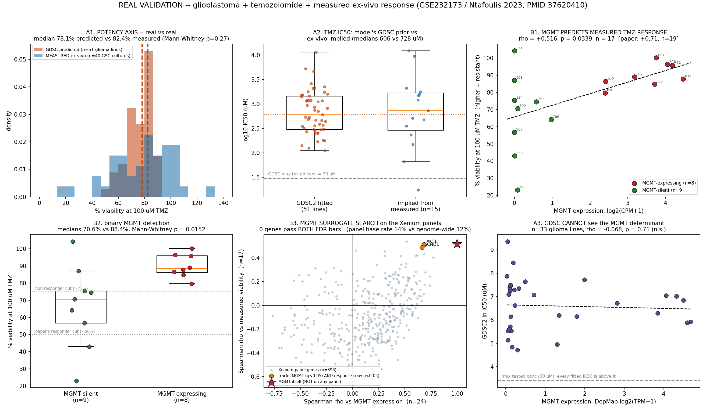

# GBM + temozolomide: measured ex-vivo response

**Right disease (glioblastoma, IDH-wildtype). Right drug (temozolomide). Measured response (ATP viability in patient-derived GSC cultures).**

Source: Ntafoulis I, Kleijn A, Ju J, *et al.* "Ex vivo drug sensitivity screening predicts response to temozolomide in glioblastoma patients and identifies candidate biomarkers." *Br J Cancer* 2023;129(8):1327-1338. **PMID 37620410**, doi:10.1038/s41416-023-02402-y. GEO **GSE232173** (Erasmus MC / GLIOTRAIN, Rotterdam).

## 0. Provenance -- verified, not assumed

| file | bytes | sha256[:16] |
|---|---:|---|
| `data_cache/hunt/geo_organoid_screens/GSE232173_count_data_24_cells.txt.gz` | 858,325 | `f4b0e3a16261b5a4` |
| `data_cache/hunt/geo_organoid_screens/BJC2023_MOESM2.docx` | 39,195 | `bbf1a1337cb41058` |
| `data_cache/hunt/geo_organoid_screens/BJC2023_MOESM3.xlsx` | 842,648 | `a21740f50dfc0965` |
| `data_cache/hunt/geo_organoid_screens/BJC2023_MOESM4.docx` | 23,144 | `3bbe004c5492092d` |
| `data_cache/hunt/geo_organoid_screens/BJC2023_MOESM5.docx` | 25,058 | `524b0dd89223c661` |
| `data_cache/hunt/geo_organoid_screens/JOINED_GSE232173_TMZviability.csv` | 684 | `f1ab5f5bfbaa59be` |
| `data_cache/gdsc_glioma_dose_response.csv` | 1,939,485 | `e9c6feee8faeda7a` |

### What the data actually contains

* **Response metric:** mean **% cell viability at 100 uM TMZ**, relative to matched DMSO controls, from a 6-day ATP-based CellTiter-Glo assay (supplementary methods, MOESM5). **LOWER = MORE SENSITIVE.** It is a single-dose readout, not an IC50. 100 uM was chosen by the authors because it is close to the reported maximum TMZ CSF concentration (~75 uM). This is also the paper's *best* readout -- it out-predicted both AUC and IC50 against patient survival.
* **Per-culture viability numbers exist for 40 cultures** (MOESM2 Supplemental Table 2). This is the *operator-reproducibility* table -- 2 or 3 operators per culture over multiple years -- and it is the only per-culture response table published anywhere in the paper. The main screen (n=66) is published as *figures only*; there is no n=66 numeric table.
* **Expression:** GSE232173 raw counts, 34,461 genes x 24 GSC cultures. Paired per model by the `GS.###` identifier. Note GEO deposits **24** cultures whereas the paper's own transcriptome analyses used **19**.
* **The analysable join is n = 17** -- cultures with both a published viability number and paired RNA-seq.
* **NO per-patient clinical outcome (PFS/OS/response) exists in any cached file.** See section C.

### Audit of the hunter's `JOINED_GSE232173_TMZviability.csv`

Re-derived independently from the primary `.docx` (stdlib `zipfile`+`ElementTree`) and the primary counts matrix.

**VERDICT: the hunter's join is CORRECT.** All 17/17 rows and all values reproduce exactly; no orphans in either direction.

Two corrections to how that file is *labelled*, though:

1. The filename implies a GEO-supplied response table. It is not. The viability numbers come from **MOESM2 Supplemental Table 2** (the operator reproducibility experiment), not from GEO. GEO's sample characteristics are constant strings (`tissue: Brain tumor`, `genotype: GBM - IDH WT`, `treatment: STUPP`) and carry **no** response or outcome data at all.
2. Because it is the reproducibility table, several cultures have wide operator spread -- %CV up to 43% (median 8.3%). The response variable used below is therefore itself noisy, which attenuates every correlation reported here.

Cultures with RNA-seq but no published viability number (7): GS.598, GS.785, GS.789, GS.799, GS.802, GS.828, GS.944.

## A. Potency axis -- does GDSC's TMZ potency hold up in patient-derived GBM?

Our molecular layer takes TMZ potency from GDSC2 (PMID 23180760): median IC50 = **606 uM** over **51 glioma cell lines** (GBM/LGG).

**The catch, stated up front:** GDSC2 screened TMZ over 0.03-30 uM, and **51/51** fitted IC50s lie *above* that ceiling (median GDSC AUC = 0.976, i.e. almost no killing in the tested range). GDSC's TMZ potency is an **extrapolation**. This ex-vivo dataset dosed at 100 uM, 3.3x beyond GDSC's ceiling, so it is a genuine out-of-range test of that extrapolation.

Prediction: recover each GDSC line's Hill slope from its own reported (IC50, AUC) pair (median slope 0.69, IQR 0.61-0.74), then evaluate the curve at 100 uM. Zero parameters fitted to the Erasmus data.

| quantity | GDSC-predicted | MEASURED ex vivo |
|---|---|---|
| % viability at 100 uM, median | **78.1%** | **82.4%** (n=40) |
| IQR | 69.4-85.0% | 62.1-97.1% |
| range | 52.5-88.7% | 16.2-130.9% |
| median on the n=17 joined subset | -- | 84.8% (bootstrap 95% CI 70.6-89.1) |

Mann-Whitney predicted vs measured: **p = 0.27** (n=40) and **p = 0.18** (n=17) -- the two distributions are statistically indistinguishable. A naive single-number prediction from the layer's headline IC50 alone (Hill = 1) gives 85.8%, i.e. within 3.4 percentage points of the measured median.

Inverting the measured viabilities back to per-model IC50s under the GDSC-recovered Hill slope gives a median of **728 uM** (range 17-12249 uM, 700x spread, over the 15/17 cultures whose measured viability is below 100% and therefore invertible) against the layer's 606 uM -- a 0.83x ratio on the central value.

**What this does NOT establish.** There is no shared model identifier between GDSC cell lines and the Erasmus GSC biobank, and only one drug is in play, so **rank concordance cannot be computed here.** The earlier GDSC-vs-HGCC check (rho = +0.83) was a *cross-drug* ordering test; this is a *magnitude/distribution* test. They are different claims. What is established is that an extrapolated cell-line potency, pushed 3.3x past its own assay ceiling, lands within a few percentage points of the median measured response in 40 patient-derived GBM cultures -- it could easily have been off by 30 points and was not.

### A2. Can GDSC itself resolve the MGMT determinant? No.

Joining GDSC2 TMZ to DepMap 24Q4 MGMT expression (33/51 glioma lines mapped):

| subset | n | MGMT vs ln IC50 | MGMT vs AUC |
|---|---:|---|---|
| all_glioma | 33 | rho = -0.068, p = 0.71 | rho = +0.252, p = 0.16 |
| GBM | 23 | rho = -0.112, p = 0.61 | rho = +0.239, p = 0.27 |
| LGG | 10 | rho = +0.406, p = 0.24 | rho = +0.491, p = 0.15 |

**MGMT does not predict TMZ IC50 in GDSC glioma lines (rho = -0.068, p = 0.71, n = 33).** That is not a contradiction of section B -- it is a statement about assay range. GDSC dosed 0.03-30 uM; the effective TMZ range reported by the authors is 25-300 uM. GDSC's TMZ arm has essentially no dynamic range, so it fixes the central potency well but carries **no resolving power for between-model ordering**. The determinant is only visible in a screen dosed in the clinical range -- which is exactly what this ex-vivo dataset is. Practical consequence: our potency layer cannot be made MGMT-aware from GDSC.

## B. Does MGMT expression predict measured TMZ sensitivity?  **Yes.**

| test | statistic | p | n |
|---|---|---|---:|
| Spearman, MGMT log2(CPM+1) vs % viability @100 uM | **rho = +0.516** | **0.0339** | 17 |
| ... permutation p (10,000 label shuffles) | | 0.0358 | 17 |
| ... restricted to the paper's tissue-paired cohort | rho = +0.735 | 0.0018 | 15 |
| Pearson (same data) | r = +0.575 (r2 = 0.331) | 0.0156 | 17 |
| MGMT-expressing vs MGMT-silent, Mann-Whitney | medians 88.4% vs 70.6% (Cohen d = +1.30) | **0.0152** | 8v9 |
| *paper's own value* (MOESM3 `Correlation_cell_005`) | rho = +0.710 | 0.0007 (q = 0.049) | 19 |

Sign is the right way round: **higher MGMT -> higher surviving fraction -> more resistant**, which is the Esteller/Hegi biology (PMID 11070098, PMID 15758010).

Genome-wide context: among the 13,225 expressed genes, MGMT ranks **#250** by |Spearman| against measured viability (top 1.9%). In the paper's own analysis MGMT ranked #20 of 637 significant genes and was one of only 121 genes that were *both* correlated with ex-vivo response *and* prognostic in parental tissue.

MGMT expression is strongly bimodal here: 8/17 joined cultures have MGMT at CPM >= 1 and 9 are effectively silent -- consistent with promoter methylation. The binary contrast (p = 0.0152) is the more robust of the two tests, because the continuous Spearman is computed across a block of tied near-zero values.

**Honest caveats on this number.** n = 17, from raw counts with simple CPM where the authors used edgeR TMM on a differently filtered gene set, and against the noisy operator-reproducibility viabilities rather than the primary screen. On the full join my rho (+0.52) is weaker than the paper's (+0.71); restricted to the 15 cultures that are also in the paper's own tissue-paired cohort it is +0.73 (p = 0.0018) -- i.e. the gap is mostly *which cultures*, not *which pipeline*. Two independent analyses of the same raw counts agree in sign, in significance, and closely in magnitude on the common subset. This is a replication, not a precise effect-size estimate.

### B2. Is any Xenium-panel gene a usable MGMT surrogate?  **No.**

MGMT is absent from both panels -- confirmed here directly from the shipped feature lists: `xenium_gbm` 319 genes; `xenium_gbm_io` 480 genes; union 739 genes; MGMT present = **False**. 396 panel genes are measurable in GSE232173 and were screened.

A usable surrogate has to clear two bars: track MGMT across the 24 cultures, **and** track the measured response across the 17, with the same sign.

* Genes passing **both** at FDR q < 0.05: **0**.
* Genes passing the MGMT bar (q<0.05) *and* raw p<0.05 against response with consistent sign: 2 -- **AKT1** (rho_MGMT +0.69, q=0.009; rho_viab +0.51, raw p=0.036, q=0.91), **CCND1** (rho_MGMT +0.66, q=0.011; rho_viab +0.49, raw p=0.047, q=0.91)

Neither survives multiple testing against the response (all q > 0.91), and neither has a mechanistic claim on TMZ metabolism.

And the base rate kills the whole idea: **14.1%** of panel genes correlate with MGMT at q<0.05, versus **12.3%** of *all* expressed genes. Panel membership carries **no** MGMT information (enrichment = 1.15x). With n = 24 a large fraction of the transcriptome co-varies with any given gene; the top panel correlate of MGMT is **ACTB** at rho = +0.77, and a housekeeping-grade hit at the top of that list is itself the tell.

**Actionable conclusion: there is no MGMT proxy to add to the spatial model. The forfeit in section B3 is real and cannot be bought back from the current panels.** The only fixes are (a) a custom Xenium add-on probe for MGMT, or (b) carrying MGMT as a per-patient scalar from bulk methylation/expression rather than as a spatial field.

### B3. What our spatial model forfeits

`reconstruct.real_xenium.SENSITIVITY_DETERMINANTS['temozolomide'] is None`, so per-cell TMZ sensitivity is a constant 1.0 and potency is one cohort-wide IC50. **The model's between-patient variance in TMZ sensitivity is exactly zero by construction.** Against this dataset that costs:

* MGMT explains **27%** of the rank variance in measured response here (rho2, n=17); **50%** using the paper's own coefficient. The model captures 0%.
* Measured response spans 23.2-104.2% viability, an **81 percentage-point** spread, and a **700x** spread in implied IC50. The model predicts one number for every patient.
* Leave-one-out MAE: constant model 17.0 pp vs a one-covariate MGMT model 13.2 pp -- a 22% reduction from a single gene (cross-validated, so not a fitting artefact).
* At cohort level this is the difference between the paper's response tiers: median OS 27.8 vs 15.9 vs 12.3 months (responders / intermediates / non-responders). A uniform-sensitivity model cannot place a patient in any of those tiers.

Where MGMT *is* measurable in our own data -- Visium is whole-transcriptome, so MGMT is in the reference; the question is whether it is detected at usable depth:

| section | MGMT in ref | spots | % spots MGMT+ | pseudobulk CPM |
|---|---|---:|---:|---:|
| GBM1/filtered_feature_bc_matrix | yes | 4,764 | 10.6% | 15.3 |
| GBM2/filtered_feature_bc_matrix | yes | 2,891 | 5.3% | 7.0 |
| GBM3/filtered_feature_bc_matrix | yes | 1,775 | 29.4% | 16.6 |
| filtered_feature_bc_matrix | yes | 3,468 | 25.8% | 25.5 |

So MGMT is recoverable as a *pseudobulk* scalar from Visium, but at single-spot level it is near the detection floor -- it is not a spatial field we can honestly resolve, only a per-section covariate.

## C. Do ex-vivo results predict patient outcome?  **Not testable on this data.**

No cached file carries a per-patient or per-culture PFS/OS/response row keyed to a GS.### identifier. Supplemental Tables 5 and 6 report only cohort medians and summary Cox / log-rank p-values; the MOESM3 sheets are gene-level (DE, correlation, CoxPH coefficients), not sample-level. Individual-level survival analysis is therefore IMPOSSIBLE on this data and is NOT attempted.

Searched: `MOESM2.docx tables`, `MOESM4.docx tables`, `MOESM5.docx tables`, `MOESM3.xlsx (all 9 sheets)`, `GSE232173 counts header`, `hunter join CSV`. The MOESM3 sheets are gene-level throughout (DE_genes_cell_005, Correlation_cell_005, DE_genes_tissue_005, CoxPH_tissue_005, Overlapping_genes_CorCox, Correlation_cell_Overlap, CoxPH_tissue_Overlap, Gliotrain_validation , TCGA_validation); none carries a `GS.###` row key.

**No outcome analysis is performed and none is simulated.** For the record, these are the paper's own published associations -- quoted, not recomputed:

| association (n = 55 patients on full Stupp) | statistic |
|---|---|
| % viability @100 uM vs PFS | Spearman rho = -0.380, p = 0.014 |
| % viability @100 uM vs OS | Spearman rho = -0.495, p = 0.0002 |
| AUC vs PFS | Spearman rho = -0.290, p = 0.03 |
| AUC vs OS | Spearman rho = -0.399, p = 0.0026 |
| IC50 vs PFS | Spearman rho = -0.206, p = 0.132 |
| IC50 vs OS | Spearman rho = -0.350, p = 0.009 |
| Cox, % viability @100 uM | PFS p = 0.012, OS p = <0.00005 |
| log-rank, responders vs non-responders | PFS p = 0.018, OS p = 0.0001 |
| median OS by ex-vivo tier | 27.8 / 15.9 / 12.3 months |
| MGMT expression in parental tissue, CoxPH (n=56) | HR = 1.85, p = 6.1e-05 (q = 0.0079) |
| ... external replication, GLIOTRAIN n=70 | HR = 1.21, p = 0.0248 |
| MGMT *promoter methylation* vs OS, same cohort | p = 0.16 (n.s.) |

Two of those rows are worth flagging because they were extracted from the primary supplementary file (MOESM3) rather than the abstract: MGMT *expression* is prognostic in the parental tumours (HR 1.85, p = 6.1e-05) and replicates externally, while MGMT *promoter methylation* -- the clinical biomarker -- was **not** significant for OS in the same cohort (p = 0.16). That strengthens the case for treating MGMT as a continuous expression covariate rather than a binary methylation flag.

*Data-quality note:* MOESM2 Supplemental Table 5 labels the PFS rows `UM 8.55 / M 5.92`, which contradicts both the paper's Results text and the OS rows in the same table. We follow the text (methylated PFS 8.55, unmethylated 5.92). Flagged, not silently resolved.

## Verdict

**What this validates.**

1. **The POTENCY axis, in patient-derived GBM.** An extrapolated GDSC TMZ potency (606 uM, 51 glioma lines) predicts a median 78.1% viability at 100 uM; 40 patient-derived GSC cultures measured 82.4% (Mann-Whitney p = 0.27). Right disease, right drug, measured response, no fitted parameters. This is a magnitude test, not an ordering test.
2. **The MGMT determinant is real and quantified.** MGMT expression predicts measured ex-vivo TMZ response at rho = +0.516 (p = 0.0339, n = 17; binary contrast p = 0.0152), independently reproducing the paper's rho = +0.71 from raw counts.

**What this does NOT validate.**

1. **Nothing spatial.** These are dissociated 2-D monolayer GSC cultures. No architecture, no vasculature, no diffusion gradient, no immune or neuronal compartment -- the authors' own GSEA shows tissue-exclusive immune and neuronal-communication programmes lost in culture. This dataset cannot test the transport half of the model at all.
2. **Not in vivo, and not PK.** 100 uM is a bath concentration on a plate. It brackets the reported CSF Cmax (~75 uM) but says nothing about delivery.
3. **No ordering claim on the potency axis** -- zero shared models between GDSC and the Erasmus biobank.
4. **No patient-outcome claim of our own** -- section C.
5. **n = 17 for every molecular claim.** The response variable is the operator-reproducibility table with %CV up to 43%. Section B is a directionally solid, magnitude-approximate replication, not a precise effect-size estimate.

**The one actionable finding.** MGMT is on neither Xenium panel (739-gene union), no panel gene surrogates for it (0 pass both FDR bars; panel MGMT-correlation base rate 14% vs genome-wide 12%, i.e. no enrichment), and the determinant is invisible to GDSC because GDSC's TMZ arm has no dynamic range. So the uniform-TMZ-sensitivity assumption is currently *unavoidable* given the inputs -- but it is now **measured**: it discards ~27% of the between-model rank variance in ex-vivo TMZ response (~50% by the paper's estimate), an 81-point viability spread, and the tiering that separates 27.8-month from 12.3-month median survival. That number belongs in the model's uncertainty statement, and the fix is a custom MGMT probe or a per-patient MGMT scalar -- not a panel proxy.

### References

* Ntafoulis I, *et al.* Br J Cancer 2023;129(8):1327-1338. PMID 37620410. GEO GSE232173.
* Stupp R, *et al.* N Engl J Med 2005;352:987-996. PMID 15758009.
* Hegi ME, *et al.* N Engl J Med 2005;352:997-1003. PMID 15758010.
* Esteller M, *et al.* N Engl J Med 2000;343:1350-1354. PMID 11070098.
* Yang W, *et al.* Nucleic Acids Res 2013;41:D955-D961 (GDSC). PMID 23180760.
* Kleijn A, *et al.* Stem Cells Int 2016;2016:5629214 (ATP viability read-out on primary GSCs). PMID 26977153.
* DepMap Public 24Q4 (MGMT expression for GDSC glioma lines).

