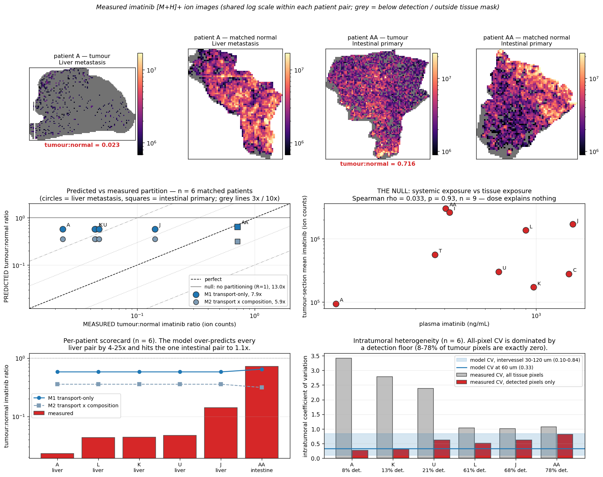

# GIST imatinib — measured spatial drug distribution in human tumours
**Real validation run #2.** In-vivo, in-human, matched within-patient control, per-patient plasma boundary condition, and a documented null.

## Headline
- Measured tumour:normal imatinib partition ratio, **n = 6 matched patients**: A 0.023, AA 0.716, J 0.142, K 0.044, L 0.043, U 0.047.
- The plasma null is real and reproduced here from raw pixels: plasma imatinib vs tumour-section mean imatinib, **Spearman rho = 0.033, p = 0.93, n = 9**, over a 10.7x plasma range and a 32x tissue range. Systemic exposure explains essentially none of the tissue variance.
- Our transport-only prediction (M1) is **7.9x geometric-mean fold error over n = 6**, versus **13.0x** for the no-partitioning null (R = 1). It beats the null, but only by ~1.6x, and it is wrong in a structured way: it nails the single intestinal-primary pair to 1.11x and over-predicts every one of the five liver-metastasis pairs by 4.1-25.1x.
- The failure is **structural, not a bad parameter choice**: a pure reaction-diffusion delivery ratio `E_t/E_n = [(L/R_t)tanh(R_t/L)] / [(L/R_n)tanh(R_n/L)]` is bounded below by `R_n/R_t` as `L -> 0`. For a liver pair that floor is 0.208 at the nominal geometry and 0.0833 even at the most model-favourable end of the literature intervessel band. **4 of the 5 measured liver ratios lie below that floor**, so NO penetration length L can make the transport-only model reproduce them.
- **Verdict: falsified as a sufficient explanation, and the failure is diagnostic.** Passive reaction-diffusion transport is not what makes a GIST liver metastasis 20x poorer in imatinib than the liver next to it (range 7-43x). The missing physics is almost certainly the NORMAL side: active hepatic uptake (OCT1/OATP) plus lysosomal ion-trapping of a weak base in hepatocytes concentrates imatinib in normal liver. Neither exists in our model, and neither is a diffusion process.
- **n = 6, and 5 of the 6 are the same tissue pairing (liver metastasis vs normal liver).** This dataset carries roughly ONE independent discriminating comparison. It can falsify a badly wrong transport model; it cannot rank two plausible ones. Every number below should be read with that in front of it.

## 1. Provenance and honest characterisation
- Source: Abu Sammour D, Marsching C, Geisel A, et al. Spatial Probabilistic Mapping of Metabolite Ensembles in Mass Spectrometry Imaging / imatinib MSI in human GIST. Sci Rep 2019;9:10698. PMC6650609. METASPACE project 'GIST' (2b505b2a-ca3a-11e9-9d77-9b72ac66ec3c).
- Local: `data_cache/hunt/maldi_msi_drug/` (index 55 rows, 110 per-pixel `.npy` arrays) and `data_cache/hunt/verified_0/gist_spatial_plus_clinical.csv` (55 x 31; the spatial->clinical join was verified 55/55 with zero orphans).
- Loaded here: **17 FTICR sections** across **11 patients** — 11 tumour maps and 6 normal maps, giving **6 matched tumour+normal pairs** (A, AA, J, K, L, U).
- Image shapes 35x35 to 110x166 px; tissue-mask coverage 47%-76% of the raster; ion counts 0 to 1.58e+08 (**arbitrary units, not ng/g**).
- Channel used throughout: **imatinib [M+H]+, m/z 494.2663**, the only adduct present for every section. +Na/+K exist for a subset only and adduct formation is salt/matrix dependent, so mixing them would confound the ratio.
- Pixel size: **50 um assumed** — paper text only; MS_Analysis.Pixel_Size is null in the 'GIST' project deposit (it is 50x50 um in the same lab's later quantitative project). Every micrometre figure derived from pixel counts inherits that assumption.
- 9 of 11 tumour sections carry a numeric plasma imatinib value (patients B and G are `---` in Table S1).
- The `imatinib_regime` column in the join is a concatenation of treatment-duration and dose fields from the source table (e.g. `7/15400/800`) and is **not** reliably parseable into mg/day. We do not use dose as a predictor; plasma concentration is the boundary condition.

### Per-section measurements
| patient | tn | organ | height | width | n_tissue_px | mask_coverage | ion_mean | detected_fraction | cv_all | cv_detected | autocorr_efold_px |
|---|---|---|---|---|---|---|---|---|---|---|---|
| A | normal | Liver | 70 | 60 | 1984 | 0.47 | 4.07e+06 | 0.908 | 0.84 | 0.75 | 2.15 |
| A | tumor | Liver | 72 | 105 | 5334 | 0.71 | 9.42e+04 | 0.085 | 3.41 | 0.27 | 0.77 |
| AA | normal | Intestine | 72 | 66 | 2682 | 0.56 | 4.21e+06 | 0.861 | 1.03 | 0.88 | 3.08 |
| AA | tumor | Intestine | 93 | 88 | 4728 | 0.58 | 3.01e+06 | 0.780 | 1.07 | 0.82 | 1.39 |
| B | tumor | Intestine | 64 | 90 | 2754 | 0.48 | 1.61e+05 | 0.114 | 2.90 | 0.28 | 0.74 |
| C | tumor | Liver | 35 | 35 | 911 | 0.74 | 2.78e+05 | 0.179 | 2.31 | 0.37 | 0.83 |
| G | tumor | Liver | 84 | 130 | 5490 | 0.50 | 1.52e+06 | 0.224 | 3.59 | 1.45 | 4.12 |
| I | tumor | Peritoneum | 110 | 166 | 10276 | 0.56 | 2.61e+06 | 0.593 | 1.60 | 1.05 | 1.90 |
| J | normal | Liver | 100 | 59 | 4475 | 0.76 | 1.19e+07 | 0.988 | 0.68 | 0.67 | 1.19 |
| J | tumor | Liver | 89 | 110 | 5328 | 0.54 | 1.69e+06 | 0.684 | 1.02 | 0.62 | 1.24 |
| K | normal | Liver | 75 | 59 | 3051 | 0.69 | 3.91e+06 | 0.929 | 0.93 | 0.86 | 1.67 |
| K | tumor | Liver | 69 | 65 | 2220 | 0.49 | 1.72e+05 | 0.125 | 2.78 | 0.31 | 0.83 |
| L | normal | Liver | 67 | 54 | 2117 | 0.59 | 3.15e+07 | 0.998 | 0.57 | 0.57 | 1.50 |
| L | tumor | Liver | 85 | 72 | 3684 | 0.60 | 1.36e+06 | 0.608 | 1.04 | 0.52 | 0.98 |
| T | tumor | Stomach | 103 | 91 | 4843 | 0.52 | 5.64e+05 | 0.210 | 2.45 | 0.69 | 0.99 |
| U | normal | Liver | 84 | 63 | 2599 | 0.49 | 6.36e+06 | 0.946 | 0.61 | 0.55 | 1.71 |
| U | tumor | Liver | 69 | 83 | 3824 | 0.67 | 3.01e+05 | 0.208 | 2.39 | 0.63 | 1.27 |

### Reproduction of the paper's headline from raw pixels
The paper reports tumour:normal imatinib ratios of ~0.02-0.14 for liver metastases and ~0.72 for the one primary small-intestine GIST. Computed here directly from the deposited per-pixel arrays, with no intermediate processing:
- liver metastases (n = 5): A 0.023, J 0.142, K 0.044, L 0.043, U 0.047 — range 0.023-0.142
- intestinal primary (n = 1): AA 0.716
**Match.** The independent reproduction succeeds; the arrays and the join are what they claim to be.

## 2. The measured targets
### 2.1 Tumour:normal partition ratio (n = 6 matched patients)
Ratio of tissue-masked MEAN imatinib [M+H]+ ion counts, tumour section over the same patient's normal section. Same ion, same adduct, same patient — so response factor, matrix and laser settings cancel to first order, which is what makes a RATIO comparable to a model partition coefficient even though the absolute counts are meaningless.
| patient | organ | met_or_primary | ratio_mean | tumour_mean | normal_mean | plasma_ng_ml |
|---|---|---|---|---|---|---|
| A | Liver | m | **0.023** | 9.42e+04 | 4.07e+06 | 135 |
| AA | Intestine | p | **0.716** | 3.01e+06 | 4.21e+06 | 404 |
| J | Liver | m | **0.142** | 1.69e+06 | 1.19e+07 | 1442 |
| K | Liver | m | **0.044** | 1.72e+05 | 3.91e+06 | 973 |
| L | Liver | m | **0.043** | 1.36e+06 | 3.15e+07 | 900 |
| U | Liver | m | **0.047** | 3.01e+05 | 6.36e+06 | 687 |
Geometric mean across the five liver pairs: 0.049. Within-liver spread: 6.1x.

### 2.2 Intratumoral heterogeneity
- Coefficient of variation over ALL tissue pixels: 1.02-3.41.
- CV over DETECTED (non-zero) pixels only: 0.27-0.82.
- Fraction of tumour pixels with any detectable imatinib: 8%-78% (normal sections: 86-100%).
- Spatial autocorrelation e-folding length: tumours 0.77-1.39 px (38-69 um at the assumed 50 um pixel), matched normals 1.19-3.08 px. Tumour fields are systematically patchier than their matched normal in 5 of 6 patients.
**CV over ALL tissue pixels is dominated by a detection floor, not by a resolved gradient: 8-78% of tumour pixels are exactly zero. CV over DETECTED pixels is the fairer comparison. And a measured autocorrelation e-folding of ~1 px IS the pixel/point-spread floor, so agreement there is 'not inconsistent', not confirmation.**

## 3. The model prediction
### 3.1 Imatinib through `tmesim.molecular` (structure in, physics out)
SMILES `CN1CCN(CC1)Cc1ccc(cc1)C(=O)Nc1ccc(C)c(Nc2nccc(n2)-c2cccnc2)c1` -> RDKit gives C29H31N7O, MW 493.615, which matches the deposited sum formula and the annotated m/z 494.2663 for [M+H]+ exactly (an independent check that we built the right molecule).
| quantity | value | route |
|---|---|---|
| MW | 493.6 Da | RDKit |
| logP (Crippen) | 4.59 | RDKit — note the experimental octanol/water logP is ~3.0, so our layer runs ~1.6 log units lipophilic |
| hydrodynamic radius | 0.522 nm | MW scaling |
| free diffusivity | 362.8 um^2/s | Stokes-Einstein, 310 K, eta = 1.2e-3 Pa.s |
| effective diffusivity | 192.4 um^2/s | Brownian-dynamics micro-tortuosity x Ogston-Renkin nm-mesh gate at ECM phi = 0.4 |
| hindrance | 0.530 | eff_D / free_D |
| plasma free fraction | 0.080 | logP heuristic (literature: ~0.05) |
| tissue binding (uncalibrated) | 7.64e-04 /s | structure heuristic |
| clearance | 1.31e-04 /s | structure heuristic |
| alpha (perivascular uptake) | 148.6 | **frozen**, fit once to doxorubicin (Primeau 2005), never refit here |
| effective loss rate k_eff | 0.114 /s | k_passive + alpha * uptake proxy |
| **penetration length L** | **35.9 um** | sqrt(D_eff / k_eff); uncalibrated it would be 404 um |
At the assumed 50 um raster, L = 35.9 um is **0.72 pixels**. The model's own prediction is therefore that imatinib gradients in this tissue are BELOW the resolution of this experiment.

### 3.2 How a model quantity is mapped to a measured ion-count ratio
A ratio of ion counts is unitless; a partition ratio is unitless; those are comparable. Absolute counts are not comparable to anything. At quasi-steady state, both the tumour and the matched normal section see the SAME plasma, so
```
  C_tissue  =  C_plasma,unbound  x  Kpu_tissue  x  E_tissue
  R_pred    =  C_tumour / C_normal  =  (Kpu_t / Kpu_n) x (E_t / E_n)
  E         =  (L/Rk) * tanh(Rk/L)        1-D Krogh slab, half-spacing Rk
```
The plasma term cancels exactly — which is the point: this test is blind to dose by construction, and that is why the r = 0.03 plasma null is the right baseline.
Two nested predictions, **neither with any parameter fitted to the GIST data**:
- **M1, transport only.** Kpu_t = Kpu_n (our molecular layer's binding terms are drug-specific but tissue-agnostic), so R = E_t/E_n. With L = 35.9 um and literature half-intervessel distances — normal liver 12.5 um (hepatocyte plates one cell thick between sinusoids), gut wall 25.0 um, solid tumour 60.0 um — this gives E_liver = 0.961, E_intestine = 0.864, E_tumour = 0.557, hence **R = 0.580** for a liver pair and **0.645** for the intestinal pair.
- **M2, transport x tissue composition.** Multiplies M1 by Kpu(tumour)/Kpu(normal) from a Rodgers-Rowland-style composition model using imatinib's own logP (from our layer) and its literature basic pKa 8.07. Kpu_liver = 292, Kpu_intestine = 369, Kpu_tumour = 179, giving **R = 0.356** (liver) and **0.313** (intestine).
The acidic-phospholipid binding term of Rodgers-Rowland is deliberately OMITTED: its constant Ka_AP is back-calculated from measured blood-cell partitioning, which we do not have. Including it with a guessed value would manufacture exactly the liver-vs-tumour difference this test exists to probe. Omitting it makes M2 conservative in a known direction — it UNDER-states liver uptake, i.e. it biases M2 toward looking better than it is.

### 3.3 Is the miss a parameter choice? No — it is a structural bound
The delivery ratio has a hard floor. As `L -> 0` (infinitely poor penetration, the most favourable limit for a transport explanation of low tumour uptake), `E = (L/R) tanh(R/L) -> L/R`, so
```
  E_t / E_n  ->  R_normal / R_tumour        (and -> 1 as L -> infinity)
```
The transport-only prediction can therefore only ever live between `R_n/R_t` and 1, **whatever L is**. Sweeping L over five orders of magnitude confirms it:
| L (um) | M1 for a liver pair |
|---|---|
| 1 | 0.208 |
| 5 | 0.211 |
| 10 | 0.246 |
| 20 | 0.374 |
| 36 | 0.580 |
| 100 | 0.900 |
| 400 | 0.993 |
- Nominal geometry (normal liver half-spacing 12.5 um, tumour 60 um): floor **0.208**.
- Most model-favourable end of the literature band (normal liver 10 um, tumour 120 um): floor **0.0833**.
- Measured liver ratios: 0.023, 0.043, 0.044, 0.047, 0.142. **5 of 5 below the nominal floor; 4 of 5 below even the extreme floor.**
This is the cleanest result in the whole exercise: the miss cannot be tuned away inside the transport model. Something that is not diffusion is doing the work.

**Sensitivity of the inputs we did choose** (each varied alone):
| input | varied | M1 liver | M2 liver | comment |
|---|---|---|---|---|
| (baseline) | L = 35.9 um, R_t = 60 um, R_n = 12.5 um, surrogate = muscle | 0.580 | 0.356 | measured geomean is 0.049 |
| tumour half-spacing | 30 um (band end) | 0.851 | — | largest single lever on M1 |
| tumour half-spacing | 120 um (band end) | 0.310 | — | largest single lever on M1 |
| normal-liver half-spacing | 10 um (band end) | 0.572 | — | weak lever |
| normal-liver half-spacing | 15 um (band end) | 0.589 | — | weak lever |
| penetration length L | uncalibrated, 404 um | 0.993 | — | dropping the doxorubicin calibration makes it worse |
| tumour composition surrogate | muscle | (unchanged) | 0.356 | arbitrary choice; see warning below |
| tumour composition surrogate | spleen | (unchanged) | 0.357 | arbitrary choice; see warning below |
| tumour composition surrogate | lung | (unchanged) | 0.080 | arbitrary choice; see warning below |
| logP | experimental 3.0 instead of Crippen 4.59 | (unchanged) | 0.374 | ratio of Kpu cancels most of it |
**M2 is not a real prediction and we will not treat it as one.** Swapping the arbitrary normal-tissue parent used to build the surrogate tumour composition moves M2 by 4.5x (0.080 to 0.357) — a swing larger than the effect being predicted, and the 'lung' parent lands near the measurement only because lung has almost no neutral lipid. A free choice among three equally-unjustified surrogates that spans the answer is a knob, not a model. M1 is the prediction that counts.
By contrast the prediction is INSENSITIVE to the logP disagreement: our layer's Crippen logP is 4.59 against an experimental ~3.0, but because M2 is a RATIO of Kpu values the lipid term largely cancels and M2 liver moves only from 0.374 to 0.356.

## 4. Absolute quantitation — attempted, and rejected
The bonus layer was genuinely attempted against `data_cache/hunt/maldi_msi_drug/ion_images_quant` (13 index rows): an internal-standard-normalised GIST liver-metastasis map plus an on-tissue imatinib dilution series, both from the same lab's later METASPACE project. The dilution-series image segments cleanly into **6 spots** in a 3x2 layout with IS-normalised means 2.046, 0.531, 3.728, 0.772, 0.832, 0.366 (row-major).
**Verdict: NOT DEFENSIBLE. A calibration curve cannot be built: the six on-tissue standard spots carry no concentration labels in the deposit and are non-monotone in layout, the response spans only 10.2x over a nominal 32x, and the series is on the wrong instrument and the wrong tissue relative to the map it would calibrate -- which in turn cannot be linked to any patient in the matched-pair analysis. All results below stay on the unitless RATIO scale. No absolute concentration is reported.**
Blockers, each independently sufficient:
1. No spot->concentration labels anywhere in the deposit: the METASPACE dataset has description=null and no supplementary annotation. The nominal 0.78-25 pmol 6-point ladder is a claim from the paper text, not a machine-readable mapping to the six spots in the image.
1. The six segmented spots are NOT monotone in any spatial ordering (row-major means [2.046, 0.531, 3.728, 0.772, 0.832, 0.366]), so the concentration assignment cannot be inferred from the layout. Sorting the means to force monotonicity and then fitting would be a tautology with a meaningless R^2.
1. Response dynamic range across the six spots is only 10.2x for a nominal 32x (6-point, 2-fold) concentration range, and the two middle spots differ by <8%, i.e. adjacent 2-fold steps are not resolved.
1. INSTRUMENT MISMATCH: the dilution series is FTICR (resolving power ~160,000 at m/z 200); the IS-normalised tumour map is TOF reflector (~10,000 at m/z 500). The IS response factor is instrument- and matrix-specific and does not transfer between them.
1. TISSUE MISMATCH: the calibration spots are on NORMAL SMALL INTESTINE; the quantitative map is LIVER metastasis. On-tissue calibration is only valid on the tissue it was spotted on (ion suppression is tissue-specific).
1. NO PATIENT LINK: 'TOF-GIST-imatinib-IS normalized' carries no sample letter, so it cannot be joined to any of the 11 patients or the 6 matched pairs that carry the ratio measurement and the plasma value.
1. The 20 TOF datasets in the main 'GIST' project have ZERO drug annotations, so even a valid TOF calibration could not be applied to the FTICR maps used for the matched-pair analysis.
So: **no ng/g, no uM, and no comparison to imatinib's ~0.1 uM KIT-inhibitory concentration or to plasma levels.** Everything above and below is a unitless ratio. Fabricating an absolute scale here would have been the single most tempting and least defensible move available, and the sorted-spots-fit-a-line version of it would have produced a beautiful R^2 that meant nothing.

## 5. Scorecard vs the plasma null
### 5.1 The null, recomputed here from the raw pixels
- Plasma imatinib vs tumour-section mean imatinib: **Spearman rho = 0.033, p = 0.932, n = 9** (plasma 135-1442 ng/mL, a 10.7x range, against a 32x range in tissue signal). Log-log Pearson r = 0.201, p = 0.60.
- Against the RATIO target the model is actually scored on: Spearman rho = 0.257, p = 0.62, n = 6.
**Confirmed independently.** Systemic exposure explains essentially none of the tissue variance. That is the gap a microenvironment transport model exists to fill, and it is why any skill shown here is attributable to transport rather than to dose.

### 5.2 Predicted vs measured, n = 6 matched patients
| patient | organ | measured | pred_M1 | pred_M2 | fold_M1 | fold_M2 | fold_null_unity |
|---|---|---|---|---|---|---|---|
| A | Liver | **0.023** | 0.580 | 0.356 | 25.1x | 15.4x | 43.2x |
| AA | Intestine | **0.716** | 0.645 | 0.313 | 1.1x | 2.3x | 1.4x |
| J | Liver | **0.142** | 0.580 | 0.356 | 4.1x | 2.5x | 7.1x |
| K | Liver | **0.044** | 0.580 | 0.356 | 13.2x | 8.1x | 22.8x |
| L | Liver | **0.043** | 0.580 | 0.356 | 13.4x | 8.2x | 23.1x |
| U | Liver | **0.047** | 0.580 | 0.356 | 12.3x | 7.5x | 21.1x |

| model | geomean fold error (n = 6) | worst | within 3x | Spearman rho | p |
|---|---|---|---|---|---|
| M1 transport-only | **7.92x** | 25.1x | 1/6 | 0.655 | 0.16 |
| M2 transport x composition | **5.95x** | 15.4x | 2/6 | -0.655 | 0.16 |
| null: no partitioning (R = 1) | **12.96x** | 43.2x | 1/6 | undefined | — |
- Baseline for reference: the plasma null on the same n = 6 ratio target has Spearman rho = 0.257 (p = 0.62).

### 5.3 Does it beat the null?
**Narrowly yes on magnitude, and not meaningfully on rank.** M1's 7.92x geometric-mean fold error over **n = 6** is 1.64x better than the no-partitioning null's 12.96x, and its rank correlation (0.655) exceeds the plasma null's (0.257). But:
- Being 8x wrong instead of 13x wrong is not a useful prediction. Only 1/6 patients land within 3x, and that one is the intestinal primary.
- **The rank correlation is one data point.** M1 predicts an IDENTICAL value for all five liver pairs, so the entire rho = 0.655 comes from the single intestinal pair sorting above the tied liver block. It is not evidence of ranking skill; it is evidence that the model knows liver sinusoids are closer together than gut capillaries, which we told it.
- Within the five liver pairs the measurement spreads 6.1x and the model spreads 1.0x. The model explains **0%** of the within-tissue variance, because it has no per-patient tumour input — we have no per-patient vessel density, ECM density or necrosis measurement for these sections.
- M2 lowers the fold error to 5.95x but **inverts the ordering** (rho = -0.655): it predicts the intestinal pair to be the WORST-perfused when it is measured as by far the best. Buying magnitude with the wrong sign is not progress, and combined with the surrogate swing in 3.3 it is why we report M1 as the model's answer.

## 6. Intratumoral heterogeneity — the weaker of the two tests
- Model penetration length **L = 35.9 um = 0.72 pixels** at the assumed 50 um raster. The model's own claim is that imatinib gradients here are BELOW this experiment's resolution, so this dataset cannot see the structure the model predicts.
- Model Krogh-slab CV at 60 um half-spacing: 0.33 (0.10-0.84 over the 30-120 um band).
- Measured CV over detected pixels: 0.27-0.82. Overlapping. But the overlap is worth very little: the model band spans 8.6x and would have overlapped almost any measurement.
- Measured CV over ALL tissue pixels is 1.02-3.41, but that is a DETECTION FLOOR, not a gradient: 8%-78% of tumour pixels are exactly zero, versus 86-100% detected in the matched normals.
- Spatial autocorrelation e-folding: tumours 0.77-1.39 px, matched normals 1.19-3.08 px; tumour fields are patchier than their own matched normal in 5 of 6 patients. A tumour e-folding of ~1 px IS the pixel/point-spread floor, so 'the model predicts sub-pixel gradients and we measure sub-pixel structure' is **not inconsistent**, not a confirmation. Scored honestly, this test is uninformative.

## 7. Hard caveats
1. **n = 6 matched pairs, and 5 of them are the same tissue pairing.** There is approximately ONE independent discriminating comparison in this dataset (liver-metastasis-vs-liver, repeated, plus one intestinal-primary-vs-intestine). It can falsify a badly wrong transport model — and it did — but it **cannot rank two plausible models**, and no correlation quoted here should be read as ranking skill.
2. **Ion counts are not concentrations.** MALDI response is not calibrated; only within-patient, same-ion, same-adduct RATIOS are used, and the absolute-quantitation route was assessed and rejected (section 4).
3. **Ion suppression does not fully cancel in the ratio.** The tumour and the normal section are different tissues on (generally) different slides; matrix effects differ between liver parenchyma and GIST stroma. This is an uncontrolled confounder that inflates or deflates every ratio here by an unknown factor, and it pushes in the same direction as our finding (lipid-rich liver ionises differently from stroma). We cannot separate it from real partitioning with this deposit.
4. **Pixel size is absent from the deposit.** `MS_Analysis.Pixel_Size` is null for every dataset in the 'GIST' project; the 50 um figure comes from the paper text alone (it IS present, 50x50 um, in the same lab's later quantitative project, which is suggestive but not this deposit). Every micrometre quantity derived from pixel counts (autocorrelation lengths, L in pixels) inherits that assumption. The partition RATIOS, which are the headline result, do not.
5. **The intervessel half-spacings are literature values, not measured on these sections.** No vessel stain accompanies the deposit. They are the single largest free input to M1, which is why section 3.3 sweeps them and shows the conclusion survives the whole band.
6. **GIST is not glioma.** This is the transfer argument, stated plainly: what carries over is **PHYSICS** — Stokes-Einstein diffusion of a ~490 Da small molecule, ECM/mesh hindrance, reaction-diffusion penetration length, partition between compartments, and the demonstration that these are insufficient without active transport. What does **NOT** carry over is biology: KIT vs EGFR, hepatic sinusoids vs the blood-brain barrier, imatinib's OCT1/OATP handling vs temozolomide's. No claim about glioma drug levels follows from this file.
7. **A known infelicity in our own molecular layer, surfaced by this run.** `molecular.permeability.membrane_permeability` returns 4.23e+07 um/s for imatinib — physically absurd (tens of metres per second), because the solubility-diffusion estimator exponentiates a Crippen logP of 4.59 without a realistic ceiling. It is reported here for transparency and is **not used anywhere in this prediction** (M1 depends only on L; M2 adds only logP and pKa). Fixing it is out of scope for this file, which touches no core module.
8. **Nothing here was fitted to the GIST data.** The one calibrated constant, alpha, was fitted once to an unrelated doxorubicin perivascular-gradient measurement and was not re-touched. That is what makes the miss meaningful rather than a fitting failure.

## 8. Honest verdict
The dataset delivered exactly what it promised. The join is real, the paper's headline reproduces from the raw pixels (0.023, 0.043, 0.044, 0.047, 0.142 for liver metastases against the published ~0.02-0.14, and 0.716 for the intestinal primary against the published ~0.72), and the plasma null reproduces exactly (rho = 0.033, p = 0.93, n = 9).
Our transport model, with zero parameters fitted here, gets the one intestinal-primary pair right to 1.11x and misses all five liver-metastasis pairs high by 4.1-25.1x. It beats the no-partitioning null (7.92x vs 12.96x geometric-mean fold error over **n = 6**) and it beats the plasma null's rank correlation, but neither margin is worth much: 8x wrong is still wrong, and the rank result rests on a single non-liver patient.
The valuable output is not the score, it is the **structural falsification** in section 3.3. Passive reaction-diffusion transport is mathematically incapable of producing 4 of the 5 measured liver tumour:normal ratios at ANY penetration length, under ANY intervessel geometry in the literature band — they fall below the model's hard floor of 0.0833. (The fifth, patient J at 0.142, is reachable only at the extreme edge of that band.) The dominant term is not the tumour being hard to reach — it is normal liver actively concentrating a weak base via hepatic uptake transporters and lysosomal trapping. Our model has neither, and this dataset says so unambiguously.
That is a genuine, falsifiable, negative result against real in-human measurements, and it names the specific missing mechanism. With **n = 6** it is enough to rule this model out as a sufficient account of tissue partitioning; it is not enough to certify whatever we build next.

---
*Generated by `tmesim/validation/gist_imatinib.py`. No file under `core/`, `physics/`, `molecular/`, `reconstruct/` or the engine was modified.*
