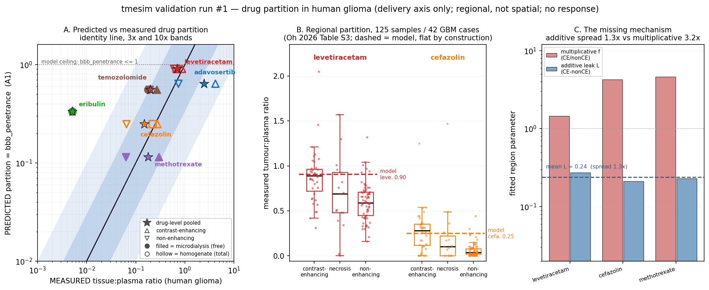

# Validation run #1 — predicted vs MEASURED drug partition in human glioma

**What this is.** The first time tmesim's molecular/transport layer has been scored against measured drug concentrations in human brain-tumour tissue. It tests ONE axis: the **partition / delivery** axis — what fraction of the drug in plasma actually reaches glioma tissue, and whether that fraction tracks MRI-defined regional blood-brain-barrier disruption.

## 1. Data provenance

**Source 1 — literature anchors.** `data_cache/hunt/autoradiography_microdialysis/parsed/regional_intratumoral_PK_anchors_literature.csv`, 27 rows, every row carrying a PMID and a DOI. 21 human rows / 6 rat rows.

| study | PMID | drug | species | n rows | region(s) | method |
|---|---|---|---|---|---|---|
| Blakeley 2008 J Neurooncol | 18787762 | methotrexate | human | 4 | contrast_enhancing, nonenhancing | intracerebral_microdialysis |
| Eroglu 2024 Cancer Chemother Pharmacol | 39422741 | eribulin | human | 1 | peritumoral_brain | intracerebral_microdialysis |
| Grossman 2012 Cancer Chemother Pharmacol | 22644796 | temozolomide | rat | 4 | U87_intratumoral_ECF, contralateral_normal_brain_ECF | intratumoral_microdialysis |
| Grossman 2013 Cancer Chemother Pharmacol | 23649683 | temozolomide | rat | 2 | U87_intratumoral_ECF | intratumoral_microdialysis |
| Jackson 2018 Fluids Barriers CNS | 29332604 | temozolomide | human | 7 | contrast_enhancing, noncontrast_enhancing | intracerebral_microdialysis |
| Lee 2025 Clin Cancer Res (ABTC adavosertib) | 39820282 | adavosertib | human | 2 | contrast_enhancing, nonenhancing | tissue_homogenate_LCMS |
| Portnow 2009 Clin Cancer Res | 19861433 | temozolomide | human | 7 | peritumoral_brain | intracerebral_microdialysis |

Column meanings: `plasma_cmax` / `tissue_cmax` are peak concentrations, `plasma_auc` / `tissue_auc` are areas under the concentration-time curve in the units given by `units_conc` / `units_auc` (they differ per study — ug/mL vs uM — which is exactly why only the **dimensionless ratio** `tissue_to_plasma_auc_pct` is used here). That column is divided by 100 on load to give a fraction. Two rows are not per-subject: Lee 2025 reports a cohort mean intratumoral:plasma ratio x100 (418 % and 74 %), and Eroglu 2024 reports a range string `0.13-1.99` (%), from which the geometric midpoint 0.51 % is taken.

**Rat rows are excluded from the scorecard.** The 6 Grossman 2012/2013 rows report intratumoral / contralateral ECF AUC with **no paired plasma AUC**, so no tissue:plasma ratio exists. They can only support a within-animal ordering (tumour ECF 3.35 vs contralateral normal-brain ECF 3.22 ug*h/mL pre-bevacizumab — i.e. essentially NO tumour-vs-normal-brain enrichment for TMZ in that model), which is itself a useful negative but is not scoreable as a partition.

**Source 2 — Oh et al. 2026 Neuro-Oncology (`noaf204`, PMC12962645) Table S3.** `data_cache/hunt/autoradiography_microdialysis/parsed/oh2026_neurooncol_TableS3_per_sample_tumor_drug_ratios.csv`: **125 surgical samples from 42 high-grade-glioma cases**, a window-of-opportunity study of BBB permeability heterogeneity. Two probe drugs were given intra-operatively and assayed in MRI-region-targeted resection specimens:

- `lev_tumor_to_plasma_ratio` = **levetiracetam**, small/neutral, BBB-penetrant (125 values, mean 0.697, range 0.00-2.05)
- `cef_tumor_to_plasma_ratio` = **cefazolin**, anionic cephalosporin, BBB-excluded (117 values, mean 0.150, range 0.00-1.47) — 21 of these are reported as exactly 0.00, i.e. **left-censored at the assay LLOQ**, not true zeros; they are kept at 0 here, which biases the cefazolin mean and any parametric test downward and is one reason the nonparametric statistics below are the primary ones.

These ratios are **single-timepoint tissue-concentration : plasma-concentration** ratios from tissue homogenate, NOT AUC ratios — sampling times (`lev_collection_time_min`, `cef_collection_time_min`) differ per sample, so each ratio is a snapshot on a distribution/elimination curve rather than an exposure ratio. Region flags: `region_contrast_enhancing` (T1-Gd) 39(+)/69(-), `region_flair` 73(+)/35(-), and 17 pathologist-called necrotic samples (whose C/F flags are N/A). `mannitol_status` records minutes since intra-operative mannitol for 40 samples — mannitol osmotically opens the barrier, so it is a confounder and a mannitol-naive sensitivity analysis is run.

## 2. How the model produces a number (assumption A1)

The frozen engine's delivery term is `source = vascular_density * bbb_penetrance * plasma_mean` (`tmesim/sim/engine.py` L45), and `tmesim/core/config.py` defines `bbb_penetrance` as the *"[0,1] fraction of vascular concentration that crosses into"* tissue. With `vascular_density` normalised to 1 and the tissue at quasi-equilibrium with a sustained plasma level — the Stage-0 plasma-averaging approximation the engine already makes — the tissue:plasma exposure ratio the model implies is the identity:

> **A1:  R_predicted = `bbb_penetrance(descriptors)`**

`bbb_penetrance` is a CNS-MPO-style structure-only score over MW / logP / TPSA / HBD (`tmesim/molecular/permeability.py`). No fitting, no calibration to any of the data below. Three consequences of A1, stated up front:

1. **R_predicted <= 1 by construction.** Any measured ratio above 1 is unreachable by the model at any parameterisation. Adavosertib's measured contrast-enhancing ratio is 4.18. That is a structural ceiling failure, not a tuning failure.
2. **R_predicted carries no region term.** `bbb_penetrance` is a function of the drug's descriptors only. The model's predicted CE-vs-non-enhancing fold change is **exactly 1.000** for every drug.
3. **R_predicted is a passive free-drug crossing fraction.** Microdialysis (Portnow, Blakeley, Jackson, Eroglu) measures *free* extracellular drug and is the modality-matched comparator. Tissue homogenate (Lee 2025, Oh 2026) measures *total* drug including intracellular and lipid-bound fractions and can exceed 1. Every scorecard row is labelled with its modality.

## 3. The scorecard — predicted vs measured, per drug

| drug | MW | logP | TPSA | HBD | **predicted** (A1) | **measured** mean | measured range | n | modality | fold error | 3x | 10x | PMID |
|---|---|---|---|---|---|---|---|---|---|---|---|---|---|
| eribulin | 729.9 | 3.44 | 146.4 | 2 | **0.334** | **0.0051** | 0.0051-0.005 | 1 | microdialysis (free) | **65.63x** | FAIL | FAIL | 39422741 |
| cefazolin | 454.5 | -0.64 | 156.1 | 2 | **0.248** | **0.1496** | 0.0000-1.470 | 117 | homogenate (total) | **1.66x** | PASS | PASS | PMC12962645 |
| methotrexate | 454.4 | 0.27 | 210.5 | 5 | **0.115** | **0.1780** | 0.0320-0.305 | 4 | microdialysis (free) | **0.65x** | PASS | PASS | 18787762 |
| temozolomide | 194.2 | -2.08 | 108.2 | 1 | **0.558** | **0.1951** | 0.0330-0.449 | 14 | microdialysis (free) | **2.86x** | PASS | PASS | 19861433|29332604 |
| levetiracetam | 170.2 | -0.13 | 63.4 | 1 | **0.904** | **0.6972** | 0.0000-2.050 | 125 | homogenate (total) | **1.30x** | PASS | PASS | PMC12962645 |
| adavosertib | 500.6 | 2.89 | 104.3 | 2 | **0.639** | **2.4600** | 0.7400-4.180 | 2 | homogenate (total) | **0.26x** | FAIL | PASS | 39820282 |

- **Order-of-magnitude (10x) band: 5/6 pass.**
- Tight (3x) band: 4/6 pass.
- **Aggregate systematic bias: geometric-mean fold error = 2.02x** (OVER-prediction of brain-tumour drug exposure).
- Excluding the single worst drug (eribulin, 65.6x): geometric-mean fold error = 1.01x — i.e. the aggregate bias is dominated by one drug, not spread evenly.
- **Modality-matched subset** (microdialysis / free drug only — the only apples-to-apples comparison, n=3): geometric-mean fold error = 4.95x, i.e. *worse* than the pooled figure, again because eribulin lives in this subset. Excluding it: 1.36x (temozolomide and methotrexate only, n=2 — too few drugs to call this a calibration).

Per-drug, honestly:

- **eribulin** (microtubule inhibitor; large macrocycle, strong P-gp substrate): predicted 0.334 vs measured 0.0051 = **65.63x**. Eroglu 2024 Cancer Chemother Pharmacol.
- **cefazolin** (anionic cephalosporin, BBB-excluded probe (Oh 2026 probe 2)): predicted 0.248 vs measured 0.1496 = **1.66x**. Oh 2026 Neuro-Oncology (noaf204) Table S3.
- **methotrexate** (antifolate; large, very polar, 5 HBD, actively effluxed): predicted 0.115 vs measured 0.1780 = **0.65x**. Blakeley 2008 J Neurooncol.
- **temozolomide** (first-line GBM alkylator; small, neutral, low logP): predicted 0.558 vs measured 0.1951 = **2.86x**. Jackson 2018 Fluids Barriers CNS; Portnow 2009 Clin Cancer Res.
- **levetiracetam** (antiepileptic BBB-penetrant probe (Oh 2026 probe 1)): predicted 0.904 vs measured 0.6972 = **1.30x**. Oh 2026 Neuro-Oncology (noaf204) Table S3.
- **adavosertib** (WEE1 inhibitor (ABTC trial); lipophilic, P-gp substrate): predicted 0.639 vs measured 2.4600 = **0.26x**. Lee 2025 Clin Cancer Res (ABTC adavosertib).

## 4. The regional test

n = 125 samples from 42 cases. Region counts: `contrast_enhancing` 39, `necrosis` 17, `non_enhancing` 69.

Two permutation tests are reported for every contrast. The **naive** one shuffles region labels freely across all samples and treats each sample as independent — it is ANTI-CONSERVATIVE here, because up to 8 samples come from the same tumour. The **within-case** one shuffles the region label only *within* each patient, preserving the patient as the clustering unit and testing the paired within-tumour contrast. **The within-case p is the one to believe.** Both use 20,000 permutations, seeded.

### levetiracetam

| region | n | mean | median | min | max |
|---|---|---|---|---|---|
| contrast_enhancing | 39 | 0.875 | 0.890 | 0.31 | 2.05 |
| necrosis | 17 | 0.674 | 0.690 | 0.00 | 1.57 |
| non_enhancing | 69 | 0.602 | 0.590 | 0.16 | 1.32 |

| contrast | mean A | mean B | ratio A/B | diff A-B | Cliff's d | Hedges' g | p (naive) | p (within-case) | informative cases | MODEL ratio |
|---|---|---|---|---|---|---|---|---|---|---|
| contrast_enhancing vs non_enhancing | 0.875 | 0.602 | **1.45x** | +0.272 | +0.590 | 1.11 | 0.0000 | **0.0000** | 31 | 1.00x |
| contrast_enhancing vs necrosis | 0.875 | 0.674 | **1.30x** | +0.201 | +0.341 | 0.59 | 0.0435 | **0.0911** | 14 | 1.00x |
| necrosis vs non_enhancing | 0.674 | 0.602 | **1.12x** | +0.072 | +0.106 | 0.28 | 0.3117 | **0.3729** | 13 | 1.00x |

Mannitol-naive sensitivity (CE vs non-enhancing, n=25 vs 48): ratio 1.45x, Cliff's d +0.593, within-case p = 0.0002 (22 informative cases). The regional effect does not depend on mannitol exposure.

### cefazolin

| region | n | mean | median | min | max |
|---|---|---|---|---|---|
| contrast_enhancing | 36 | 0.276 | 0.280 | 0.00 | 1.25 |
| necrosis | 15 | 0.220 | 0.100 | 0.00 | 1.47 |
| non_enhancing | 66 | 0.065 | 0.035 | 0.00 | 0.44 |

| contrast | mean A | mean B | ratio A/B | diff A-B | Cliff's d | Hedges' g | p (naive) | p (within-case) | informative cases | MODEL ratio |
|---|---|---|---|---|---|---|---|---|---|---|
| contrast_enhancing vs non_enhancing | 0.276 | 0.065 | **4.26x** | +0.211 | +0.641 | 1.39 | 0.0000 | **0.0000** | 30 | 1.00x |
| contrast_enhancing vs necrosis | 0.276 | 0.220 | **1.25x** | +0.056 | +0.344 | 0.20 | 0.5439 | **0.6007** | 13 | 1.00x |
| necrosis vs non_enhancing | 0.220 | 0.065 | **3.40x** | +0.155 | +0.241 | 0.89 | 0.0038 | **0.0166** | 12 | 1.00x |

Mannitol-naive sensitivity (CE vs non-enhancing, n=25 vs 48): ratio 4.38x, Cliff's d +0.598, within-case p = 0.0000 (22 informative cases). The regional effect does not depend on mannitol exposure.

**Independent literature replication of the regional ordering** (different patients, different drugs, different assay):

| drug | n CE | n non-enh | mean CE | mean non-enh | CE/non-enh | CE - non-enh | method | PMID |
|---|---|---|---|---|---|---|---|---|
| adavosertib | 1 | 1 | 4.180 | 0.740 | **5.65x** | +3.440 | tissue_homogenate_LCMS | 39820282 |
| methotrexate | 2 | 2 | 0.293 | 0.063 | **4.65x** | +0.230 | intracerebral_microdialysis | 18787762 |
| temozolomide | 2 | 5 | 0.265 | 0.191 | **1.39x** | +0.074 | intracerebral_microdialysis | 19861433|29332604 |

## 5. The model has NO region-specific BBB mechanism — and here is what one would have to be

Stated plainly: **`bbb_penetrance` is a pure function of the drug's 2D descriptors. There is no term in the molecular layer, the transport PDE, or `DrugParams` that represents regional barrier integrity.** The engine's only spatial modulation of delivery is `vascular_density`, which is vessel *density*, not barrier *leakiness* — a region can have identical vessel density and a completely different permeability-surface-area product. So the model's predicted CE-vs-non-enhancing fold change is exactly 1.00 against measured fold changes of 1.45x (levetiracetam) and 4.26x (cefazolin). **The model fails the regional test completely — it cannot even express the answer.**

What would have to be added, and what its value would have to be. Fit two candidate one-parameter region terms to the CE-vs-non-enhancing contrast in three independent drug/assay combinations. A term that is genuinely a property of the *barrier* rather than of the *drug* must come out drug-INDEPENDENT; the spread across drugs is the diagnostic.

| drug | source | mean CE | mean non-enh | multiplicative f = CE/nonCE | additive leak L = CE-nonCE |
|---|---|---|---|---|---|
| levetiracetam | Oh 2026 (homogenate) | 0.875 | 0.602 | 1.45 | 0.272 |
| cefazolin | Oh 2026 (homogenate) | 0.276 | 0.065 | 4.26 | 0.211 |
| methotrexate | Blakeley 2008 (microdialysis) | 0.293 | 0.063 | 4.65 | 0.230 |

- multiplicative `f` spread across drugs: **3.2x**
- additive leak `L` spread across drugs: **1.3x** (L = 0.211 to 0.272, mean **0.238**)

**The additive form wins** (1.3x spread vs 3.2x). That is mechanistically interpretable and it is the concrete specification of the missing feature: contrast enhancement corresponds to a **drug-independent parallel leak conductance** that adds roughly a constant increment (~0.24 in tissue:plasma units) to the partition regardless of the molecule's own physicochemistry — exactly what a size-nonselective paracellular opening should do. A multiplicative barrier factor cannot work: it would have to be ~4.7x for the barrier-excluded drugs and only ~1.5x for the already-penetrant one, because a drug that is already near-freely permeable has no headroom left to gain.

Concretely, to pass this test the model would need:

1. A **regional barrier field** — a per-voxel/per-region `bbb_disruption` in [0,1] derived from contrast enhancement (or a Ktrans-like DCE-MRI parameter), carried alongside `vascular_density` in the microenvironment fields.
2. A **delivery term of the form** `source = vascular_density * (bbb_penetrance + L * bbb_disruption) * plasma`, i.e. an additive leak in parallel with the drug's intrinsic transcellular route, with `L` calibrated to ~0.24 and capped so the partition cannot exceed the free-drug ceiling.
3. A **separate total-vs-free bookkeeping** so that homogenate-measured ratios above 1 (adavosertib 4.18) are represented as tissue binding rather than as impossible barrier crossing.

## 6. The honest verdict

**Partition magnitude: partial pass.** 5/6 drugs land inside an order of magnitude and 4/6 inside 3x. The aggregate geometric-mean fold error is 2.02x — the model **over-predicts** human glioma drug exposure — but that aggregate is dominated by one drug (eribulin, 66x); with it removed the bias falls to 1.01x, i.e. close to unbiased on the remaining drugs.

**The two failures are two DIFFERENT failures, and neither is a mis-tuned constant.** They should not be lumped together:

- **Eribulin, 66x over-predicted — a missing efflux mechanism, exposed by an averaging rule that cannot express a veto.** Eribulin is a 730 Da macrocycle and a well-characterised P-glycoprotein substrate; its measured peritumoral brain:plasma ratio is 0.13-1.99 % (Eroglu 2024, PMID 39422741). `bbb_penetrance` still scores it **0.334**. Two things go wrong at once. (i) The function combines its four descriptor desirabilities by taking their *mean*, so eribulin's two disqualifying properties — MW 730 (desirability ~0.01) and TPSA 146 (~0.01) — are averaged against its two favourable ones — logP 3.44 (~0.86) and 2 HBD (~0.78) — and the molecule is rescued to a mid-range score instead of being vetoed. A mean cannot express "this is disqualifying"; a minimum, or a product, could. (ii) Even a correct passive score would be too high, because the real limit on eribulin is active efflux, which the function's own docstring concedes it "cannot capture". Efflux is the single largest source of error in the delivery axis, and this is the cheapest available fix to the second-largest.
- **Adavosertib, 3.8x under-predicted — a ceiling artefact, not a physics error.** Its measured contrast-enhancing ratio is 4.18, above the model's structural maximum of 1.0. But that 4.18 is a *tissue homogenate* number (total drug, including everything bound inside cells); a free-drug partition of 4.18 would require active uptake INTO brain. The model cannot be right here because it is not modelling the same quantity. Its predicted 0.639 is in fact close to adavosertib's *non-enhancing* measured ratio (0.74, 0.86x).

**A caveat in the model's own docstring turns out to be backwards here.** `permeability.bbb_penetrance` documents that it UNDER-predicts temozolomide, because TMZ's logP and TPSA are outside the CNS-favourable window even though TMZ is clinically a BBB-crossing drug. Against these measurements it does the opposite: predicted 0.558 vs a measured mean of 0.195 across 14 human subjects (Portnow 2009 + Jackson 2018), a 2.9x OVER-prediction. The documented caveat is about TMZ's *rank* among CNS-like molecules; as an *absolute partition* the score is too generous. Both statements can be true, but only the second one is the one that matters when the number is used as a delivery fraction.

**Ordering across drugs: pass — and this is the strongest positive result in the run.** Oh 2026 measured a BBB-penetrant and a BBB-excluded drug in the *same* tissue samples, which removes every between-patient confounder. Measured separation: 4.66x pooled (0.697 vs 0.150), rising to 9.3x in non-enhancing tissue where the barrier is intact. The model, from 2D structure alone with no fitting, predicts 0.904 vs 0.248 = 3.65x — right direction, right order of magnitude for the separation. It does under-state the gap in intact-barrier tissue, which is the same efflux-blindness that sinks eribulin, just in a milder form.

**Regional ordering: outright fail.** The measured regional effect is real and strong — contrast-enhancing tissue carries 1.45x for levetiracetam (within-case p = 0.0000, Cliff's d +0.59) and 4.26x for cefazolin (within-case p = 0.0000, Cliff's d +0.64) the partition of non-enhancing tissue — and it replicates independently in Blakeley 2008's methotrexate microdialysis. The model predicts a fold change of exactly 1.00 because it has no region-specific BBB mechanism at all. Section 5 gives the concrete specification of what to add.

**Necrosis does not behave as naively expected.** The prior hypothesis was CE > non-enhancing > necrosis. Measured, necrosis sits *between* CE and non-enhancing (and for cefazolin it is statistically indistinguishable from CE), which makes sense — necrotic cores sit inside the enhancing region and share its disrupted barrier, even though their perfusion is poor. Any region term added to the model should be driven by barrier integrity, not by a tissue-viability label.

### What this DOES establish

- The molecular layer's structure-only `bbb_penetrance`, used as a tissue:plasma partition, is within an order of magnitude of measured human glioma values for 5/6 drugs, and correctly rank-orders a BBB-penetrant against a BBB-excluded drug measured in the *same* human tissue samples.
- The measured regional heterogeneity of drug delivery in human GBM is real, large, and reproducible across two independent studies and four drugs — it is a legitimate, quantified validation target.
- The specific missing mechanism has been identified and its magnitude estimated (an additive, drug-independent leak of ~0.24 in contrast-enhancing tissue).

### What this does NOT establish

- **Nothing about response.** No cell kill, no survival, no potency. Delivery is necessary, not sufficient.
- **Nothing spatial.** These data are *regional* (an MRI-defined label per specimen); there are no coordinates, no distance-to-vessel, no gradients. The sim's perivascular penetration lengths are untouched by this run.
- **Nothing about time.** The Oh 2026 ratios are single-timepoint snapshots at varying collection times, not AUC ratios; assumption A1 equates a steady-state partition to both, which is only approximately right.
- **Nothing about the free/total distinction.** Two of the six drugs are scored against tissue homogenate (total drug), which is not the quantity A1 predicts. Their fold errors are contaminated by tissue binding.
- **Nothing about n.** Four of the six drugs rest on n <= 14 subjects, two of them on a single cohort summary. Only levetiracetam/cefazolin have real sample size, and those two are clustered within 42 patients.

---

Generated by `tmesim/validation/glioma_regional_pk.py`. No core / physics / molecular / reconstruct / engine module was modified; the molecular layer was read, not tuned. All statistics use 20,000 seeded permutations.
