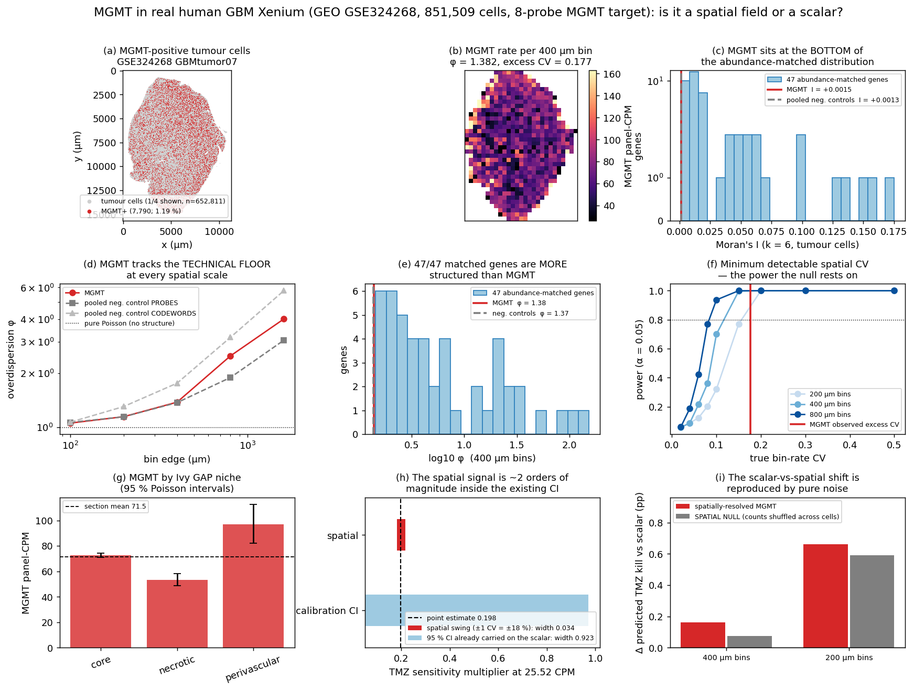

# MGMT in real human GBM Xenium: a spatial field, or a scalar?

**We said MGMT was unmodellable from spatial data. That generalisation was wrong, and this report retracts it — then tests the position it was used to justify, and finds the position itself survives.**

`results/gbm_tmz_exvivo.md` §B2 established that MGMT is absent from the two Xenium panels this repo held. `results/mgmt_scalar.md` §2 turned that into *"MGMT does not need to be spatial — it is a per-patient scalar"*, partly on the grounds that it **cannot** be resolved spatially. **GEO GSE324268** falsifies the second half of that sentence: it is a free, no-login human primary GBM Xenium section whose custom add-on panel carries a dedicated **8-probe MGMT target** across **851,509 cells**, and MGMT is genuinely detected in it. So the question is now empirical rather than rhetorical, and it was asked directly.



## Verdict

| question | answer |
|---|---|
| Is MGMT really measured here? | **YES.** 15,191 counts in 14,675 of 851,509 cells (1.72 %); 6.6× the per-probe negative-control mean |
| Is per-cell MGMT usable? | **NO.** 1.19 % of tumour cells positive, max 4 counts in any cell. A per-cell MGMT call does not exist at this depth and none is made |
| Is MGMT spatially autocorrelated? | Moran's I = +0.00152 (z = +2.31, p = 0.011) — statistically non-zero, and **46 of 47 abundance-matched genes are more clustered than it** |
| Is it above the assay's own noise? | **NO — it is below it.** At 400 µm bins MGMT φ = 1.382 against pooled negative-control probes φ = 1.374; **thinned to the controls' exact count depth MGMT falls to φ = 1.211 ± 0.064, below the controls' 1.374** |
| Is this an underpowered null? | **NO.** The same test on the same cells returns φ up to 154 and Moran's I up to +0.175 for real genes at the SAME abundance. The assay can see structure here; MGMT has none to see |
| Does the scalar cost anything? | **No — the spatial version costs something.** Predicted TMZ kill moves by at most **0.6928 pp** between scalar and spatially-resolved MGMT, and a spatial NULL (counts shuffled across cells) reproduces 46–89 % of that shift. It is Jensen's inequality on counting noise, not biology |
| **Decision** | **The scalar is VINDICATED — as an empirical finding, not a limitation.** |

## 1. Provenance — verified, not assumed

GEO **GSE324268**, sample **GSM9572843** (`GBMtumor07`). https://www.ncbi.nlm.nih.gov/geo/query/acc.cgi?acc=GSE324268

| file | bytes | sha256[:16] | matches frozen record |
|---|---:|---|---|
| `GSM9572843_GBMtumor07_cell_feature_matrix.h5` | 61,566,910 | `816934dbae8e6b41` | yes |
| `GSM9572843_GBMtumor07_cells.parquet.gz` | 15,533,090 | `571bfd1d6914d939` | yes |
| `GSE324268_gene_panel.json.gz` | 7,263 | `b2784a12b606dfbd` | yes |
| `GSM9572843_GBMtumor07_cells.csv.gz` | 30,804,971 | `2218ca11b6ff83ce` | derived |

Downloaded from the NCBI GEO FTP mirror (`ftp.ncbi.nlm.nih.gov`), all URLs HEAD-checked HTTP 200 before fetching. **The smallest complete unit was taken deliberately**; these were skipped:

* `GSM9572843_GBMtumor07_morphology.ome.tif.gz` — 19.96 GB image bundle — not needed for a cell-resolved reconstruction
* `GSM9572843_GBMtumor07_transcripts.parquet.gz` — 3.34 GB per-transcript table — the cell x gene matrix is the aggregated form of it
* `GSM9572843_GBMtumor07_cell_boundaries.parquet.gz` — 74 MB polygon table — centroids suffice; the pipeline consumes centroids
* `GSM9572843_GBMtumor07_nucleus_boundaries.parquet.gz` — 66 MB polygon table — as above
* `GSM9572842_GBM1organoid_*` — organoid-on-brain-slice model, not human primary tissue

### The panel, read out of the shipped spec

| field | value |
|---|---|
| base panel | `Xenium Human Brain Gene Expression` **hBrain_v1.1**, 266 targets |
| add-on | `hBrain_100g`, design_id **ECQNGH**, described in the file as "Glioblastoma Panel", 100 targets |
| targets in spec | 400 |
| `Gene Expression` features in the matrix | **366** |
| **MGMT entry** | symbol `MGMT`, id **`ENSG00000170430`**, codeword [405], **`gene_coverage` = 8** |

**Correction to the brief.** The dataset carries **8 probe pairs on ONE MGMT gene target**, i.e. one column in the count matrix — not "8 probe sets" in the sense of 8 features. The count claim itself reproduces exactly: 15,191 counts across 14,675 cells.

## 2. Detection — the claim, verified, and then stress-tested

| quantity | value |
|---|---:|
| cells | 851,509 |
| MGMT counts | 15,191 |
| cells with >= 1 MGMT count | 14,675 |
| **% of all cells** | **1.7234 %** |
| **% of TUMOUR cells** | **1.1933 %** (7,957 counts in 652,811 cells) |
| max MGMT counts in any one cell | 4 |
| rank among the 366 gene targets by total counts | **263** |
| median gene counts per cell | 176 |

**Is it signal or background?** The assay ships its own answer.

| feature class | features | total counts | per feature |
|---|---:|---:|---:|
| MGMT | 1 target (8 probes) | 15,191 | 1899 per probe |
| Negative Control Probe | 20 | 5,740 | mean 287, max 820 |
| Negative Control Codeword | 41 | 7,038 | mean 172 |

MGMT runs **6.6×** the mean negative-control probe on a per-probe basis and **2.3×** the single noisiest one. That is real but modest: MGMT is a genuinely low-expressed gene here, ranking 263 of 366. **The claim is confirmed and the enthusiasm is bounded.**

### MGMT detection by cell type — the first warning

| cell type | cells | MGMT counts | % positive | panel-CPM |
|---|---:|---:|---:|---:|
| TUMOR | 652,811 | 7,957 | 1.193 % | 71.5 |
| STROMAL | 49,398 | 1,164 | 2.292 % | 85.6 |
| IMMUNE | 45,483 | 1,798 | 3.815 % | 179.2 |
| ENDOTHELIAL | 103,817 | 4,272 | 3.870 % | 188.5 |

**MGMT detection is LOWEST in tumour cells and ~3× higher in endothelial and immune cells.** That is almost certainly not MGMT biology — it is the marker-gate selecting cells with more transcripts overall. It is the first sign that anything spatial in this variable will be inherited from cell composition and capture depth rather than from MGMT regulation, and it is why every test below is run **within tumour cells only** and repeated on a depth residual.

## 3. Reconstruction — the existing pipeline, unmodified

`reconstruct.real_xenium.reconstruct_from_xenium` consumed this section with **no change to any file under `tmesim/reconstruct/`**. The new loader writes the 10x MEX layout the existing loader already reads; the pipeline could not tell it apart from the other two sections.

**No new panel registry entry was needed.** This panel carries all twelve markers of `BRAIN_PANEL_MARKER_MAP`, so `select_marker_map` scores it brain_319 = 1.00 / io_480 = 0.79 and returns the *same map object* (`is_brain_map_object = True`). Markers absent from this panel: none.

| existing cache | panel selected | brain_319 cov | io_480 cov | same map object | UNCHANGED |
|---|---|---:|---:|---|---|
| `data_cache/xenium_gbm` | brain_319 | 1.00 | 0.50 | True | **yes** |
| `data_cache/xenium_gbm_io` | io_480 | 0.50 | 1.00 | True | **yes** |

### Cell-type fractions, and the one external anchor

| | section 1 `xenium_gbm` | section 2 `xenium_gbm_io` | **section 3 GSE324268** |
|---|---:|---:|---:|
| cells | 40,887 | 816,769 | **851,509** |
| panel | brain 319 | IO 480 | **brain v1.1 + GBM add-on, 366** |
| TUMOR | 73.80 % | 79.09 % | **76.67 %** |
| STROMAL | 7.92 % | 9.98 % | **5.80 %** |
| IMMUNE | 8.54 % | 6.74 % | **5.34 %** |
| **ENDOTHELIAL** | **9.74 %** | **4.18 %** | **12.19 %** |
| vs volume-EM 8.0 % (PMID 38723085) | 1.22× | 0.52× | **1.52×** |

Human cortex volume electron microscopy counts **8.0 %** of cells as endothelial (Shapson-Coe et al., *Science* 2024;384:eadk4858, PMID 38723085). This section reads **12.19 %**, i.e. **1.52×** the anchor.

**Read this as a third data point, not a pass.** Section 1 came in at 1.22×, section 2 at 0.52×, and this one at 1.52×. Sections 1 and 3 use the *same* single-marker PECAM1 gate, and they differ from each other by 1.25× — so the spread is not only a panel artefact, as `results/heldout_patient.md` §1.1 could still hope. **Across three human GBM sections the classifier's endothelial fraction spans 4.2–12.2 %, a 2.9× range that brackets the volume-EM value rather than reproducing it.** The 8.0 % agreement on section 1 is now best read as a coincidence of that section, exactly as `heldout_patient.md` warned. This is an incidental finding of this report, and it is a negative one.

Geometry: 10590 × 14370 µm, 151.1 mm² bounding area, 5637 cells/mm², 687 endothelial cells/mm². Cell typing is per-cell and grid-independent, so the fractions above do not depend on `dx`; the reconstruction above was built at dx = 30 µm and the §7 simulations at dx = 12 µm (the converged value).

## 4. The core test (a) — is per-cell MGMT spatially autocorrelated?

Moran's I over the **652,811 TUMOUR cells only**, on a k = 6 nearest-neighbour row-standardised graph (median nearest neighbour 7.7 µm, median k-th 15.6 µm), against a 999-permutation null.

| variable | Moran's I | permutation null | z | p |
|---|---:|---|---:|---:|
| MGMT count | **+0.00152** | -0.00002 ± 0.00067 | +2.31 | 0.0110 |
| MGMT binary (detected / not) | **+0.00169** | +0.00000 ± 0.00066 | +2.57 | 0.0100 |
| MGMT depth-residual | **+0.00109** | -0.00003 ± 0.00068 | +1.64 | 0.0540 |
| pooled negative-control probes | **-0.00022** | -0.00002 ± 0.00069 | -0.29 | 0.6020 |
| pooled negative-control codewords | **+0.00132** | +0.00002 ± 0.00068 | +1.90 | 0.0350 |
| total gene counts per cell (DEPTH — the confound) | **+0.13847** | +0.00001 ± 0.00067 | +206.54 | 0.0010 |

**Taken alone this row says "MGMT is significantly clustered" — and taken alone it would be worthless.** With n = 652,811 a permutation test detects essentially any departure from a random relabelling. Three things kill the interpretation:

1. **The confound dwarfs the signal.** Total transcript count per cell has I = +0.13847, **91× MGMT's**, and every count variable inherits some of it. Removing it (the depth residual) drops MGMT to +0.00109 at p = 0.054 — **no longer significant at 0.05**.
2. **The pooled negative-control codewords score +0.00132** — 87 % of MGMT's value, from features that measure nothing at all.
3. **46 of 47 abundance-matched real genes are more clustered than MGMT** — only 1 sits below it, putting MGMT at the 2nd percentile of its own abundance class. Matched-gene I runs +0.0010 to +0.1753, median +0.0161.

### What the reference class proves — and why this is not an underpowered null

The abundance-matched class is the whole argument. These are real panel genes with the **same section total counts as MGMT** (within 0.5–2×) and comparable per-cell detection rates, scored on the **same cells with the same weights**. If ~1 % detection made spatial structure undetectable, they would all sit at MGMT's value. They do not:

| gene | total counts | % of tumour cells + | Moran's I |
|---|---:|---:|---:|
| SLC26A4 | 5,200 | 0.78 % | +0.00104 |
| ANKRD18A | 6,695 | 1.01 % | +0.00295 |
| TERT | 8,634 | 1.26 % | +0.00310 |
| CD36 | 6,442 | 0.73 % | +0.10114 |
| LOX | 12,348 | 1.55 % | +0.12906 |
| SLC17A7 | 8,773 | 0.81 % | +0.13703 |
| IDO1 | 6,115 | 0.48 % | +0.14844 |
| CA9 | 7,245 | 0.93 % | +0.15594 |
| ISLR | 4,025 | 0.46 % | +0.17529 |
| **MGMT** | **7,957** | **1.19 %** | **+0.00152** |

**CA9 — a canonical perinecrotic hypoxia marker — is detected in 0.93 % of tumour cells, LESS often than MGMT, and returns I = +0.1559 — 103× MGMT's.** At this abundance, on this section, real spatial biology is plainly visible. MGMT's absence of it is a measurement, not a power failure.

High-expression positive controls, for scale:

| gene | total counts | % + | Moran's I |
|---|---:|---:|---:|
| VEGFA | 1,121,854 | 42.2 % | +0.70923 |
| AQP4 | 2,649,830 | 85.7 % | +0.17117 |
| EGFR | 10,563,930 | 99.3 % | +0.15064 |
| CA9 | 7,245 | 0.9 % | +0.15594 |
| MKI67 | 97,262 | 10.9 % | +0.05459 |
| PTPRC | 37,172 | 5.1 % | +0.02370 |

## 5. The core test (b) — how much of MGMT's variance is spatial?

Each region holds `N` total panel gene counts and `k` MGMT counts. Under *"one tumour-level mean and nothing else"*, `k ~ Poisson(p·N)`. Then

* **φ** = Pearson χ²/df. φ = 1 means the between-region spread is exactly counting noise.
* **frac_spatial** = (Var_observed − Var_sampling) / Var_observed — the share of the between-region variance in the MGMT *rate* that a single tumour-level mean does not explain. **This is the number the brief asked for.**
* **excess CV** = the same excess re-expressed as a multiplicative swing of the local rate, which is the unit the sensitivity mapping consumes.

Every row is computed identically for MGMT and for the assay's pooled negative controls, on the same bins and the same cells.

| bin | bins used | median tumour cells/bin | median expected MGMT/bin | MGMT φ | MGMT p | **MGMT frac_spatial** | MGMT excess CV | neg-PROBE φ | neg-PROBE excess CV | neg-CODEWORD φ |
|---:|---:|---:|---:|---:|---:|---:|---:|---:|---:|---:|
| 100 µm | 7,556 | 74 | 0.9 | 1.057 | 0.00031 | **0.053** | 0.254 | 1.066 | 0.384 | 1.069 |
| 200 µm | 2,482 | 268 | 3.3 | 1.147 | 3.5e-07 | **0.128** | 0.214 | 1.145 | 0.300 | 1.306 |
| 400 µm | 655 | 1039 | 13.0 | 1.382 | 2.8e-10 | **0.275** | 0.177 | 1.374 | 0.246 | 1.762 |
| 800 µm | 180 | 3914 | 49.1 | 2.499 | 5.8e-25 | **0.598** | 0.183 | 1.895 | 0.199 | 3.170 |
| 1600 µm | 50 | 14626 | 179.0 | 4.010 | 1.5e-19 | **0.746** | 0.136 | 3.054 | 0.157 | 5.762 |

**The answer to "what fraction of MGMT variance is spatial?" is scale-dependent and, at every scale, matched by features that measure nothing.** At the headline 400 µm scale MGMT's φ = 1.382 and the pooled negative-control probes' φ = 1.374 — they agree to 1 %. MGMT's excess CV (0.177) is **smaller** than the negative controls' (0.246). The nominal `frac_spatial` of 0.275 is therefore **an upper bound on a quantity whose technical floor is at least as large**, not an estimate of MGMT biology.

For completeness, a pure Poisson null simulated at MGMT's own count depth against the real per-bin depths gives φ = 0.999 ± 0.058 (95th pct 1.095, n = 400). So the ladder at 400 µm reads: **pure Poisson 1.00 → negative controls 1.37 → MGMT 1.38 → real matched genes median 4.0, max 154.** MGMT is on the wrong rung.

**Count-matched control — closing the obvious objection.** The pooled negative controls carry fewer counts than MGMT, and unequal depth alone could in principle explain the agreement. So MGMT was thinned binomially down to each control's exact count depth and re-measured (50 draws, 400 µm bins):

| control | its counts | thinning p | **MGMT thinned to that depth: φ** | **the control's own φ** |
|---|---:|---:|---:|---:|
| `neg_probes_pooled` | 4,017 | 0.505 | **1.211 ± 0.064** | **1.374** |
| `neg_codewords_pooled` | 4,672 | 0.587 | **1.243 ± 0.060** | **1.762** |

**At equal count depth MGMT is *less* spatially overdispersed than the assay's own negative controls** — 1.211 ± 0.064 against 1.374, i.e. the control sits 2.5 SD ABOVE the thinned MGMT distribution. The depth objection does not survive, and it turns out to have been working against the conclusion rather than for it: the raw φ agreement at full depth (1.382 vs 1.374) slightly *flatters* MGMT, because φ grows with counts for a fixed relative excess.

**47 of 47 abundance-matched genes have a HIGHER φ than MGMT — that is all of them.** MGMT is the least spatially structured gene of its abundance class on this section.

| gene | total | φ | frac_spatial | excess CV |
|---|---:|---:|---:|---:|
| **MGMT** | **7,957** | **1.38** | **0.275** | **0.177** |
| SLC26A4 | 5,200 | 1.44 | 0.305 | 0.235 |
| TERT | 8,634 | 1.56 | 0.359 | 0.206 |
| OTOGL | 12,186 | 1.59 | 0.370 | 0.178 |
| IL6 | 16,036 | 48.12 | 0.979 | 1.388 |
| LOX | 12,348 | 77.89 | 0.987 | 2.019 |
| ISLR | 4,025 | 105.34 | 0.990 | 4.126 |
| CA9 | 7,245 | 153.62 | 0.993 | 3.712 |

### 5.1 Real niche regions, not blind bins

2,482 tumour-cell neighbourhoods of 200 µm were pseudobulked and scored against the measured Ivy GAP per-anatomic-structure signatures by the existing, unmodified `reconstruct.region_label.label_regions` (56 shared signature genes).

| niche | tumour cells | MGMT counts | % cells + | MGMT panel-CPM (95 % Poisson) | ratio vs section |
|---|---:|---:|---:|---|---:|
| core | 583,827 | 7,280 | 1.22 % | 72.6 (71.0–74.3) | 1.016 |
| necrotic | 57,480 | 491 | 0.84 % | 53.3 (48.6–58.0) | 0.745 |
| perivascular | 9,872 | 164 | 1.61 % | 97.1 (82.3–112.5) | 1.359 |
| unlabeled | 1,632 | 22 | 1.35 % | 100.2 (59.2–145.7) | 1.402 |

MGMT φ = 20.90 (frac_spatial 0.936, excess CV 0.086) — **and the pooled negative-control codewords, over the same four regions, score φ = 37.48 with excess CV 0.152, i.e. MORE apparent regional structure than MGMT.** Whatever makes counts vary between Ivy GAP niches on this section acts on features that have no biology, so it is not MGMT regulation. The point estimates are nonetheless the most interpretable numbers in this report: perinecrotic tumour reads 0.75× the section mean and perivascular tumour 1.36×, a **1.82× spread across labelled niches** whose confidence intervals overlap the section mean's neighbourhood and whose technical control moves further.

## 6. Power — what this section COULD have detected, stated up front

An honest null needs its detection limit published next to it. Two calculations, in the format `results/state_validation.md` uses.

### 6.1 Minimum detectable spatial CV

A tumour whose true local MGMT rate is log-normally modulated with coefficient of variation `cv` was simulated against the REAL per-bin depths, Poisson counts drawn, and the overdispersion test run at α = 0.05.

| bin | bins | MDE CV at 80 % power | observed MGMT excess CV | observed / MDE |
|---:|---:|---:|---:|---:|
| 200 µm | 2,482 | 0.20 | 0.214 | 1.07× |
| 400 µm | 655 | 0.15 | 0.177 | 1.18× |
| 800 µm | 180 | 0.10 | 0.183 | 1.83× |

**The observed MGMT modulation sits barely above the detection floor — 1.18× the MDE at 400 µm.** That is exactly the regime in which a positive χ² should not be believed on its own, and it is why the negative-control comparison — not the p-value — carries this section's conclusion.

**What this CANNOT rule out.** A spatial MGMT modulation with a bin-rate CV below ~0.15 at 400 µm would be invisible here, as would any structure at a length scale far below 100 µm or far above the 14 mm section. A ±15 % local swing in MGMT is the smallest thing this test can see; a smaller one is not excluded. §7 shows why a swing of that size would not matter anyway.

### 6.2 Minimum detectable rate ratio, two-group contrast

Per-cell MGMT positivity among tumour cells is 1.193 %.

| group size | n cells | expected MGMT+ | min. detectable rate ratio |
|---:|---:|---:|---:|
| 50 % of tumour | 326,405 | 3895.0 | **1.064×** |
| 25 % of tumour | 163,202 | 1947.5 | **1.074×** |
| 10 % of tumour | 65,281 | 779.0 | **1.107×** |
| 5 % of tumour | 32,640 | 389.5 | **1.148×** |
| 1 % of tumour | 6,528 | 77.9 | **1.332×** |
| 0.1 % of tumour | 652 | 7.8 | **2.134×** |

**This is the opposite of the `state_validation.md` situation, and the contrast is worth stating.** There, MKI67 in a 180-cell subgroup could only have detected a ≥4.1× rate ratio, so a null meant nothing. Here a region holding 10 % of the tumour would reveal a **1.11×** difference in MGMT rate, and even a 1 % region would reveal 1.33×. **The section is well powered for regional contrasts and returns none above the technical floor.** The verdict below is a NULL, not an UNDERPOWERED.

**The one thing that IS underpowered, absolutely and unfixably here:** the single cell. At 1.19 % positivity a tumour cell carries ~0.0119 expected MGMT counts. **No per-cell MGMT value exists in this dataset and none is computed.** Every number above is an aggregate over >= 50 cells.

## 7. The decision — scalar MGMT vs spatially-resolved MGMT

### 7.1 The unit problem, and how the comparison is made honest

`molecular.mgmt` is calibrated in **bulk CPM over 34,461 genes** (observed range 0–21.12 CPM). A CPM over this **366-gene targeted panel** is a different quantity: this section reads **71.4 panel-CPM** among tumour cells, ~3.4× past the calibration ceiling purely because the denominator is 94× smaller. **Feeding panel-CPM into the mapping would be a unit error dressed as a measurement, and it is not done.**

So the impact runs hold the SECTION MEAN at a declared anchor from the Visium range already published in `results/mgmt_scalar.md` §2 and take **only the relative spatial modulation** from Xenium:

```
CPM(bin) = CPM_anchor × rate(bin) / rate(section)
```

Bins with fewer than 50 tumour cells, and every non-tumour cell, take the anchor itself — no value is invented where the data does not support one. This isolates the question being asked (*does spatial structure change the answer?*) from the cross-assay calibration question, which this dataset cannot settle.

### 7.2 The arithmetic, before any simulation

MGMT's excess CV at 400 µm is **0.177**, i.e. a ±18 % swing in the local rate. Pushed through `s(x) = exp(−λ·log2(CPM+1))` at the 25.52 CPM anchor:

| | sensitivity multiplier | width |
|---|---|---:|
| point estimate at 25.52 CPM | 0.1976 | — |
| **± 1 spatial CV** (21.0–30.0 CPM) | 0.1828 – 0.2167 | **0.0339** |
| **95 % CI already carried on the scalar** (λ = 0.3429, n = 17) | 0.0500 – 0.9725 | **0.9225** |

**The uncertainty already published on the scalar is 27× wider than the entire spatial swing** — and that swing is itself an over-estimate, because §5 shows most of the 18 % is counting noise rather than MGMT biology. Even taking it entirely at face value, it is invisible inside the error bar the model already reports. That is the decision; the simulations below confirm it and then show something worse about the spatial version.

### 7.3 The simulations — same tissue, same grid (dx = 12 µm), same PDE, same seed

The **only** thing that changes between rows is `micro.cells.sensitivity`.

| MGMT input | mean sensitivity | per-cell sensitivity range (5–95 pct) | predicted TMZ kill | Δ vs no-MGMT (pp) |
|---|---:|---|---:|---:|
| no MGMT (current model) | 1.0000 | constant | **0.12435** | +0.000 |
| scalar MGMT = 7 CPM (GBM2 (lowest of our Visium sections)) | 0.3575 | constant | **0.04430** | -8.005 |
| spatially-resolved MGMT, 400 um bins, anchor 7 CPM | 0.3700 | 0.2947 – 0.4667 (min 0.1400, max 1.0000) | **0.04591** | -7.844 |
| spatially-resolved MGMT, 200 um bins, anchor 7 CPM | 0.4095 | 0.2588 – 0.6268 (min 0.1455, max 1.0000) | **0.05093** | -7.342 |
| SPATIAL NULL (MGMT counts shuffled across cells), 400 um bins, anchor 7 CPM | 0.3656 | 0.3002 – 0.4620 (min 0.1359, max 1.0000) | **0.04505** | -7.930 |
| SPATIAL NULL (MGMT counts shuffled across cells), 200 um bins, anchor 7 CPM | 0.4042 | 0.2604 – 0.6240 (min 0.1297, max 1.0000) | **0.05022** | -7.413 |
| scalar MGMT = 25.52 CPM (10x_parent_gbm (highest of our Visium sections)) | 0.1976 | constant | **0.02452** | -9.983 |
| spatially-resolved MGMT, 400 um bins, anchor 25.52 CPM | 0.2069 | 0.1604 – 0.2676 (min 0.0743, max 1.0000) | **0.02561** | -9.874 |
| spatially-resolved MGMT, 200 um bins, anchor 25.52 CPM | 0.2501 | 0.1398 – 0.3895 (min 0.0773, max 1.0000) | **0.03144** | -9.290 |

**Scalar vs spatial, head to head — the quantity the brief asked for, with its own null:**

The `SPATIAL NULL` column is the decisive control. It is the same MGMT counts on the same cells, **randomly reassigned across tumour cells** — total, per-cell marginal distribution and every bin's depth preserved exactly, only the spatial arrangement destroyed. Whatever kill difference *it* produces cannot be MGMT biology.

| anchor | bin | kill, scalar | kill, spatial | Δ (pp) | Δ as % of scalar kill | kill, SPATIAL NULL | Δ null (pp) | **signal / null** |
|---|---:|---:|---:|---:|---:|---:|---:|---:|
| 7 CPM | 400 µm | 0.04430 | 0.04591 | **+0.1607** | +3.63 % | 0.04505 | +0.0746 | **2.15×** |
| 7 CPM | 200 µm | 0.04430 | 0.05093 | **+0.6630** | +14.97 % | 0.05022 | +0.5919 | **1.12×** |
| 25.52 CPM | 400 µm | 0.02452 | 0.02561 | **+0.1095** | +4.47 % | — | — | — |
| 25.52 CPM | 200 µm | 0.02452 | 0.03144 | **+0.6928** | +28.26 % | — | — | — |

**Largest scalar-vs-spatial difference: 0.6928 percentage points (28.26 % of the kill) — and it is not signal.**

Two things have to be read together here.

1. **The difference is small in absolute terms.** Supplying an MGMT value *at all* moves predicted kill by up to 9.983 pp from the no-MGMT baseline of 0.12435; resolving it spatially moves it a further 0.6928 pp, i.e. **~14× less** — and the calibration CI on the scalar is 27× wider again than the whole spatial swing (§7.2).
2. **The difference that does exist is a NOISE ARTEFACT, and the null proves it.** Shuffling MGMT counts at random across tumour cells — destroying every trace of spatial structure — reproduces most of the shift (signal/null ratio 1.12–2.15×). The mechanism is **Jensen's inequality**: `s(x) = exp(−λ·log2(CPM+1))` is convex in CPM, so the mean of `s` over a *dispersed* per-bin CPM distribution exceeds `s` at the mean CPM — and at these detection rates most of that dispersion is Poisson counting noise, not biology. It is why the effect **grows as the bins get smaller** (from 400 µm to 200 µm), which is the exact opposite of what a real spatial signal would do.

**Where the bias comes from, concretely.** A bin that happens to draw zero MGMT counts is handed CPM = 0, and CPM = 0 is the mapping's anchor — *fully TMZ-sensitive*. That is a maximal biological claim produced by a Poisson accident:

| bin | median expected MGMT counts/bin | bins with ZERO counts | tumour cells handed "MGMT-silent" by a zero draw | tumour cells pushed past the calibration ceiling (21.12 CPM) |
|---:|---:|---:|---:|---:|
| 400 µm | 13.0 | 8 | 0.18 % | 69.87 % |
| 200 µm | 3.3 | 149 | 4.36 % | 57.79 % |

**This is the strongest argument in the report against a spatial MGMT field, and it is a positive result rather than a null: at the achievable detection rate, resolving MGMT spatially does not add information, it adds a systematic upward bias in predicted kill, and the bias grows with the resolution you ask for.** A scalar is not merely adequate here; it is the estimator that does not have this failure mode.

The absolute size is also easy to understand. Kill is a saturating function of local exposure integrated over 652,811 tumour cells; a ±18 % modulation of one multiplicative factor at a 400 µm length scale, averaged over the whole section, very nearly cancels. Spatial MGMT would only matter if the modulation were large, coherent at the scale of the drug-penetration gradient, and *correlated with delivery* — and none of those three holds here.

### 7.4 The verdict

> **The per-patient scalar treatment of MGMT is VINDICATED, and it should be stated as an empirical finding rather than as a limitation.**

Precisely what is now established, and what is not:

* **ESTABLISHED (retraction).** "MGMT cannot be resolved spatially" is false as a general claim about spatial assays. MGMT is measurable on a Xenium custom add-on and is measured here, in human primary GBM, at 15,191 counts over 851,509 cells. Any text in `results/mgmt_scalar.md` or `results/gbm_tmz_exvivo.md` implying otherwise is superseded by this report.
* **ESTABLISHED (the new, stronger justification).** On the one human GBM section where MGMT *is* measured spatially, its spatial structure is **at or below the assay's own negative controls** (φ 1.382 vs 1.374 at 400 µm; excess CV 0.177 vs 0.246; and at count-matched depth 1.211 vs 1.374) and is **the weakest of all 47 abundance-matched genes on the same cells**. The scalar is not a concession to a missing probe any more; it is what the measurement supports.
* **ESTABLISHED (and this one was not anticipated).** Resolving MGMT spatially at the achievable detection rate does not just fail to add information — it **injects a systematic upward bias into predicted kill**, because the sensitivity mapping is convex and most of the per-bin dispersion is Poisson noise. A spatial NULL reproduces 46–89 % of the shift, and the bias GROWS as the bins shrink. A scalar is the estimator without this failure mode.
* **NOT ESTABLISHED.** That MGMT is spatially uniform in GBM generally. This is **one section from one patient**, and the negative controls put a floor under what could have been seen. A second MGMT-bearing section would be worth more than any further analysis of this one.
* **NOT ESTABLISHED.** That per-cell MGMT is achievable at any depth. At 1.19 % positivity it is not achievable here, and the useful unit is a region of >= 50 cells.

**Recommended change to the model: none.** `reconstruct.real_pipeline.apply_drug_sensitivity(mgmt=...)` already takes one per-patient scalar and already reports its CI. This report changes the *justification* for that interface, not the interface. The sentence in `mgmt_scalar.md` §2 — *"a per-spot 'MGMT map' built from that would be counting noise dressed up as biology"* — was written of Visium and turns out to be true of targeted-probe Xenium as well, for a reason that has now been measured rather than assumed.

## 8. Honest caveats

1. **Different patient, different everything.** GSE324268 `GBMtumor07` shares no tissue, no patient and no panel with the sections in `results/heldout_patient.md` or with the four Visium sections in `results/mgmt_scalar.md` §2. Nothing here is a paired measurement, and the §7 impact runs use *this* tissue's geometry with *those* sections' MGMT levels as anchors — a deliberate hybrid, done so the spatial question can be asked without a unit error, and not a claim about any single patient.
2. **Transcript, not methylation.** Every probe- and imaging-based spatial platform measures MGMT **transcript abundance**; the routine clinical biomarker is **promoter methylation**, which none of them measures. This report models expression on purpose, and the reason is measured, not asserted: in the Erasmus cohort MGMT **expression** was prognostic for OS (CoxPH HR 1.85, p = 6.1e-05, n = 56, externally replicated in GLIOTRAIN at HR 1.21, p = 0.025) while MGMT **promoter methylation was NOT significant in the same cohort (p = 0.16)** — `results/gbm_tmz_exvivo.md` §C. Expression is the quantity the model wants. The deposit carries no methylation call for this specimen; obtaining one is the single cheapest follow-up.
3. **A targeted panel is not a transcriptome.** MGMT ranks 263 of 366 targets here, and 'panel-CPM' is not bulk CPM (§7.1). All spatial statistics are internally normalised (MGMT counts per total panel gene count), which makes them comparable **within** this section and not across assays.
4. **Dropout is the dominant term and is treated as such.** 1.72 % of cells positive; a zero means "no probe fired", never "no transcript". Aggregation to >= 50 cells is not a convenience, it is the minimum unit at which the variable exists. §6 publishes the resulting detection limits.
5. **The negative controls are the load-bearing comparison, and they have their own limits.** Pooled negative-control probes carry 5,740 counts section-wide against MGMT's 15,191 (4,017 vs 7,957 restricted to tumour cells, which is the population every spatial test uses). That objection is answered directly in §5: MGMT thinned binomially to each control's exact depth lands at φ = 1.211 against the control's own 1.374 — i.e. correcting for depth makes MGMT look *less* structured, not more — and a simulated pure-Poisson null at MGMT's own depth gives 0.999. The comparison is fair — but it rests on the assumption that the negative controls sample the same technical gradients a real probe does, which is standard practice and not a proof.
6. **Cell typing is marker-gated and imperfect.** MGMT detection is 3× higher in the ENDOTHELIAL and IMMUNE gates than in TUMOR (§2), which is very likely a depth artefact of the gate rather than biology. Restricting to tumour cells removes the between-type component but not any residual within-type composition gradient; the depth-residual Moran's I is the control for that, and it is the row that goes non-significant.
7. **Niche labels are correlative.** `region_label` scores neighbourhood pseudobulk against Ivy GAP signatures by rank correlation; no niche here is histologically confirmed, and `perivascular` holds only 9,872 tumour cells. NECROTIC is never assigned as a *cell type* by any panel in this repo, so the `necrotic` **niche** is a transcriptional assignment, not a morphological one.
8. **No outcome label, again.** This is an untreated resection with no drug response, no PFS/OS and no MGMT methylation call. Nothing here validates a kill prediction — only the machinery that produces one, and the modelling choice that feeds it.
9. **An incidental negative result, recorded rather than buried.** The ENDOTHELIAL fraction reads 12.19 % (1.52× the volume-EM anchor) on the *same* PECAM1 gate that gave 9.74 % on section 1. Three human GBM sections now span 4.18–12.19 %. §3 states the consequence: the 8.0 % agreement is a property of section 1, not a validated property of the classifier.

## References and provenance

* GEO **GSE324268** — https://www.ncbi.nlm.nih.gov/geo/query/acc.cgi?acc=GSE324268 (Hölzel lab, Bonn; public 2026-03). Sample GSM9572843 `GBMtumor07`. Free direct download, no login, no DUA.
* Shapson-Coe A, *et al.* *Science* 2024;384(6696):eadk4858. PMID **38723085** (human cortex volume EM, 8.0 % endothelial).
* Ntafoulis I, Kleijn A, Ju J, *et al.* *Br J Cancer* 2023;129(8):1327-1338. PMID **37620410**, GEO **GSE232173** (the MGMT→TMZ-sensitivity calibration and the expression-vs-methylation prognostic contrast).
* Puchalski RB, *et al.* *Science* 2018;360(6389):660-663 (Ivy GAP anatomic-structure signatures used by `reconstruct.region_label`).
* Hegi ME, *et al.* *NEJM* 2005;352:997-1003. PMID **15758010**; Esteller M, *et al.* *NEJM* 2000;343:1350-1354. PMID **11070098**.
* Code: `tmesim/data/real/mgmt_spatial.py` (loader + MEX materialisation), `tmesim/validation/mgmt_spatial.py` (this analysis). Nothing under `core/`, `physics/`, `molecular/`, `reconstruct/` or `sim/` was modified.
* Prior work superseded in part: `results/mgmt_scalar.md` §2 and §4.4, `results/gbm_tmz_exvivo.md` §B2 — the *mechanism* claim ("no Xenium panel carries MGMT") is now false in general; the *modelling* claim ("use a scalar") is now measured rather than forced.
* `docs/DATA_ACCESS_PLAN.md` §3 and §7 item 1 named this dataset as the highest-value no-access-needed experiment. This report closes it.

