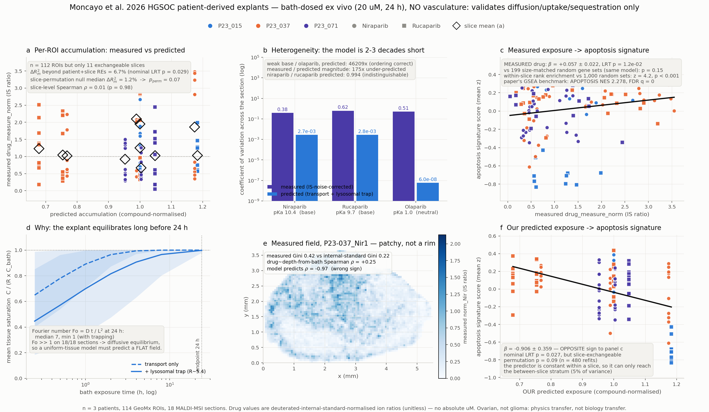

# Moncayo et al. 2026 HGSOC explants — real-data validation of diffusion, uptake and sequestration

`tmesim/validation/moncayo_explant.py` · `./.venv/bin/python -m tmesim.validation.moncayo_explant`

## 0. Read this before any number below

> **The explants were bath-dosed ex vivo: 20 uM in medium, 24 h. There is no vasculature, no perfusion, and no source term.** This run can validate **diffusion into tissue, cellular uptake and intracellular sequestration**. It **cannot** validate vascular delivery, interstitial pressure, vessel normalisation, or anything downstream of a blood supply. Every claim below is scoped to the bath-dosed regime.

Four more limits that travel with every number:

1. **Ovarian, not glioma.** High-grade serous ovarian carcinoma patient-derived explants. Everything else in `tme-sim` is glioma. Whatever transfers is *physics* (a diffusion-reaction field in tissue), not *biology*.
2. **No absolute concentrations.** The measured quantity is a MALDI-MSI drug ion intensity divided by a co-sprayed **drug-matched deuterated internal standard**, averaged over the ROI. It is a unitless ratio. No uM claim is made about any measured value anywhere in this document.
3. **n = 3 patients**, 114 GeoMx ROIs, 18 MALDI-MSI sections, 12 ROI-table slices of which 11 have an MSI counterpart (112 ROIs enter the fits; 2 are dropped because slice `T23_071_NirBlad2` was not deposited in the MSI table).
4. **The ROI table has no X/Y.** GeoMx ROI positions were never deposited, so a transport model's prediction can only be resolved to the **slice**. See §1 for what that costs.

## 1. Provenance and what is being predicted

Moncayo et al., *Nature Communications* 2026, PMID 41844641, DOI 10.1038/s41467-026-70558-1. Zenodo 17610220 (CC-BY-4.0) + GEO GSE281519 + the journal Source Data workbook. Files as used, on disk:

| file | bytes | sha256 (first 16) |
|---|---:|---|
| `data_cache/hunt/geomx_dsp/zenodo17610220_ROI_drug_measurements.csv` | 18,630 | `9e56d85abf901a58` |
| `data_cache/hunt/geomx_dsp/zenodo17610220_ROI_drug_plus_expression.csv.gz` | 2,192,906 | `79d99c185aa3db80` |
| `data_cache/hunt/geomx_dsp/NatCommun2026_SourceData_SupFig2_MSI_perpixel.csv.gz` | 13,240,167 | `17c5b4be8036c7e8` |
| `data_cache/hunt/geomx_dsp/zenodo17610220_modelling.Rmd` | 18,288 | `345b2fe5be113c3e` |

**Response variable**: `drug_measure_norm` = `drug_measure` / `measure_norm_factor`, where `measure_norm_factor` is a single constant per compound (asserted at load time). **Frame**: the authors' own, shipped in `zenodo17610220_modelling.Rmd` — `lmer(y ~ x + (1|Patient) + (1|Patient:Slice), REML=FALSE)` with a likelihood-ratio test, reproduced here with `statsmodels` MixedLM (nested slice as a variance component inside the patient grouping, ML).

### Where the measured variance actually lives

| stratum | share of variance in `drug_measure_norm` |
|---|---:|
| between patient | 5.0% |
| between slice, within patient | 5.0% |
| **within slice (ROI to ROI)** | **89.9%** |

This single table caps the whole exercise. A coordinate-free, slice-resolved prediction is **structurally incapable of reaching the 90% of the variance that lives between ROIs inside one section**. The most a perfect slice-level model could explain beyond the random effects is the 5.0% between-slice stratum, and the random effects are already fitted to absorb exactly that. We state this before reporting the fit rather than after.

## 2. What was simulated, and how (additive-only)

**Geometry — measured, not invented.** Each of the 18 MSI sections is rasterised from *its own* on-tissue pixel coordinates on the native 20 um grid, hole-filled, then block-coarsened 3x to a 60 um model grid. Section areas run 1.2-19.3 mm^2 with maximum in-plane distance-to-edge 384-1800 um.

**Boundary condition — a bath, not a vessel.** Dirichlet C = 20 uM on the entire section perimeter, C = 0 inside at t = 0, for 24 h. This is the opposite of the vascular-source geometry used everywhere else in this repo, and it is the correct representation of a submerged explant.

**Solver — engine numerics, analysis-layer boundary.** The frozen public solver `simulate_drug_transport` implements a volumetric source with **no-flux** boundaries and a zero initial condition; it has no Dirichlet facility, so it structurally cannot express a bath. Rather than modify it, this module imports and calls two engine internals unchanged — `physics.diffusion._effective_diffusivity` (the same `D_eff = D (1 - 0.6 x ecm)` tortuosity law) and `physics.diffusion._build_diffusion_operator` (the same symmetric finite-volume Laplacian) — and adds only the boundary condition. **Nothing in `core/`, `physics/`, `molecular/`, `reconstruct/` or `sim/` was edited.**

**Solver verification.** Checked against Crank's analytic plane-sheet solution (eq. 4.18) at 0.25 / 1 / 4 / 24 h: worst relative error **0.53%** (PASS, tolerance 3%).

**How lysosomal sequestration is encoded without touching the engine.** Reversible instantaneous partitioning into an acidic compartment of volume fraction `phi_lys` is a *linear equilibrium*, so it is exactly equivalent to a retardation factor

```
  ratio = [D]_lys/[D]_cyt = (1 + 10^(pKa - 4.7)) / (1 + 10^(pKa - 7.2))      (Henderson-Hasselbalch ion trapping)
  R     = 1 + phi_lys * (ratio - 1)
  R dC_free/dt = div(D grad C_free)   <=>   D -> D/R,  C_measured = R * C_free
```

so it is implemented as a **constructed `DrugParams` whose diffusivity is divided by R**, plus a post-multiplication of the solved field by R. No engine change, and exact for linear partitioning. Reference `phi_lys` = 0.014 (cell volume fraction ~0.7 x lysosomal fraction of cell volume ~0.02), swept over (0.005, 0.014, 0.05) in §4.

**Three model conditions**, all run on all 18 geometries x all 3 compounds (so the compound contrast is within-geometry and cannot be confounded by explant shape):

| condition | pH-partitioning / lysosomal trap | molecular-layer clearance+binding sink |
|---|---|---|
| `transport_only` | no | no |
| `transport+shipped_loss` | no | yes |
| `transport+lysosomal_seq` | **yes** | no |

## 3. Analysis 1 — accumulation-heterogeneity fit

### 3.1 The transport-only model has nothing to fit

Under `transport_only` the predicted accumulation is **identical to the bath concentration in every voxel of every section** (mean saturation 1.000000, predicted CV 1.4e-08). The predictor is constant, no slope is identifiable, and **variance explained beyond the random effects is 0.0% by construction**. That is not a fitting failure; it is the model's answer.

The reason is dimensional. The Fourier number Fo = D_eff t / L^2 at the 24 h endpoint has median **14.7** without trapping and **7.4** with it (minimum 1.13); 18/18 sections have Fo > 1. Mean tissue saturation is already 0.89 at **1 hour** (0.70 with trapping) and 0.9982 at 24 h. **A 24 h bath-dosed 1-2 mm explant is at diffusive equilibrium.** A model whose only spatial mechanism is diffusion from a uniform boundary into uniform tissue must predict a flat field there — and does.

### 3.2 The one condition with a non-constant prediction

`transport+shipped_loss` adds the molecular layer's own first-order `clearance + binding` sink, which makes the steady state depend on section size and shape, so the prediction finally varies slice to slice (relative SD 0.163).

| statistic | pooled | Niraparib | Rucaparib |
|---|---:|---:|---:|
| beta | 1.521 | 1.921 | 0.051 |
| SE | 0.594 | 1.016 | n/a |
| LRT p | 0.029 | 0.097 | 1.000 |
| **dR2 marginal (variance beyond REs)** | 6.7% | 5.4% | 0.0% |
| R2 conditional | 0.160 | 0.135 | 0.017 |
| singular fit | no | no | **yes** |

### 3.3 And why that p-value does not survive

The parametric LRT above treats 112 ROIs as if they carried 112 units of information. They do not: **our predictor is constant within a slice**, so the exchangeable unit is the slice, of which there are 11. A slice random intercept with a small variance component (5.0% of total) does not absorb a slice-constant regressor, and the ROI count leaks straight into the standard error. Permuting the slice->prediction assignment *within compound* (preserving the compound split, the slice means and the ROI counts) and refitting 961 times gives the honest reference:

| | value |
|---|---:|
| observed abs(t) | 2.56 |
| permutation null median abs(t) | 0.78 |
| permutation null 95th pct abs(t) | 2.44 |
| **permutation p (slice-exchangeable)** | **0.044** |
| observed dR2 beyond REs | 6.7% |
| permutation null median dR2 | 1.2% |
| permutation null 95th pct dR2 | 7.5% |
| **permutation p for dR2** | 0.074 |

Slice-level agreement, the same information viewed directly, one point per slice and no ROI-count weighting (n = 11): Spearman rho = 0.009 (p = 0.979), Pearson r = 0.239 (p = 0.478); within-compound slice permutation p = 0.981.

**The two permutation statistics disagree, and that disagreement is the finding.** On |t| the observed value clears the null 95th percentile (2.56 vs 2.44, p = 0.044); on dR2 it does not (6.7% vs 7.5%, p = 0.074); and the unweighted slice-level Spearman is 0.009. An effect that appears or vanishes depending on whether slices are weighted by ROI count is not a validated prediction; it is 11 points arranged so that one weighting scheme finds a trend.

### 3.4 And the effect that does appear is a thickness proxy

Under `transport+shipped_loss` the model's slice-to-slice prediction is almost exactly a monotone function of how thick the section is: Spearman(prediction, mean distance-to-edge) = -0.948 (p = 9.4e-06, n = 11). That is the whole mechanism — a first-order sink lets a thin section equilibrate closer to the bath than a thick one. So the fair question is whether the simulator beats the one-number geometric covariate it is standing in for. Same frame, same ROIs:

| fixed effect | beta | SE | LRT p | dR2 beyond REs |
|---|---:|---:|---:|---:|
| **our prediction** | 1.521 | 0.594 | 0.029 | 6.7% |
| section mean distance-to-edge (um) | -0.001368 | 0.000656 | 0.094 | 4.3% |
| section max distance-to-edge (um) | -0.000455 | 0.000224 | 0.070 | 4.4% |
| section area (mm^2) | -0.035448 | 0.030603 | 0.263 | 2.1% |

**Verdict, analysis 1.** *Variance explained beyond the patient/slice random effects: nominally 6.7% under `transport+shipped_loss`, against a slice-permutation null whose median is 1.2% and 95th percentile 7.5% (p = 0.074); exactly 0.0% under `transport_only`, by construction.* Rounded honestly: **between zero and a few percent, not separable from chance with 11 exchangeable slices, and what little there is is a section-thickness effect rather than a transport prediction.** This model does not predict per-ROI drug accumulation in bath-dosed explants. It is not close, and §3.1 explains why it cannot be.

## 4. Analysis 2 — the compound-specificity falsification test

**The claim under test.** Niraparib and rucaparib are weak bases whose lysosomal sequestration drives accumulation heterogeneity; olaparib is not a base and does not show it. A model carrying the mechanism must (a) order the compounds correctly *and* (b) get the magnitude approximately right. Passing (a) at 1/175th of the observed magnitude is not a pass.

### 4.1 Does the molecular layer see the chemistry? Yes.

Basic centres are found from structure with RDKit — an sp3 nitrogen that is not an amide/sulfonamide/phosphoramide N, not attached to an aromatic ring, not already charged (`[NX3;H2,H1,H0;!$(N[C,S,P]=[O,S,N]);!$(N-a);!$(N#*);!$([N+])]`). InChIKeys were asserted against the public identifiers before anything else ran.

| compound | InChIKey | MW | cLogP | basic centres | class | pKa (structure) | pKa (literature, cross-check only) | lysosome:cytosol ratio | R at phi_lys=0.014 |
|---|---|---:|---:|---:|---|---:|---:|---:|---:|
| Niraparib | `PCHKPVIQAHNQLW-AWEZNQCLSA-N` | 320.4 | 2.59 | 1 | cyclic_secondary_amine | 10.4 | 9.95 | 316.0 | 5.41 |
| Rucaparib | `HMABYWSNWIZPAG-UHFFFAOYSA-N` | 323.4 | 2.98 | 1 | acyclic_secondary_amine | 9.7 | 9.4 | 315.2 | 5.40 |
| Olaparib | `HUTZIPRGMCJLQS-UHFFFAOYSA-N` | 434.5 | 2.35 | 0 | none | 1.0 | -- (no basic centre) | 1.0 | 1.00 |

**This part works.** Purely from SMILES, the layer finds one basic secondary amine in niraparib and one in rucaparib and **none** in olaparib (both piperazine nitrogens are acylated), matching the literature cross-check exactly. The weak-base / non-base split is recovered from structure: `weak_base_split_detected = True`.

### 4.2 Does that chemistry produce the predicted heterogeneity? Ordering yes, magnitude no.

Predicted coefficient of variation of accumulation across each section, averaged over all 18 geometries (every compound on every geometry):

| compound | `transport_only` | `transport+lysosomal_seq` | measured CV | measured CV minus IS-noise floor |
|---|---:|---:|---:|---:|
| Niraparib | 1.43e-08 | 2.74e-03 | 0.640 | 0.382 |
| Rucaparib | 1.49e-08 | 2.76e-03 | 0.845 | 0.620 |
| Olaparib | 5.95e-08 | 5.95e-08 | 0.744 | 0.512 |

- **Ordering: correct.** With sequestration on, predicted heterogeneity for the weak bases is **46,209x** olaparib's. The model does not produce the same heterogeneity for all three compounds — so the narrow version of the falsification test is *passed*, and the pH-partitioning term is doing real, chemistry-driven work.
- **Magnitude: off by 175x.** Predicted weak-base CV is 2.75e-03; the measured, internal-standard-noise-corrected weak-base CV is 0.481. The mechanism is present in the model but contributes essentially none of the observed spatial structure.
- **Niraparib and rucaparib are indistinguishable to the model.** Predicted CV ratio 0.994. Both are strong enough bases that the Henderson-Hasselbalch trapping ratio saturates at 10^(7.2-4.7) ~ 316 — the two ratios differ by only 0.25%. Any pH-partition model has this ceiling; it can separate a base from a non-base and nothing finer.

### 4.3 Why a bigger lysosomal compartment cannot rescue it

| phi_lys | R (weak base) | predicted CV (weak base) |
|---:|---:|---:|
| 0.005 | 2.6 | 6.79e-05 |
| 0.014 | 5.4 | 2.74e-03 |
| 0.05 | 16.8 | 5.62e-02 |

Even at phi_lys = 0.05 — 5% of tissue volume as acidic compartment, at or above every value in the cell-biology literature — the mean predicted weak-base CV reaches only 5.62e-02 (largest single section 1.78e-01), still 8.6x short of the measured value.

**And this is structural, not a tuning problem.** With `phi_lys` *uniform in space*, R is uniform, so at equilibrium C_total = R x C_bath **everywhere** and the dispersion goes to zero however large R becomes. Uniform sequestration buys a longer time constant, never an equilibrium pattern. To produce the observed hotspots the model would need a **spatial field of lysosomal / acidic-phospholipid content**. A literature pass for this project established that **no measured mg/g or mol% acidic-phospholipid content exists for tumour tissue and no published PBPK model carries tumour-specific lysosomal parameters** — so this is not a parameter we declined to fit, it is a parameter that does not exist in the literature. That makes it unexplored territory rather than an oversight, and it is the single most useful thing this run identifies.

### 4.4 The measured side of the contrast is confounded — stated, not spun

| compound | slices | measured Gini | internal-standard Gini | excess Gini | excess Moran's I | exact-zero pixel fraction |
|---|---:|---:|---:|---:|---:|---:|
| Niraparib | 7 | 0.343 | 0.256 | 0.087 | 0.090 | 10.25% |
| Rucaparib | 5 | 0.440 | 0.278 | 0.162 | 0.113 | 37.69% |
| Olaparib | 6 | 0.401 | 0.274 | 0.127 | -0.176 | 51.23% |

- Weak bases vs olaparib on **excess_gini**: 0.118 vs 0.127, Mann-Whitney one-sided p = 0.554 (n = 12 vs 6 sections).
- Weak bases vs olaparib on **excess_moran**: 0.099 vs -0.176, Mann-Whitney one-sided p = 0.005 (n = 12 vs 6 sections).

The two metrics say different things, and both readings are given. On **dispersion** (Gini, CV) olaparib looks *as* heterogeneous as the weak bases. On **spatial autocorrelation** (Moran's I) it does not: the weak-base fields are positively autocorrelated (contiguous patches, 0.090 / 0.113 above their internal-standard floor) while olaparib's is *negatively* autocorrelated (-0.176), i.e. salt-and-pepper — the signature of a field dominated by detection noise rather than structure. That is qualitatively what the authors describe. But:

olaparib sections carry a mean 51% exact-zero pixel fraction (below the MALDI detection floor) against 10-38% for the weak bases, which inflates every dispersion metric for olaparib. The measured side of this contrast is therefore confounded and we do not claim it in either direction; the falsification is run on the PREDICTED side, where no such confound exists.

A negative Moran's I is exactly what a 51%-zero field produces, so the autocorrelation contrast cannot be cleanly separated from the detection confound either. We report both metrics and claim neither.

Two further reasons not to read the measured columns as a replication of the authors' claim: **olaparib contributes zero GeoMx ROIs** (its drug hotspots were too small to hit the nuclei minimum, so it is absent from analyses 1 and 3 entirely), and the paper's compound-specificity evidence rests on FACS-sorted reculture and hotspot morphology, not on section-level dispersion. Our metric is not their metric.

### 4.5 The sign of the spatial gradient — the sharpest single failure

Correlation between drug level and distance-to-bath-surface, per section: the model predicts Spearman rho = -0.84 (drug falls off with depth, as a penetration-limited field must). The measurement gives mean rho = 0.066, and is **positive on 14/18 sections** — drug is, if anything, slightly *higher* in the section interior.

The measured field is not a penetration gradient at all. It is patchy, and the patches are not organised by distance from the medium. Whatever sets them — cell density, tumour-vs-stroma composition, lysosomal capacity — is orthogonal to the transport axis this model computes.

**Verdict, analysis 2: PARTIAL - ordering only.** Ordering correct (True), magnitude correct (False). The molecular layer *does* distinguish the weak bases from olaparib, from structure, with no hand-entered pKa — so this is not the clean total negative one might have expected. But the mechanism as implemented is ~175x too weak to account for the measured heterogeneity, it cannot separate two strong bases from each other, and it produces a gradient of the wrong sign. **The lysosomal-reservoir mechanism is present in name and absent in effect.** Reported as a publishable negative, not a failure.

## 5. Analysis 3 — exposure -> molecular response coupling

### 5.1 Gene sets and scoring

**MSigDB Hallmark 2020 *Apoptosis*** (161 symbols, 135 on the GeoMx WTA panel) and **KEGG 2021 Human *Lysosome*** (128 symbols, 105 on panel), both embedded verbatim in the module so the run is reproducible offline. Score = mean z-score: deposited Q3-normalised counts -> `log2(x+1)` -> per-gene z across all 114 ROIs -> unweighted mean over set members. Null = 1000 random gene sets of the same size from the same 11224-gene panel, scored identically.

### 5.2 Does the MEASURED drug level predict the signatures? Yes.

`signature ~ drug_measure_norm + (1|Patient) + (1|Patient:Slice)`:

| signature | subset | beta | SE | LRT p | dR2 beyond REs |
|---|---|---:|---:|---:|---:|
| apoptosis | pooled | 0.0567 | 0.0224 | 0.012 | 6.4% |
| apoptosis | Niraparib | 0.1113 | 0.0344 | 5.5e-04 | 22.5% |
| apoptosis | Rucaparib | -0.0255 | 0.0268 | 0.344 | 1.6% |
| lysosome | pooled | 0.1066 | 0.0226 | 7.4e-06 | 19.1% |
| lysosome | Niraparib | 0.1302 | 0.0343 | 4.3e-04 | 23.2% |
| lysosome | Rucaparib | 0.0778 | 0.0310 | 0.003 | 15.6% |

- **apoptosis** vs 199 size-matched random gene sets refitted through the same mixed model: observed |t| = 2.53, null median 1.36, null 95th pct 2.89, **empirical p = 0.155**.
- **lysosome** vs 198 size-matched random gene sets refitted through the same mixed model: observed |t| = 4.71, null median 1.49, null 95th pct 3.00, **empirical p = 0.005**.

Whole-panel rank enrichment, the fast analogue of the authors' GSEA: all 11224 genes ranked by their **within-slice** partial correlation with `drug_measure_norm` (both sides residualised on slice identity as fixed effects, which is strictly more conservative than the authors' random-effects treatment), then tested against 1,000 size-matched random sets:

| set | mean rank fraction (0.5 = no enrichment) | z vs random sets | empirical p | mean within-slice r |
|---|---:|---:|---:|---:|
| apoptosis | 0.394 | 4.20 | 1.0e-03 | 0.074 |
| lysosome | 0.335 | 5.66 | 1.0e-03 | 0.131 |

The paper's benchmark is GSEA **APOPTOSIS NES = 2.278, FDR q = 0**. Our statistic is a rank-enrichment z, not a permutation NES, so the numbers are not directly comparable — but the **direction and significance replicate**: apoptosis genes sit high among the drug-correlated genes (z = 4.2, p < 0.001) even after absorbing slice identity as a fixed effect. **Measured drug level does predict the apoptotic signature, as it should.**

One caveat that must travel with that sentence. The two null models disagree for apoptosis. Against random gene sets *in the ROI-level mixed model* the apoptosis score's |t| = 2.53 sits inside the random-set distribution (p = 0.155); against random gene sets *in the within-slice ranking* it is far outside (z = 4.2, p < 0.001). The lysosome signature clears both (p = 0.005 and p < 0.001). The reading we stand behind: a broad slice-level expression axis co-varies with drug level, so any large gene set picks up *some* association at ROI level; the apoptosis-specific part of it is only demonstrable once slice identity is absorbed, and there it is unambiguous. Direction and specificity agree with the authors; we do not claim their effect size.

### 5.3 Does OUR predicted exposure predict them? Only backwards.

| signature | subset | beta | SE | LRT p | dR2 beyond REs | singular |
|---|---|---:|---:|---:|---:|---|
| apoptosis | pooled | -0.9064 | 0.3590 | 0.027 | 33.1% | no |
| apoptosis | Niraparib | -0.4937 | 0.2583 | 0.115 | 5.8% | no |
| apoptosis | Rucaparib | -0.0397 | 0.2274 | 1.000 | 0.2% | **yes** |
| lysosome | pooled | -0.6942 | 0.3329 | 0.107 | 20.0% | no |
| lysosome | Niraparib | -0.2457 | 0.6410 | 0.700 | 1.1% | no |
| lysosome | Rucaparib | -0.9966 | 0.3340 | 1.000 | 57.9% | **yes** |

Pooled apoptosis against our predicted exposure: beta = -0.906 — **negative, the opposite sign to the measured relationship** — with a nominal LRT p = 0.027 and an inflated-looking dR2 of 33.1%. Do not read that as a result. It is the same pseudo-replication artefact as §3.3, and the same slice-exchangeable permutation dissolves it:

| signature | observed abs(t) | null median | null 95th pct | permutation p |
|---|---:|---:|---:|---:|
| apoptosis | 2.52 | 1.38 | 2.84 | 0.091 |
| lysosome | 2.09 | 1.01 | 3.08 | 0.164 |

Under `transport_only` the predictor is constant and the question does not arise at all. So: **our predicted exposure does not predict the apoptotic signature**; the only nominal association runs backwards and does not survive the correct null. This is a clean negative and it is the expected consequence of §3 — a predictor that is constant within a slice can only ever address the 5.0% between-slice stratum, while the measured drug-to-apoptosis coupling lives *within* slices, which is exactly where the authors' design put it.

### 5.4 The bridge back to analysis 2

The **lysosome** signature tracks measured drug level *more strongly than apoptosis does* (beta = 0.1066, p = 7.4e-06 vs beta = 0.0567, p = 0.012), and in the within-slice ranking it is the stronger of the two sets (z = 5.7 vs 4.2). ROIs with more lysosomal machinery hold more drug, at the sub-slice scale.

That is same-dataset, independent evidence that the mechanism missing from §4 is precisely lysosomal capacity, **and** that it varies on the spatial scale our slice-resolved prediction cannot see. It also points at the experiment that would fix it: a spatial map of lysosomal/acidic-phospholipid content co-registered with drug, which does not currently exist for any tumour tissue.

## 6. Honest overall verdict

| # | test | verdict |
|---|---|---|
| 1 | per-ROI accumulation fit, authors' mixed-effects frame | **FAIL.** 0.0% beyond REs by construction under `transport_only`; 6.7% nominal under `transport+shipped_loss`, permutation p = 0.074 on dR2 and 0.044 on abs(t) against a slice-exchangeable null, unweighted slice-level Spearman 0.01, and the predictor is a section-thickness proxy. Not separable from chance. |
| 2 | compound-specificity falsification | **PARTIAL / effectively negative.** Ordering right (46,209x weak base : olaparib, recovered from SMILES), magnitude 175x too small, the two weak bases indistinguishable, gradient of the wrong sign on 14/18 sections. |
| 3 | exposure -> apoptosis coupling | **Measured: PASS** (beta = 0.0567, p = 0.012; within-slice rank-enrichment z = 4.2, p < 0.001, replicating the paper's NES 2.278 in direction — though the ROI-level random-gene-set null is not cleared, see §5.2). **Ours: FAIL** (beta = -0.906, wrong sign; slice-permutation p = 0.091). |

**What this run establishes.**

1. On the *only* open dataset that pairs a measured spatial drug field with molecular state on the same rows, **this simulator's transport layer explains essentially none of the measured per-ROI drug accumulation** beyond patient and slice identity: exactly zero under `transport_only`, and under `transport+shipped_loss` a nominal 6.7% that a slice-exchangeable null cannot distinguish from chance and that is, mechanically, a section-thickness effect.
2. The reason is diagnosable and is not a bug: a 24 h bath-dosed explant is at diffusive equilibrium (Fo median 7.4), so a uniform-tissue diffusion model *must* predict a flat field. Everything the measurement sees is heterogeneity the model has no term for.
3. The pH-partitioning / lysosomal-trapping mechanism, implemented here in the analysis layer as an exact linear-equilibrium retardation, **recovers the weak-base/non-base split from chemical structure alone** — but with a spatially uniform lysosomal volume fraction it cannot generate spatial structure at equilibrium at any parameter value. The missing ingredient is a *spatial field* of acidic-compartment content, for which **no measurement and no PBPK parameterisation exists in tumour tissue**.
4. The dataset's response axis is real and we reproduce it: measured drug level predicts the apoptotic transcriptional signature within slices, concordant with the authors' GSEA. Our predicted exposure does not.

**What this run does *not* establish.** Nothing about vascular delivery, interstitial pressure, perfusion heterogeneity, or drug transport in glioma. Nothing about absolute concentrations. Nothing that generalises past n = 3 patients. A negative here does not falsify the vascular-transport model; it falsifies the claim that diffusion plus uniform sequestration explains intratumoral drug heterogeneity in bath-dosed human explants.



*Panels: (a) measured vs predicted per-ROI accumulation, coloured by patient, marker by compound, slice means as open diamonds; (b) heterogeneity across compounds, measured (IS-noise-corrected) vs predicted, log scale; (c) measured exposure -> apoptosis signature; (d) saturation time-course showing why the model must predict a flat field; (e) one measured MSI field, showing patchiness that is not organised by distance from the bath; (f) our predicted exposure -> apoptosis signature.*

