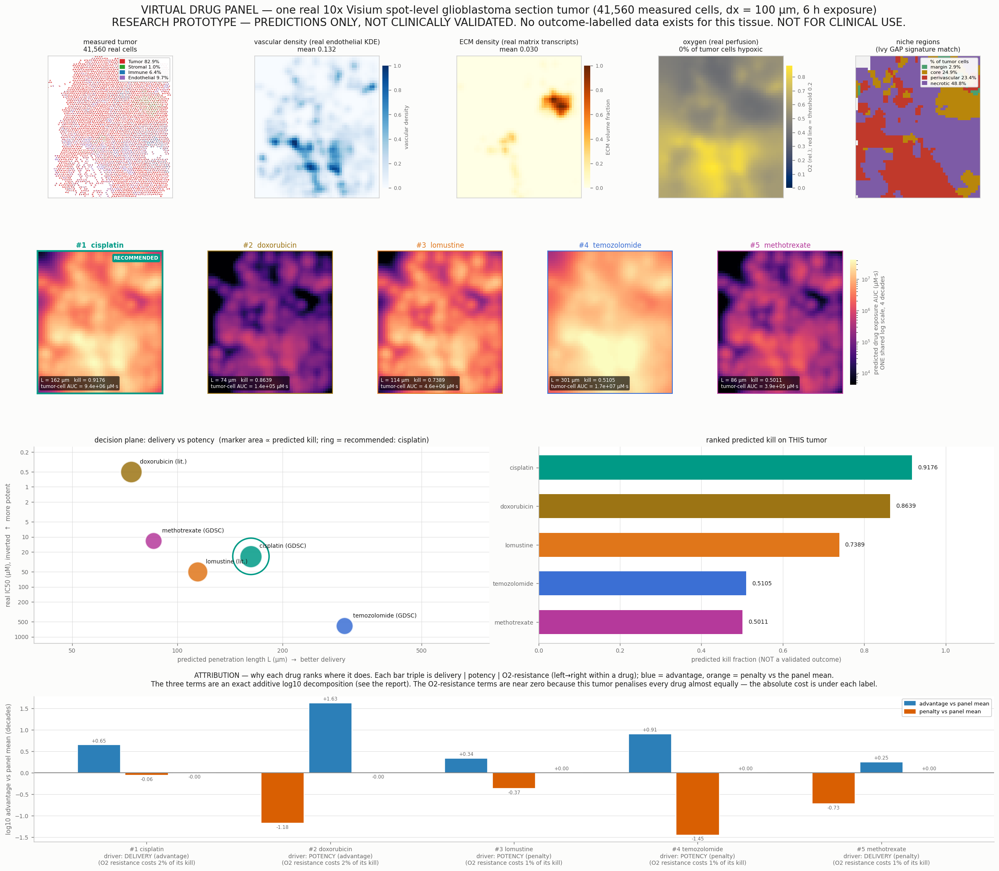

# Virtual drug panel — one real 10x Visium spot-level glioblastoma section

> **STALE ABSOLUTE NUMBERS — regenerate.** Every absolute exposure / AUC / coverage / kill
> figure below was generated with the **KDE** vascular source, which was the default until
> `results/vessel_promotion.md`. The default is now the **discrete** segmented-vessel source,
> whose tissue-integrated total is **3.36x smaller** (a change of *unit*, not of physics —
> the dose-matched geometry-only effect on coverage is <=0.0166). Relative orderings and
> per-drug contrasts here are largely unaffected; absolute levels are not. Reproduce with
> `mode='kde'` to recover exactly these numbers.

**Patient / sample id:** `visium:10x_parent_gbm` · **source:** `visium` · **grid:** 57×50 at dx = 100 µm · **extent:** 5000 × 5700 µm

**Generated by:** `experiments/patient_report.py` (`./.venv/bin/python experiments/patient_report.py --source visium`) · **figure:** `results/patient_report_visium.png`

> ## ⚠️ LIMITATIONS — READ BEFORE ANY OTHER NUMBER ON THIS PAGE
>
> **This is a research prototype. Every number in this report is a PREDICTION of a physical model. NOT FOR CLINICAL USE. Do not use it to select, rank, exclude, or dose any therapy for any patient.**
>
> 1. **The predictions are NOT clinically validated.** No prediction in this report has been compared against a measured treatment response, because none exists to compare against.
> 2. **No outcome-labelled data exists for this tissue.** The 10x Visium spot-level glioblastoma section is an **untreated resection**. There is no paired drug response for any of the five drugs, so the ranking below has never been scored and its accuracy is **unknown** — not 'good', not 'bad', unknown.
> 3. **Potency is measured in dissociated cells.** The IC50 values come from GDSC cell-line viability screens (dissociated glioma lines in monolayer) or from curated literature ranges. They carry none of this tumor's 3-D architecture, stromal/immune context, or intra-tumoral heterogeneity, and cell-line IC50 is a weak surrogate for in-patient sensitivity.
> 4. **`penetration_index` is resolution-sensitive.** Per `results/numerical_rigor.md` §2 it is *over-estimated on coarse grids* (≈0.285 at dx = 60 µm falling to ≈0.187 at dx = 10 µm) because a grid coarser than the ~45 µm perivascular boundary layer cannot resolve it. ⚠️ **This report was run at dx = 100 µm, which is NOT in the converged regime** — its `penetration_index` is an upper bound and is likely ~15–25% high. Re-run at dx ≤ 12 µm for a converged penetration number. `kill_fraction` *is* grid-converged for dx ≤ 20 µm.
> 5. **One measurement sets the absolute scale.** The perivascular sink constant α is fit to a *single* doxorubicin penetration measurement (~45 µm); every drug's absolute penetration rides on that one anchor, and the underlying binding proxy is a structure-based *ordering*, not a first-principles rate. A drug it mis-ranks (active transport, efflux, ion trapping) would be mis-predicted.
> 6. **Per-cell drug sensitivity is a placeholder.** The reconstruction carries a marker-scaled provisional `sensitivity`, not a measured per-cell drug response.
> 7. **Systemic PK is simplified.** A single time-averaged sustained plasma level drives the transport solve (documented Stage-0 simplification in `tmesim/sim/engine.py`); it preserves total delivered drug and relative ranking but is not a time-resolved infusion.

---

## 0. What this artifact is

One real patient's tumor tissue in, one **ranked, mechanistically attributed drug panel** out. The microenvironment is reconstructed **once** from measured spatial transcriptomics and reused for every drug, so every difference in the table below is attributable to that drug's own physics and potency acting on *identical* tissue — not to a different patient, a different geometry, or a different random draw.

| what | is it real? | provenance |
|---|:--:|---|
| cell positions & phenotypes | **real** | 41,560 measured cells, threshold-gated marker typing |
| vascular field | **real** | KDE of the measured ENDOTHELIAL cells |
| ECM field | **real** | expression-weighted KDE of measured matrix transcripts (stromal proxy) |
| oxygen field | **real-driven** | physics solver driven by the real vascular field |
| niche regions | **real** | Ivy GAP anatomic-region signature correlation |
| drug transport | **real physics** | structure-compiled diffusivity + α-calibrated perivascular sink (α = 148.6, fit once on doxorubicin, revalidated out-of-sample on mitoxantrone) |
| potency (IC50) | **real, but ex-vivo** | GDSC glioma cell-line screen, else curated literature — labelled per drug below |
| **treatment outcome** | ❌ **absent** | this tissue is an untreated resection; there is **no** measured response to score against |

---

## 1. Tumor microenvironment profile — the measured description of THIS tumor

### 1.1 Cell-type composition

| cell type | cells | fraction |
|---|---:|---:|
| Tumor | 34,434 | 82.85% |
| Stromal | 433 | 1.04% |
| Immune | 2,664 | 6.41% |
| Endothelial | 4,029 | 9.69% |
| **total** | **41,560** | 100% |

Tumor cells: **34,434** (82.9% of all measured cells).

### 1.2 Physical fields (over the tissue mask)

| field | mean | p10 | median | p90 | max |
|---|---:|---:|---:|---:|---:|
| vascular density | **0.132** | 0.002 | 0.079 | 0.340 | 1.000 |
| ECM volume fraction | **0.030** | 0.000 | 0.000 | 0.053 | 1.000 |
| oxygen (relative) | **0.597** | 0.431 | 0.582 | 0.782 | 0.880 |

Tissue mask covers 2,850 grid voxels (100.0% of the bounding box).

### 1.3 Hypoxia and the resistance state of the tumor cells

> **0.0% of this tumor's cells are hypoxic** (O₂ below the 0.2 threshold in the real-perfusion oxygen solve).

The oxygen solve bands every living tumor cell, and *both* the hypoxic and the marginal-oxygen quiescent band carry a kill penalty — so the full resistance picture, not just hypoxia, is what suppresses the panel:

| tumor-cell state | O₂ band | fraction | kill penalty |
|---|---|---:|---|
| VIABLE | O₂ ≥ 0.4 | 94.6% | none |
| QUIESCENT | 0.2 ≤ O₂ < 0.4 | 5.4% | ×0.5 |
| HYPOXIC | O₂ < 0.2 | 0.0% | ×0.35 |

So although only 0.0% of tumor cells are outright hypoxic, 5.4% carry *some* oxygen-driven resistance. §3 measures what that costs each drug by re-simulating with both penalties switched off.

> **Honest caveat on this number.** The hypoxic fraction is a threshold-crossing count sitting close to the O₂ cutoff, and it is **not grid-converged** — across this section it moves ≈94% (dx = 30 µm) → 36% (20) → 16% (15) → 13% (12) → 11% (10) → 7% (8 µm). Earlier characterisations of this section as 'deeply hypoxic (~94%)' were a coarse-grid artifact and are retracted (see `results/real_drug_panel.md`). Treat it as an order of magnitude only. `kill_fraction` is converged; this is not.

### 1.4 Niche-region breakdown

Each of 3,468 measured locations (measured in-tissue Visium spots (55 µm, 100 µm pitch)) is scored against the four Ivy GAP anatomic-region signatures over 283 shared genes and assigned to its best-correlating niche; every reconstructed cell inherits its nearest location's niche.

| niche region | locations | % of all cells | % of TUMOR cells |
|---|---:|---:|---:|
| margin | 90 | 2.6% | 2.9% |
| core | 786 | 22.6% | 24.9% |
| perivascular | 964 | 27.8% | 23.4% |
| necrotic | 1,628 | 47.0% | 48.8% |

*Read this honestly:* the niche assignment is a correlation to a bulk reference atlas (Ivy GAP) over the small set of genes shared with this assay's panel — it is a regional *prior*, not a histological read of this section.

---

## 2. Ranked virtual drug panel

> ### 🏁 Highest predicted kill on this tumor: **cisplatin** (0.9176)
> Dominant driver **DELIVERY (advantage)** · L = 162 µm · IC50 24.6 µM — GDSC **measured** (n=34 glioma lines) · tumor-cell exposure 9.4e+06 µM·s.
> 
> **This is a model output, not a recommendation.** It has never been checked against a measured response for this tissue or any other. Treat it as a hypothesis to test in the lab, nothing more.

All five drugs are simulated on the **same** reconstruction with the same 6 h exposure window, the same seed, and the same compilation pipeline (`calibrate_alpha` → `calibrated_drugparams` → `apply_barrier_to_drugparams`). Ranked by predicted kill fraction:

| # | drug | MW (Da) | real IC50 (µM) | IC50 source | BBB penetrance | D_eff (µm²/s) | penetration L (µm) | tumor-cell exposure AUC (µM·s) | tissue exposure AUC (µM·s) | penetration_index | **predicted kill** |
|---:|---|---:|---:|:--|---:|---:|---:|---:|---:|---:|---:|
| 1 | **cisplatin** | 298 | 24.6 | GDSC (measured) | 0.893 | 232 | 162 | 9.4e+06 | 8.97e+06 | 0.259 | **0.9176** |
| 2 | **doxorubicin** | 544 | 0.5 | literature | 0.051 | 181 | 74 | 1.39e+05 | 1.35e+05 | 0.209 | **0.8639** |
| 3 | **lomustine** | 234 | 50 | literature | 0.973 | 255 | 114 | 4.59e+06 | 4.41e+06 | 0.231 | **0.7389** |
| 4 | **temozolomide** | 194 | 606 | GDSC (measured) | 0.558 | 273 | 301 | 1.7e+07 | 1.62e+07 | 0.323 | **0.5105** |
| 5 | **methotrexate** | 454 | 12 | GDSC (measured) | 0.115 | 195 | 86 | 3.94e+05 | 3.82e+05 | 0.215 | **0.5011** |

**Column definitions.**

- **real IC50 / IC50 source** — measured median across GDSC glioma cell lines where the drug is screened, otherwise a curated literature anchor. Per-drug provenance:

  - `cisplatin` — **GDSC measured**, n=34 glioma cell lines. median across 34 glioma cell lines (GDSC2 Cisplatin); raw median LN_IC50=3.2007; ic50_uM=exp(median LN_IC50).
  - `doxorubicin` — **curated literature** (not measured in GDSC's glioma screen). Anthracycline; sub-micromolar in glioma cell lines (~0.1-1 uM). Poor BBB penetration limits clinical GBM use. Range from cancer cell-line viability screens (e.g. NCI-60 / GDSC anthracyclines).
  - `lomustine` — **curated literature** (not measured in GDSC's glioma screen). Nitrosourea (CCNU), oral GBM alkylator (PCV / lomustine arms); glioma cell-line IC50 tens of uM. Literature order-of-magnitude anchor.
  - `temozolomide` — **GDSC measured**, n=51 glioma cell lines. median across 51 glioma cell lines (GDSC2 Temozolomide); raw median LN_IC50=6.4070; ic50_uM=exp(median LN_IC50).
  - `methotrexate` — **GDSC measured**, n=49 glioma cell lines. median across 49 glioma cell lines (GDSC2 Methotrexate); raw median LN_IC50=2.4849; ic50_uM=exp(median LN_IC50).

- **BBB penetrance** — structure-derived fraction of the vascular concentration that crosses into tissue.
- **D_eff** — `D · (1 − 0.6·ECM)` evaluated at *this tumor's* mean ECM = 0.030, i.e. the diffusivity the PDE actually experiences here.
- **penetration L** — analytic reaction–diffusion length `L = √(D_eff / k_eff)` (µm) at this tumor's ECM; the grid-independent delivery metric. Compare against the calibrated ~45 µm perivascular boundary layer.
- **tumor-cell exposure AUC** — the exposure field sampled at this tumor's actual tumor-cell coordinates (what the cells that matter really see). **tissue exposure AUC** is the plain mean over the tissue mask.
- **penetration_index** — the solver's spatial-uniformity index. Resolution-sensitive; quoted here at the converged dx = 100 µm (see limitations).
- **predicted kill** — fraction of tumor cells killed. **A model output with no validation label.**

---

## 3. Why each drug ranks where it does — computed attribution

### 3.1 The method (an exact additive decomposition, not a story)

Predicted kill is driven by how much drug the tumor cells see relative to how much they need, then discounted by this tumor's own resistance state. Each drug's standing is decomposed into three **exactly additive log10 terms** ('decades'), each centred on the panel mean so `+` reads as advantage over the panel and `−` as penalty:

```
C_tumor_i = (mean AUC at this tumor's TUMOR-cell positions) / T_window   [µM]
drive_i   = C_tumor_i / IC50_i                                           [-]

delivery_i = log10 C_tumor_i - mean_j log10 C_tumor_j
potency_i  = -( log10 IC50_i - mean_j log10 IC50_j )
o2resist_i = log10 rho_i     - mean_j log10 rho_j

  rho_i = kill_i / kill_i(resistance OFF)   <- measured by a SECOND simulation
                                              of the same drug on the same
                                              tissue with hypoxia_resistance=1
                                              and quiescent_resistance=1

identity:  delivery_i + potency_i  ==  log10 drive_i - mean_j log10 drive_j
```

The **dominant driver** for a drug is the term of largest magnitude (labelled *advantage* or *penalty* by its sign). The reason for each **adjacent rank gap** is the term that differs most between the two drugs. Nothing here is asserted — the O₂-resistance term in particular comes from a real counterfactual simulation, which is why this experiment runs each drug twice. `rho_i` bundles the hypoxic *and* the quiescent kill penalty (both are switched off together), so it is named for the oxygen-driven resistance state as a whole, not hypoxia alone.

### 3.2 Attribution table (decades vs the panel mean)

| # | drug | delivery | potency | O₂-resist. | net | dominant driver | exposure pct | potency pct | O₂-resistance cost |
|---:|---|---:|---:|---:|---:|:--|---:|---:|---:|
| 1 | **cisplatin** | +0.65 | -0.06 | -0.00 | +0.59 | DELIVERY (advantage) | 75 | 50 | 2.3% |
| 2 | **doxorubicin** | -1.18 | +1.63 | -0.00 | +0.45 | POTENCY (advantage) | 0 | 100 | 1.9% |
| 3 | **lomustine** | +0.34 | -0.37 | +0.00 | -0.03 | POTENCY (penalty) | 50 | 25 | 1.4% |
| 4 | **temozolomide** | +0.91 | -1.45 | +0.00 | -0.54 | POTENCY (penalty) | 100 | 0 | 1.3% |
| 5 | **methotrexate** | -0.73 | +0.25 | +0.00 | -0.47 | DELIVERY (penalty) | 25 | 75 | 0.8% |

### 3.3 Is the attribution itself faithful? (falsifiability check)

An attribution that does not reproduce the thing it claims to explain is decoration. Spearman rank correlation, across the panel, between the **net attribution** and the **simulated kill**:

> **ρ(net attribution, predicted kill) = +0.900** → partially faithful — the decomposition captures the trend but not the exact ordering.

Component-wise: ρ(delivery, kill) = +0.000, ρ(potency, kill) = +0.200. With only 5 drugs a single ρ is a weak statistic — it is reported to be checkable, not because it is powerful.

### 3.4 Per-drug reading

### #1 · cisplatin — dominant driver: **DELIVERY (advantage)**

`predicted kill 0.9176` · `tumor-cell exposure 9.4e+06 µM·s (C̄ = 435 µM)` · `L = 162 µm` · `IC50 = 24.6 µM` · `BBB 0.893` · `D_eff 232 µm²/s`

- **Delivery +0.65 decades.** The mean drug exposure actually sampled at this tumor's own tumor-cell positions is 9.4e+06 µM·s over the 6 h window (time-averaged C̄ = 435 µM), the 75ᵗʰ percentile of the 5-drug panel. That follows from D_eff = 232 µm²/s at this tumor's mean ECM (0.030) and BBB penetrance 0.893, giving a penetration length L = 162 µm (3.6× the calibrated ~45 µm perivascular boundary layer, 75ᵗʰ percentile).
- **Potency -0.06 decades.** IC50 = 24.6 µM — GDSC **measured** (n=34 glioma lines) — the 50ᵗʰ percentile of the panel.
- **O₂-resistance -0.00 decades.** Counterfactual check: re-simulating this same drug on this same tissue with the hypoxic *and* quiescent kill penalties switched OFF raises the predicted kill from 0.9176 to 0.9396 — so this tumor's oxygen-driven resistance state (§1.3) costs this drug **2.3%** of the kill it would otherwise achieve (0ᵗʰ percentile — higher is less penalised). Note this term is nearly identical across the panel: it depresses every drug rather than re-ordering them.
- **Reading.** Its position is set mainly by **DELIVERY** (+0.65 decades), with potency (-0.06) second; the three terms net to +0.59 decades versus the panel average.
- **Why it ranks above the next drug.** Versus **doxorubicin** immediately below it, the term that differs most is **DELIVERY** (+1.83 decades ≈ 67.5× in its favour); the other terms differ by potency -1.69, o2-resistance -0.00.

### #2 · doxorubicin — dominant driver: **POTENCY (advantage)**

`predicted kill 0.8639` · `tumor-cell exposure 1.39e+05 µM·s (C̄ = 6.45 µM)` · `L = 74 µm` · `IC50 = 0.5 µM` · `BBB 0.051` · `D_eff 181 µm²/s`

- **Delivery -1.18 decades.** The mean drug exposure actually sampled at this tumor's own tumor-cell positions is 1.39e+05 µM·s over the 6 h window (time-averaged C̄ = 6.45 µM), the 0ᵗʰ percentile of the 5-drug panel. That follows from D_eff = 181 µm²/s at this tumor's mean ECM (0.030) and BBB penetrance 0.051, giving a penetration length L = 74 µm (1.6× the calibrated ~45 µm perivascular boundary layer, 0ᵗʰ percentile).
- **Potency +1.63 decades.** IC50 = 0.5 µM — curated **literature** — the 100ᵗʰ percentile of the panel.
- **O₂-resistance -0.00 decades.** Counterfactual check: re-simulating this same drug on this same tissue with the hypoxic *and* quiescent kill penalties switched OFF raises the predicted kill from 0.8639 to 0.8809 — so this tumor's oxygen-driven resistance state (§1.3) costs this drug **1.9%** of the kill it would otherwise achieve (25ᵗʰ percentile — higher is less penalised). Note this term is nearly identical across the panel: it depresses every drug rather than re-ordering them.
- **Reading.** Its position is set mainly by **POTENCY** (+1.63 decades), with delivery (-1.18) second; the three terms net to +0.45 decades versus the panel average.
- **Why it ranks above the next drug.** Versus **lomustine** immediately below it, the term that differs most is **POTENCY** (+2.00 decades ≈ 100.0× in its favour); the other terms differ by delivery -1.52, o2-resistance -0.00.

### #3 · lomustine — dominant driver: **POTENCY (penalty)**

`predicted kill 0.7389` · `tumor-cell exposure 4.59e+06 µM·s (C̄ = 213 µM)` · `L = 114 µm` · `IC50 = 50 µM` · `BBB 0.973` · `D_eff 255 µm²/s`

- **Delivery +0.34 decades.** The mean drug exposure actually sampled at this tumor's own tumor-cell positions is 4.59e+06 µM·s over the 6 h window (time-averaged C̄ = 213 µM), the 50ᵗʰ percentile of the 5-drug panel. That follows from D_eff = 255 µm²/s at this tumor's mean ECM (0.030) and BBB penetrance 0.973, giving a penetration length L = 114 µm (2.5× the calibrated ~45 µm perivascular boundary layer, 50ᵗʰ percentile).
- **Potency -0.37 decades.** IC50 = 50 µM — curated **literature** — the 25ᵗʰ percentile of the panel.
- **O₂-resistance +0.00 decades.** Counterfactual check: re-simulating this same drug on this same tissue with the hypoxic *and* quiescent kill penalties switched OFF raises the predicted kill from 0.7389 to 0.7493 — so this tumor's oxygen-driven resistance state (§1.3) costs this drug **1.4%** of the kill it would otherwise achieve (50ᵗʰ percentile — higher is less penalised). Note this term is nearly identical across the panel: it depresses every drug rather than re-ordering them.
- **Reading.** Its position is set mainly by **POTENCY** (-0.37 decades), with delivery (+0.34) second; the three terms net to -0.03 decades versus the panel average.
- **Why it ranks above the next drug.** Versus **temozolomide** immediately below it, the term that differs most is **POTENCY** (+1.08 decades ≈ 12.1× in its favour); the other terms differ by delivery -0.57, o2-resistance -0.00.

### #4 · temozolomide — dominant driver: **POTENCY (penalty)**

`predicted kill 0.5105` · `tumor-cell exposure 1.7e+07 µM·s (C̄ = 788 µM)` · `L = 301 µm` · `IC50 = 606 µM` · `BBB 0.558` · `D_eff 273 µm²/s`

- **Delivery +0.91 decades.** The mean drug exposure actually sampled at this tumor's own tumor-cell positions is 1.7e+07 µM·s over the 6 h window (time-averaged C̄ = 788 µM), the 100ᵗʰ percentile of the 5-drug panel. That follows from D_eff = 273 µm²/s at this tumor's mean ECM (0.030) and BBB penetrance 0.558, giving a penetration length L = 301 µm (6.7× the calibrated ~45 µm perivascular boundary layer, 100ᵗʰ percentile).
- **Potency -1.45 decades.** IC50 = 606 µM — GDSC **measured** (n=51 glioma lines) — the 0ᵗʰ percentile of the panel.
- **O₂-resistance +0.00 decades.** Counterfactual check: re-simulating this same drug on this same tissue with the hypoxic *and* quiescent kill penalties switched OFF raises the predicted kill from 0.5105 to 0.5171 — so this tumor's oxygen-driven resistance state (§1.3) costs this drug **1.3%** of the kill it would otherwise achieve (75ᵗʰ percentile — higher is less penalised). Note this term is nearly identical across the panel: it depresses every drug rather than re-ordering them.
- **Reading.** Its position is set mainly by **POTENCY** (-1.45 decades), with delivery (+0.91) second; the three terms net to -0.54 decades versus the panel average.
- **Why it ranks above the next drug.** Versus **methotrexate** immediately below it, the term that differs most is **POTENCY** (-1.70 decades ≈ 50.5× against it); the other terms differ by delivery +1.64, o2-resistance -0.00.

### #5 · methotrexate — dominant driver: **DELIVERY (penalty)**

`predicted kill 0.5011` · `tumor-cell exposure 3.94e+05 µM·s (C̄ = 18.3 µM)` · `L = 86 µm` · `IC50 = 12 µM` · `BBB 0.115` · `D_eff 195 µm²/s`

- **Delivery -0.73 decades.** The mean drug exposure actually sampled at this tumor's own tumor-cell positions is 3.94e+05 µM·s over the 6 h window (time-averaged C̄ = 18.3 µM), the 25ᵗʰ percentile of the 5-drug panel. That follows from D_eff = 195 µm²/s at this tumor's mean ECM (0.030) and BBB penetrance 0.115, giving a penetration length L = 86 µm (1.9× the calibrated ~45 µm perivascular boundary layer, 25ᵗʰ percentile).
- **Potency +0.25 decades.** IC50 = 12 µM — GDSC **measured** (n=49 glioma lines) — the 75ᵗʰ percentile of the panel.
- **O₂-resistance +0.00 decades.** Counterfactual check: re-simulating this same drug on this same tissue with the hypoxic *and* quiescent kill penalties switched OFF raises the predicted kill from 0.5011 to 0.5049 — so this tumor's oxygen-driven resistance state (§1.3) costs this drug **0.8%** of the kill it would otherwise achieve (100ᵗʰ percentile — higher is less penalised). Note this term is nearly identical across the panel: it depresses every drug rather than re-ordering them.
- **Reading.** Its position is set mainly by **DELIVERY** (-0.73 decades), with potency (+0.25) second; the three terms net to -0.47 decades versus the panel average.
- **Why it ranks last.** Versus **temozolomide** immediately above it, the term that differs most is **POTENCY** (+1.70 decades for this drug ≈ 50.5× in its favour); its other terms stand at delivery -1.64, o2-resistance +0.00 relative to that drug.

---

## 4. Decision panel figure



`results/patient_report_visium.png` — row 1: the measured tumor (cell types, vascular density, ECM density, oxygen with the hypoxia threshold contoured, niche regions). Row 2: the predicted exposure (AUC) map for each drug on that same tissue, in ranked order on one shared colour scale, with the top-ranked drug ringed. Row 3: the decision plane (penetration length vs IC50, marker area ∝ predicted kill) and the ranked kill bars. Row 4: the attribution decomposition above.

---

## 5. What would have to be true for this to be trustworthy

State this plainly, because the report is otherwise easy to over-read:

1. **A tissue with a paired, measured drug response.** Everything here is unfalsifiable until a tumor with a known outcome is run through the identical pipeline and the predicted ranking is scored against the observed one.
2. **A potency measurement in context.** Cell-line IC50 must be replaced by (or at minimum reconciled with) a 3-D / organoid / patient-derived measurement from tissue resembling this one.
3. **More than one penetration anchor.** α currently rides on a single doxorubicin measurement; independent per-drug perivascular-distance data would test whether the ordering transfers outside the strongly-bound class.
4. **A measured per-cell sensitivity**, replacing the provisional marker-scaled placeholder.

Until then the correct reading of this artifact is: *this is what validated transport physics and measured ex-vivo potency predict on this specific measured geometry* — a hypothesis generator, not a decision.

---

> ## ⚠️ LIMITATIONS — READ BEFORE ANY OTHER NUMBER ON THIS PAGE
>
> **This is a research prototype. Every number in this report is a PREDICTION of a physical model. NOT FOR CLINICAL USE. Do not use it to select, rank, exclude, or dose any therapy for any patient.**
>
> 1. **The predictions are NOT clinically validated.** No prediction in this report has been compared against a measured treatment response, because none exists to compare against.
> 2. **No outcome-labelled data exists for this tissue.** The 10x Visium spot-level glioblastoma section is an **untreated resection**. There is no paired drug response for any of the five drugs, so the ranking below has never been scored and its accuracy is **unknown** — not 'good', not 'bad', unknown.
> 3. **Potency is measured in dissociated cells.** The IC50 values come from GDSC cell-line viability screens (dissociated glioma lines in monolayer) or from curated literature ranges. They carry none of this tumor's 3-D architecture, stromal/immune context, or intra-tumoral heterogeneity, and cell-line IC50 is a weak surrogate for in-patient sensitivity.
> 4. **`penetration_index` is resolution-sensitive.** Per `results/numerical_rigor.md` §2 it is *over-estimated on coarse grids* (≈0.285 at dx = 60 µm falling to ≈0.187 at dx = 10 µm) because a grid coarser than the ~45 µm perivascular boundary layer cannot resolve it. ⚠️ **This report was run at dx = 100 µm, which is NOT in the converged regime** — its `penetration_index` is an upper bound and is likely ~15–25% high. Re-run at dx ≤ 12 µm for a converged penetration number. `kill_fraction` *is* grid-converged for dx ≤ 20 µm.
> 5. **One measurement sets the absolute scale.** The perivascular sink constant α is fit to a *single* doxorubicin penetration measurement (~45 µm); every drug's absolute penetration rides on that one anchor, and the underlying binding proxy is a structure-based *ordering*, not a first-principles rate. A drug it mis-ranks (active transport, efflux, ion trapping) would be mis-predicted.
> 6. **Per-cell drug sensitivity is a placeholder.** The reconstruction carries a marker-scaled provisional `sensitivity`, not a measured per-cell drug response.
> 7. **Systemic PK is simplified.** A single time-averaged sustained plasma level drives the transport solve (documented Stage-0 simplification in `tmesim/sim/engine.py`); it preserves total delivered drug and relative ranking but is not a time-resolved infusion.

*Generated 2026-07-27 16:29:15 by `experiments/patient_report.py` in 68 s. Deterministic (seed 0) — re-running reproduces this file.*
