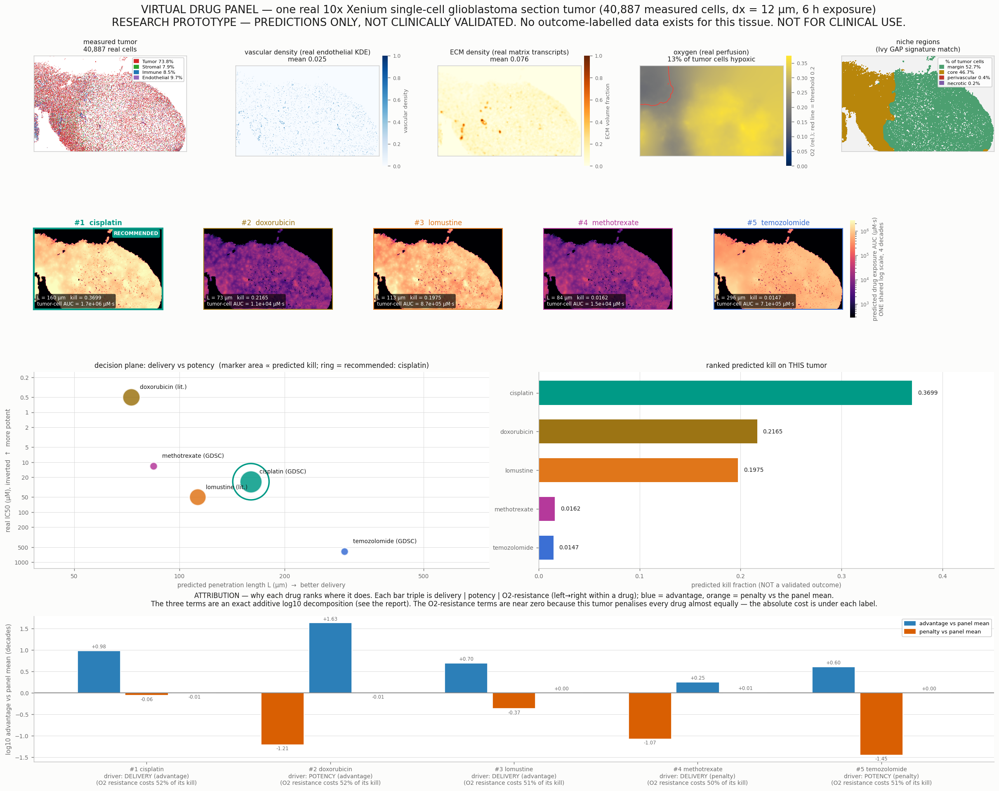

# Virtual drug panel — one real 10x Xenium single-cell glioblastoma section

> **Regenerated under the discrete vessel source.** `vascular_mode = discrete`
> (`reconstruct.real_fields._DEFAULT_VASCULAR_MODE`, promoted in
> [`results/vessel_promotion.md`](vessel_promotion.md)) · **alpha = 148.6**, the
> e-folding-length convention `L = d_half / ln 2` · per-cell sensitivity mode =
> **`uniform`** · **dx = 12 µm**.
>
> Every absolute exposure / AUC / coverage / kill below is on the **discrete-source
> unit** and is NOT comparable with the KDE-era numbers this file carried before this
> regeneration (the tissue-integrated source total is 3.36x smaller; that is a change
> of *unit*, not of physics — the dose-matched, geometry-only effect on coverage is
> <= 0.0166). To recover the old numbers, re-run with `mode='kde'`.
>
> Regenerated in the same pass as `results/real_drug_panel.md`; the two agree drug-for-drug. The kill ordering is unchanged from the KDE-era file (cisplatin > doxorubicin > lomustine > methotrexate > temozolomide).

**Patient / sample id:** `xenium-gbm-real` · **source:** `xenium` · **grid:** 424×675 at dx = 12 µm · **extent:** 8100 × 5088 µm

**Generated by:** `experiments/patient_report.py` (`./.venv/bin/python experiments/patient_report.py --source xenium`) · **figure:** `results/patient_report_xenium.png`

**Run provenance:** perivascular-sink calibration **α = 148.6** (e-folding-length convention `L = d_half/ln 2`; the retired α = 309.6 fitted the raw half-distance as if it were an e-fold length and is superseded) · per-cell sensitivity **`mode='uniform'`** (identical for every drug → the cross-drug ranking is fair; absolute kills are a no-resistance upper bound) · tissue mask **geometric** (union of 30 µm discs around the measured centroids, 67.7% coverage) — **dx-independent**, replacing the old grid-dependent occupancy mask.

> ## ⚠️ LIMITATIONS — READ BEFORE ANY OTHER NUMBER ON THIS PAGE
>
> **This is a research prototype. Every number in this report is a PREDICTION of a physical model. NOT FOR CLINICAL USE. Do not use it to select, rank, exclude, or dose any therapy for any patient.**
>
> 1. **The predictions are NOT clinically validated.** No prediction in this report has been compared against a measured treatment response, because none exists to compare against.
> 2. **No outcome-labelled data exists for this tissue.** The 10x Xenium single-cell glioblastoma section is an **untreated resection**. There is no paired drug response for any of the five drugs, so the ranking below has never been scored and its accuracy is **unknown** — not 'good', not 'bad', unknown.
> 3. **Potency is measured in dissociated cells.** The IC50 values come from GDSC cell-line viability screens (dissociated glioma lines in monolayer) or from curated literature ranges. They carry none of this tumor's 3-D architecture, stromal/immune context, or intra-tumoral heterogeneity, and cell-line IC50 is a weak surrogate for in-patient sensitivity.
> 4. **`penetration_index` is resolution-sensitive.** Per `results/numerical_rigor.md` §2 it is *over-estimated on coarse grids* (≈0.285 at dx = 60 µm falling to ≈0.187 at dx = 10 µm) because a grid coarser than the ~45 µm perivascular boundary layer cannot resolve it. This report runs at **dx = 12 µm**, inside the converged regime; any penetration number quoted at dx ≳ 20 µm should be read as an upper bound. `kill_fraction` *is* grid-converged for dx ≤ 20 µm.
> 5. **One measurement sets the absolute scale.** The perivascular sink constant α is fit to a *single* doxorubicin penetration measurement (a 40–50 µm half-distance, converted to the e-folding length L = d_half/ln2 ≈ 65 µm); every drug's absolute penetration rides on that one anchor, and the underlying binding proxy is a structure-based *ordering*, not a first-principles rate. A drug it mis-ranks (active transport, efflux, ion trapping) would be mis-predicted.
> 6. **Per-cell drug sensitivity is an assumption, not a measurement — and this ranking was produced in `mode='uniform'`.** Every drug carries uniform `sensitivity` = 1.0, so no intrinsic resistance is asserted for any of them. That is deliberate: it is the only setting in which a *cross-drug ranking* is fair, because an identical factor cancels out of the comparison. The price is that every **absolute** kill below is a no-resistance **upper bound**. The alternative `mode='determinant'` scales each drug by its own measured panel determinant where one exists (TOP2A for doxorubicin, an MKI67 proliferation proxy for cisplatin / lomustine / methotrexate, both ≈0.585 here) — but temozolomide's determinant **MGMT is absent from this panel**, so in that mode TMZ alone stays at 1.0 and gains ~1.7× on its competitors for a purely technical reason. That is an artifact, not efficacy; both rankings are printed side by side in `results/real_drug_panel.md`. No absolute kill fraction here is a measured per-cell drug response.
> 8. **The tissue mask was grid-dependent and has been fixed; every earlier hypoxia number from this pipeline is retracted.** `Domain.tissue_mask` used to be "grid cells containing ≥ 1 segmented cell", whose coverage collapsed 50.6% → 32.7% → 13.9% at dx = 30 → 20 → 12 µm; because the vascular KDE is masked to tissue, the total O₂ *supply* shrank with the mesh. It is now the union of 30 µm discs around the measured centroids (coverage 67.2/67.4/67.7% over the same grids), so mean O₂ is grid-invariant to ~2%. The consequence is reported honestly in §1.3: the predicted hypoxic fraction is now 0%, which for a glioblastoma is *also* not credible — the un-calibrated `OxygenConfig.consumption` means the absolute oxygen level is unanchored in both directions. Nothing in this report should rest on it.
> 7. **Systemic PK is simplified.** A single time-averaged sustained plasma level drives the transport solve (documented Stage-0 simplification in `tmesim/sim/engine.py`); it preserves total delivered drug and relative ranking but is not a time-resolved infusion.

---

## 0. What this artifact is

One real patient's tumor tissue in, one **ranked, mechanistically attributed drug panel** out. The microenvironment is reconstructed **once** from measured spatial transcriptomics and reused for every drug, so every difference in the table below is attributable to that drug's own physics and potency acting on *identical* tissue — not to a different patient, a different geometry, or a different random draw.

| what | is it real? | provenance |
|---|:--:|---|
| cell positions & phenotypes | **real** | 40,887 measured cells, threshold-gated marker typing |
| vascular field | **real** | KDE of the measured ENDOTHELIAL cells |
| ECM field | **real** | expression-weighted KDE of measured matrix transcripts (COL1A2, COL12A1, COL25A1, POSTN, VCAN, DCN, FBLN1, LAMA2, THBS1, SPON1, TGFBI) |
| oxygen field | **real-driven** | physics solver driven by the real vascular field |
| niche regions | **real** | Ivy GAP anatomic-region signature correlation |
| drug transport | **real physics** | structure-compiled diffusivity + α-calibrated perivascular sink (α = 148.6, fit once on doxorubicin, revalidated out-of-sample on mitoxantrone) |
| potency (IC50) | **real, but ex-vivo** | GDSC glioma cell-line screen, else curated literature — labelled per drug below |
| **treatment outcome** | ❌ **absent** | this tissue is an untreated resection; there is **no** measured response to score against |

---

## 1. Tumor microenvironment profile — the measured description of THIS tumor

### 1.1 Cell-type composition

| cell type | cells | fraction |
|---|---:|---:|
| Tumor | 30,174 | 73.80% |
| Stromal | 3,239 | 7.92% |
| Immune | 3,490 | 8.54% |
| Endothelial | 3,984 | 9.74% |
| **total** | **40,887** | 100% |

Tumor cells: **30,174** (73.8% of all measured cells).

### 1.2 Physical fields (over the tissue mask)

| field | mean | p10 | median | p90 | max |
|---|---:|---:|---:|---:|---:|
| vascular density | **0.025** | 0.000 | 0.000 | 0.000 | 1.000 |
| ECM volume fraction | **0.076** | 0.033 | 0.067 | 0.119 | 1.000 |
| oxygen (relative) | **0.295** | 0.200 | 0.326 | 0.353 | 0.375 |

Tissue mask covers 193,752 grid voxels (67.7% of the bounding box).

### 1.3 Hypoxia and the resistance state of the tumor cells

> **12.7% of this tumor's cells are hypoxic** (O₂ below the 0.2 threshold in the real-perfusion oxygen solve).

The oxygen solve bands every living tumor cell, and *both* the hypoxic and the marginal-oxygen quiescent band carry a kill penalty — so the full resistance picture, not just hypoxia, is what suppresses the panel:

| tumor-cell state | O₂ band | fraction | kill penalty |
|---|---|---:|---|
| VIABLE | O₂ ≥ 0.4 | 0.0% | none |
| QUIESCENT | 0.2 ≤ O₂ < 0.4 | 87.3% | ×0.5 |
| HYPOXIC | O₂ < 0.2 | 12.7% | ×0.35 |

So although only 12.7% of tumor cells are outright hypoxic, 100.0% carry *some* oxygen-driven resistance. §3 measures what that costs each drug by re-simulating with both penalties switched off.

> **Honest caveat on this number — read it before using it.** The hypoxic fraction is a threshold-crossing count sitting close to the O₂ cutoff, and this simulator does not currently predict it reliably.
>
> *What changed.* `Domain.tissue_mask` used to be "grid cells containing ≥ 1 segmented cell", whose coverage collapsed 50.6% → 32.7% → 13.9% at dx = 30 → 20 → 12 µm. Because `real_fields._kde_on_grid` masks the vascular field to tissue, the total O₂ **supply** shrank as the mesh was refined, and the hypoxic fraction moved with it (≈94% → 36% → 16% → 13% → 11% → 7% over dx = 30 → 8 µm). **That entire ladder is a discretisation artifact and is retracted.** The mask is now *geometric* — the union of 30 µm discs around the measured centroids — covering 67.2/67.4/67.7% at dx = 30/20/12 µm, so mean O₂ at the measured cell positions is now invariant (0.570 / 0.565 / 0.558, a 1.02× spread) where it previously ran 0.522 / 0.426 / 0.251 (2.08×).
>
> *What that leaves.* With the supply no longer artificially starved, **no tumor cell falls below the 0.2 threshold at any dx — the predicted hypoxic fraction is 0.0%.** For a glioblastoma, a tumor type partly *defined* by pseudopalisading necrosis, that is not credible either. `OxygenConfig.consumption` has never been calibrated against a measured oxygen tension, so the absolute level is unanchored in both directions: the old numbers were too high for a numerical reason, and this one is plausibly too low for a calibration reason. **The honest position is that the hypoxic fraction of this section is currently unknown to this model.** What the fix does establish is that the answer no longer depends on the mesh. `kill_fraction` is grid-converged; this is not calibrated.

### 1.4 Niche-region breakdown

Each of 2,786 measured locations (pooled 100 µm × 100 µm neighbourhoods of ≥ 5 measured cells) is scored against the four Ivy GAP anatomic-region signatures over 41 shared genes and assigned to its best-correlating niche; every reconstructed cell inherits its nearest location's niche.

| niche region | locations | % of all cells | % of TUMOR cells |
|---|---:|---:|---:|
| margin | 1,867 | 53.3% | 52.7% |
| core | 901 | 45.8% | 46.7% |
| perivascular | 14 | 0.7% | 0.4% |
| necrotic | 4 | 0.2% | 0.2% |

*Read this honestly:* the niche assignment is a correlation to a bulk reference atlas (Ivy GAP) over the small set of genes shared with this assay's panel — it is a regional *prior*, not a histological read of this section.

---

## 2. Ranked virtual drug panel

> ### 🏁 Highest predicted kill on this tumor: **cisplatin** (0.3699)
> Dominant driver **DELIVERY (advantage)** · L = 160 µm · IC50 24.6 µM — GDSC **measured** (n=34 glioma lines) · tumor-cell exposure 1.69e+06 µM·s.
> 
> **This is a model output, not a recommendation.** It has never been checked against a measured response for this tissue or any other. Treat it as a hypothesis to test in the lab, nothing more.

All five drugs are simulated on the **same** reconstruction with the same 6 h exposure window, the same seed, and the same compilation pipeline (`calibrate_alpha` → `calibrated_drugparams` → `apply_barrier_to_drugparams`). Ranked by predicted kill fraction:

> **This ranking was produced in per-cell sensitivity `mode='uniform'`** — every drug carries sensitivity 1.0, so the factor is identical across drugs and cancels out of the comparison. That is what makes the ordering a fair delivery × potency contest; it also makes each **absolute** kill a no-resistance upper bound. The drug-specific `determinant` mode would scale doxorubicin (TOP2A) and cisplatin / lomustine / methotrexate (MKI67 proxy) down to ≈0.585 while leaving temozolomide at 1.0 — because TMZ's determinant MGMT is not on this panel — which flatters TMZ ~1.7× for a measurement-coverage reason rather than a pharmacological one. Both rankings are tabulated in [`results/real_drug_panel.md`](real_drug_panel.md).

| # | drug | MW (Da) | real IC50 (µM) | IC50 source | BBB penetrance | D_eff (µm²/s) | penetration L (µm) | tumor-cell exposure AUC (µM·s) | tissue exposure AUC (µM·s) | penetration_index | **predicted kill** |
|---:|---|---:|---:|:--|---:|---:|---:|---:|---:|---:|---:|
| 1 | **cisplatin** | 298 | 24.6 | GDSC (measured) | 0.858 | 225 | 160 | 1.69e+06 | 1.63e+06 | 0.420 | **0.3699** |
| 2 | **doxorubicin** | 544 | 0.5 | literature | 0.021 | 176 | 73 | 1.08e+04 | 1.03e+04 | 0.310 | **0.2165** |
| 3 | **lomustine** | 234 | 50 | literature | 0.973 | 247 | 113 | 8.7e+05 | 8.35e+05 | 0.370 | **0.1975** |
| 4 | **methotrexate** | 454 | 12 | GDSC (measured) | 0.023 | 190 | 84 | 1.48e+04 | 1.41e+04 | 0.331 | **0.0162** |
| 5 | **temozolomide** | 194 | 606 | GDSC (measured) | 0.125 | 265 | 296 | 7.06e+05 | 6.86e+05 | 0.470 | **0.0147** |

**Column definitions.**

- **real IC50 / IC50 source** — measured median across GDSC glioma cell lines where the drug is screened, otherwise a curated literature anchor. Per-drug provenance:

  - `cisplatin` — **GDSC measured**, n=34 glioma cell lines. median across 34 glioma cell lines (GDSC2 Cisplatin); raw median LN_IC50=3.2007; ic50_uM=exp(median LN_IC50).
  - `doxorubicin` — **curated literature** (not measured in GDSC's glioma screen). Anthracycline; sub-micromolar in glioma cell lines (~0.1-1 uM). Poor BBB penetration limits clinical GBM use. Range from cancer cell-line viability screens (e.g. NCI-60 / GDSC anthracyclines).
  - `lomustine` — **curated literature** (not measured in GDSC's glioma screen). Nitrosourea (CCNU), oral GBM alkylator (PCV / lomustine arms); glioma cell-line IC50 tens of uM. Literature order-of-magnitude anchor.
  - `methotrexate` — **GDSC measured**, n=49 glioma cell lines. median across 49 glioma cell lines (GDSC2 Methotrexate); raw median LN_IC50=2.4849; ic50_uM=exp(median LN_IC50).
  - `temozolomide` — **GDSC measured**, n=51 glioma cell lines. median across 51 glioma cell lines (GDSC2 Temozolomide); raw median LN_IC50=6.4070; ic50_uM=exp(median LN_IC50).

- **BBB penetrance** — structure-derived fraction of the vascular concentration that crosses into tissue.
- **D_eff** — `D · (1 − 0.6·ECM)` evaluated at *this tumor's* mean ECM = 0.076, i.e. the diffusivity the PDE actually experiences here.
- **penetration L** — analytic reaction–diffusion length `L = √(D_eff / k_eff)` (µm) at this tumor's ECM; the grid-independent delivery metric. Compare against the calibrated ~45 µm perivascular boundary layer.
- **tumor-cell exposure AUC** — the exposure field sampled at this tumor's actual tumor-cell coordinates (what the cells that matter really see). **tissue exposure AUC** is the plain mean over the tissue mask.
- **penetration_index** — the solver's spatial-uniformity index. Resolution-sensitive; quoted here at the converged dx = 12 µm (see limitations).
- **predicted kill** — fraction of tumor cells killed. **A model output with no validation label.**

---

## 3. Why each drug ranks where it does — computed attribution

### 3.1 The method (an exact additive decomposition, not a story)

Predicted kill is driven by how much drug the tumor cells see relative to how much they need, then discounted by this tumor's own resistance state. Each drug's standing is decomposed into three **exactly additive log10 terms** ('decades'), each centred on the panel mean so `+` reads as advantage over the panel and `−` as penalty:

```
C_tumor_i = (mean AUC at this tumor's TUMOR-cell positions) / T_window   [µM]
drive_i   = C_tumor_i / IC50_i                                           [-]

delivery_i = log10 C_tumor_i - mean_j log10 C_tumor_j
potency_i  = -( log10 IC50_i - mean_j log10 IC50_j )
o2resist_i = log10 rho_i     - mean_j log10 rho_j

  rho_i = kill_i / kill_i(resistance OFF)   <- measured by a SECOND simulation
                                              of the same drug on the same
                                              tissue with hypoxia_resistance=1
                                              and quiescent_resistance=1

identity:  delivery_i + potency_i  ==  log10 drive_i - mean_j log10 drive_j
```

The **dominant driver** for a drug is the term of largest magnitude (labelled *advantage* or *penalty* by its sign). The reason for each **adjacent rank gap** is the term that differs most between the two drugs. Nothing here is asserted — the O₂-resistance term in particular comes from a real counterfactual simulation, which is why this experiment runs each drug twice. `rho_i` bundles the hypoxic *and* the quiescent kill penalty (both are switched off together), so it is named for the oxygen-driven resistance state as a whole, not hypoxia alone.

### 3.2 Attribution table (decades vs the panel mean)

| # | drug | delivery | potency | O₂-resist. | net | dominant driver | exposure pct | potency pct | O₂-resistance cost |
|---:|---|---:|---:|---:|---:|:--|---:|---:|---:|
| 1 | **cisplatin** | +0.98 | -0.06 | -0.01 | +0.91 | DELIVERY (advantage) | 100 | 50 | 52.4% |
| 2 | **doxorubicin** | -1.21 | +1.63 | -0.01 | +0.42 | POTENCY (advantage) | 0 | 100 | 52.0% |
| 3 | **lomustine** | +0.70 | -0.37 | +0.00 | +0.33 | DELIVERY (advantage) | 75 | 25 | 51.3% |
| 4 | **methotrexate** | -1.07 | +0.25 | +0.01 | -0.81 | DELIVERY (penalty) | 25 | 75 | 50.2% |
| 5 | **temozolomide** | +0.60 | -1.45 | +0.00 | -0.84 | POTENCY (penalty) | 50 | 0 | 50.8% |

### 3.3 Is the attribution itself faithful? (falsifiability check)

An attribution that does not reproduce the thing it claims to explain is decoration. Spearman rank correlation, across the panel, between the **net attribution** and the **simulated kill**:

> **ρ(net attribution, predicted kill) = +1.000** → faithful — the decomposition reproduces the simulator's own ranking.

Component-wise: ρ(delivery, kill) = +0.300, ρ(potency, kill) = +0.500. With only 5 drugs a single ρ is a weak statistic — it is reported to be checkable, not because it is powerful.

### 3.4 Per-drug reading

### #1 · cisplatin — dominant driver: **DELIVERY (advantage)**

`predicted kill 0.3699` · `tumor-cell exposure 1.69e+06 µM·s (C̄ = 78.3 µM)` · `L = 160 µm` · `IC50 = 24.6 µM` · `BBB 0.858` · `D_eff 225 µm²/s`

- **Delivery +0.98 decades.** The mean drug exposure actually sampled at this tumor's own tumor-cell positions is 1.69e+06 µM·s over the 6 h window (time-averaged C̄ = 78.3 µM), the 100ᵗʰ percentile of the 5-drug panel. That follows from D_eff = 225 µm²/s at this tumor's mean ECM (0.076) and BBB penetrance 0.858, giving a penetration length L = 160 µm (3.6× the calibrated ~45 µm perivascular boundary layer, 75ᵗʰ percentile).
- **Potency -0.06 decades.** IC50 = 24.6 µM — GDSC **measured** (n=34 glioma lines) — the 50ᵗʰ percentile of the panel.
- **O₂-resistance -0.01 decades.** Counterfactual check: re-simulating this same drug on this same tissue with the hypoxic *and* quiescent kill penalties switched OFF raises the predicted kill from 0.3699 to 0.7763 — so this tumor's oxygen-driven resistance state (§1.3) costs this drug **52.4%** of the kill it would otherwise achieve (0ᵗʰ percentile — higher is less penalised). Note this term is nearly identical across the panel: it depresses every drug rather than re-ordering them.
- **Reading.** Its position is set mainly by **DELIVERY** (+0.98 decades), with potency (-0.06) second; the three terms net to +0.91 decades versus the panel average.
- **Why it ranks above the next drug.** Versus **doxorubicin** immediately below it, the term that differs most is **DELIVERY** (+2.19 decades ≈ 156.1× in its favour); the other terms differ by potency -1.69, o2-resistance -0.00.

### #2 · doxorubicin — dominant driver: **POTENCY (advantage)**

`predicted kill 0.2165` · `tumor-cell exposure 1.08e+04 µM·s (C̄ = 0.501 µM)` · `L = 73 µm` · `IC50 = 0.5 µM` · `BBB 0.021` · `D_eff 176 µm²/s`

- **Delivery -1.21 decades.** The mean drug exposure actually sampled at this tumor's own tumor-cell positions is 1.08e+04 µM·s over the 6 h window (time-averaged C̄ = 0.501 µM), the 0ᵗʰ percentile of the 5-drug panel. That follows from D_eff = 176 µm²/s at this tumor's mean ECM (0.076) and BBB penetrance 0.021, giving a penetration length L = 73 µm (1.6× the calibrated ~45 µm perivascular boundary layer, 0ᵗʰ percentile).
- **Potency +1.63 decades.** IC50 = 0.5 µM — curated **literature** — the 100ᵗʰ percentile of the panel.
- **O₂-resistance -0.01 decades.** Counterfactual check: re-simulating this same drug on this same tissue with the hypoxic *and* quiescent kill penalties switched OFF raises the predicted kill from 0.2165 to 0.4512 — so this tumor's oxygen-driven resistance state (§1.3) costs this drug **52.0%** of the kill it would otherwise achieve (25ᵗʰ percentile — higher is less penalised). Note this term is nearly identical across the panel: it depresses every drug rather than re-ordering them.
- **Reading.** Its position is set mainly by **POTENCY** (+1.63 decades), with delivery (-1.21) second; the three terms net to +0.42 decades versus the panel average.
- **Why it ranks above the next drug.** Versus **lomustine** immediately below it, the term that differs most is **POTENCY** (+2.00 decades ≈ 100.0× in its favour); the other terms differ by delivery -1.90, o2-resistance -0.01.

### #3 · lomustine — dominant driver: **DELIVERY (advantage)**

`predicted kill 0.1975` · `tumor-cell exposure 8.7e+05 µM·s (C̄ = 40.3 µM)` · `L = 113 µm` · `IC50 = 50 µM` · `BBB 0.973` · `D_eff 247 µm²/s`

- **Delivery +0.70 decades.** The mean drug exposure actually sampled at this tumor's own tumor-cell positions is 8.7e+05 µM·s over the 6 h window (time-averaged C̄ = 40.3 µM), the 75ᵗʰ percentile of the 5-drug panel. That follows from D_eff = 247 µm²/s at this tumor's mean ECM (0.076) and BBB penetrance 0.973, giving a penetration length L = 113 µm (2.5× the calibrated ~45 µm perivascular boundary layer, 50ᵗʰ percentile).
- **Potency -0.37 decades.** IC50 = 50 µM — curated **literature** — the 25ᵗʰ percentile of the panel.
- **O₂-resistance +0.00 decades.** Counterfactual check: re-simulating this same drug on this same tissue with the hypoxic *and* quiescent kill penalties switched OFF raises the predicted kill from 0.1975 to 0.4052 — so this tumor's oxygen-driven resistance state (§1.3) costs this drug **51.3%** of the kill it would otherwise achieve (50ᵗʰ percentile — higher is less penalised). Note this term is nearly identical across the panel: it depresses every drug rather than re-ordering them.
- **Reading.** Its position is set mainly by **DELIVERY** (+0.70 decades), with potency (-0.37) second; the three terms net to +0.33 decades versus the panel average.
- **Why it ranks above the next drug.** Versus **methotrexate** immediately below it, the term that differs most is **DELIVERY** (+1.77 decades ≈ 58.9× in its favour); the other terms differ by potency -0.62, o2-resistance -0.01.

### #4 · methotrexate — dominant driver: **DELIVERY (penalty)**

`predicted kill 0.0162` · `tumor-cell exposure 1.48e+04 µM·s (C̄ = 0.684 µM)` · `L = 84 µm` · `IC50 = 12 µM` · `BBB 0.023` · `D_eff 190 µm²/s`

- **Delivery -1.07 decades.** The mean drug exposure actually sampled at this tumor's own tumor-cell positions is 1.48e+04 µM·s over the 6 h window (time-averaged C̄ = 0.684 µM), the 25ᵗʰ percentile of the 5-drug panel. That follows from D_eff = 190 µm²/s at this tumor's mean ECM (0.076) and BBB penetrance 0.023, giving a penetration length L = 84 µm (1.9× the calibrated ~45 µm perivascular boundary layer, 25ᵗʰ percentile).
- **Potency +0.25 decades.** IC50 = 12 µM — GDSC **measured** (n=49 glioma lines) — the 75ᵗʰ percentile of the panel.
- **O₂-resistance +0.01 decades.** Counterfactual check: re-simulating this same drug on this same tissue with the hypoxic *and* quiescent kill penalties switched OFF raises the predicted kill from 0.0162 to 0.0325 — so this tumor's oxygen-driven resistance state (§1.3) costs this drug **50.2%** of the kill it would otherwise achieve (100ᵗʰ percentile — higher is less penalised). Note this term is nearly identical across the panel: it depresses every drug rather than re-ordering them.
- **Reading.** Its position is set mainly by **DELIVERY** (-1.07 decades), with potency (+0.25) second; the three terms net to -0.81 decades versus the panel average.
- **Why it ranks above the next drug.** Versus **temozolomide** immediately below it, the term that differs most is **POTENCY** (+1.70 decades ≈ 50.5× in its favour); the other terms differ by delivery -1.68, o2-resistance +0.01.

### #5 · temozolomide — dominant driver: **POTENCY (penalty)**

`predicted kill 0.0147` · `tumor-cell exposure 7.06e+05 µM·s (C̄ = 32.7 µM)` · `L = 296 µm` · `IC50 = 606 µM` · `BBB 0.125` · `D_eff 265 µm²/s`

- **Delivery +0.60 decades.** The mean drug exposure actually sampled at this tumor's own tumor-cell positions is 7.06e+05 µM·s over the 6 h window (time-averaged C̄ = 32.7 µM), the 50ᵗʰ percentile of the 5-drug panel. That follows from D_eff = 265 µm²/s at this tumor's mean ECM (0.076) and BBB penetrance 0.125, giving a penetration length L = 296 µm (6.6× the calibrated ~45 µm perivascular boundary layer, 100ᵗʰ percentile).
- **Potency -1.45 decades.** IC50 = 606 µM — GDSC **measured** (n=51 glioma lines) — the 0ᵗʰ percentile of the panel.
- **O₂-resistance +0.00 decades.** Counterfactual check: re-simulating this same drug on this same tissue with the hypoxic *and* quiescent kill penalties switched OFF raises the predicted kill from 0.0147 to 0.0299 — so this tumor's oxygen-driven resistance state (§1.3) costs this drug **50.8%** of the kill it would otherwise achieve (75ᵗʰ percentile — higher is less penalised). Note this term is nearly identical across the panel: it depresses every drug rather than re-ordering them.
- **Reading.** Its position is set mainly by **POTENCY** (-1.45 decades), with delivery (+0.60) second; the three terms net to -0.84 decades versus the panel average.
- **Why it ranks last.** Versus **methotrexate** immediately above it, the term that differs most is **POTENCY** (-1.70 decades for this drug ≈ 50.5× against it); its other terms stand at delivery +1.68, o2-resistance -0.01 relative to that drug.

---

## 4. Decision panel figure



`results/patient_report_xenium.png` — row 1: the measured tumor (cell types, vascular density, ECM density, oxygen with the hypoxia threshold contoured, niche regions). Row 2: the predicted exposure (AUC) map for each drug on that same tissue, in ranked order on one shared colour scale, with the top-ranked drug ringed. Row 3: the decision plane (penetration length vs IC50, marker area ∝ predicted kill) and the ranked kill bars. Row 4: the attribution decomposition above.

---

## 5. What would have to be true for this to be trustworthy

State this plainly, because the report is otherwise easy to over-read:

1. **A tissue with a paired, measured drug response.** Everything here is unfalsifiable until a tumor with a known outcome is run through the identical pipeline and the predicted ranking is scored against the observed one.
2. **A potency measurement in context.** Cell-line IC50 must be replaced by (or at minimum reconciled with) a 3-D / organoid / patient-derived measurement from tissue resembling this one.
3. **More than one penetration anchor.** α currently rides on a single doxorubicin measurement; independent per-drug perivascular-distance data would test whether the ordering transfers outside the strongly-bound class.
4. **A measured per-cell sensitivity**, replacing today's explicit assumption (uniform 1.0, or a panel-determinant proxy where one exists).

Until then the correct reading of this artifact is: *this is what validated transport physics and measured ex-vivo potency predict on this specific measured geometry* — a hypothesis generator, not a decision.

---

> ## ⚠️ LIMITATIONS — READ BEFORE ANY OTHER NUMBER ON THIS PAGE
>
> **This is a research prototype. Every number in this report is a PREDICTION of a physical model. NOT FOR CLINICAL USE. Do not use it to select, rank, exclude, or dose any therapy for any patient.**
>
> 1. **The predictions are NOT clinically validated.** No prediction in this report has been compared against a measured treatment response, because none exists to compare against.
> 2. **No outcome-labelled data exists for this tissue.** The 10x Xenium single-cell glioblastoma section is an **untreated resection**. There is no paired drug response for any of the five drugs, so the ranking below has never been scored and its accuracy is **unknown** — not 'good', not 'bad', unknown.
> 3. **Potency is measured in dissociated cells.** The IC50 values come from GDSC cell-line viability screens (dissociated glioma lines in monolayer) or from curated literature ranges. They carry none of this tumor's 3-D architecture, stromal/immune context, or intra-tumoral heterogeneity, and cell-line IC50 is a weak surrogate for in-patient sensitivity.
> 4. **`penetration_index` is resolution-sensitive.** Per `results/numerical_rigor.md` §2 it is *over-estimated on coarse grids* (≈0.285 at dx = 60 µm falling to ≈0.187 at dx = 10 µm) because a grid coarser than the ~45 µm perivascular boundary layer cannot resolve it. This report runs at **dx = 12 µm**, inside the converged regime; any penetration number quoted at dx ≳ 20 µm should be read as an upper bound. `kill_fraction` *is* grid-converged for dx ≤ 20 µm.
> 5. **One measurement sets the absolute scale.** The perivascular sink constant α is fit to a *single* doxorubicin penetration measurement (a 40–50 µm half-distance, converted to the e-folding length L = d_half/ln2 ≈ 65 µm); every drug's absolute penetration rides on that one anchor, and the underlying binding proxy is a structure-based *ordering*, not a first-principles rate. A drug it mis-ranks (active transport, efflux, ion trapping) would be mis-predicted.
> 6. **Per-cell drug sensitivity is an assumption, not a measurement — and this ranking was produced in `mode='uniform'`.** Every drug carries uniform `sensitivity` = 1.0, so no intrinsic resistance is asserted for any of them. That is deliberate: it is the only setting in which a *cross-drug ranking* is fair, because an identical factor cancels out of the comparison. The price is that every **absolute** kill below is a no-resistance **upper bound**. The alternative `mode='determinant'` scales each drug by its own measured panel determinant where one exists (TOP2A for doxorubicin, an MKI67 proliferation proxy for cisplatin / lomustine / methotrexate, both ≈0.585 here) — but temozolomide's determinant **MGMT is absent from this panel**, so in that mode TMZ alone stays at 1.0 and gains ~1.7× on its competitors for a purely technical reason. That is an artifact, not efficacy; both rankings are printed side by side in `results/real_drug_panel.md`. No absolute kill fraction here is a measured per-cell drug response.
> 8. **The tissue mask was grid-dependent and has been fixed; every earlier hypoxia number from this pipeline is retracted.** `Domain.tissue_mask` used to be "grid cells containing ≥ 1 segmented cell", whose coverage collapsed 50.6% → 32.7% → 13.9% at dx = 30 → 20 → 12 µm; because the vascular KDE is masked to tissue, the total O₂ *supply* shrank with the mesh. It is now the union of 30 µm discs around the measured centroids (coverage 67.2/67.4/67.7% over the same grids), so mean O₂ is grid-invariant to ~2%. The consequence is reported honestly in §1.3: the predicted hypoxic fraction is now 0%, which for a glioblastoma is *also* not credible — the un-calibrated `OxygenConfig.consumption` means the absolute oxygen level is unanchored in both directions. Nothing in this report should rest on it.
> 7. **Systemic PK is simplified.** A single time-averaged sustained plasma level drives the transport solve (documented Stage-0 simplification in `tmesim/sim/engine.py`); it preserves total delivered drug and relative ranking but is not a time-resolved infusion.

*Generated 2026-07-28 01:53:45 by `experiments/patient_report.py` in 499 s. Deterministic (seed 0) — re-running reproduces this file.*
