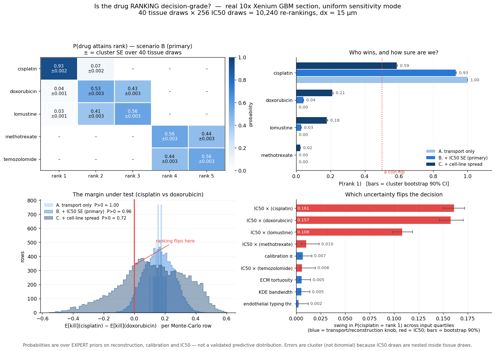

# Ranking robustness — is the per-patient drug ranking DECISION-GRADE?

> **STALE ABSOLUTE NUMBERS — regenerate.** Every absolute exposure / AUC / coverage / kill
> figure below was generated with the **KDE** vascular source, which was the default until
> `results/vessel_promotion.md`. The default is now the **discrete** segmented-vessel source,
> whose tissue-integrated total is **3.36x smaller** (a change of *unit*, not of physics —
> the dose-matched geometry-only effect on coverage is <=0.0166). Relative orderings and
> per-drug contrasts here are largely unaffected; absolute levels are not. Reproduce with
> `mode='kde'` to recover exactly these numbers.

**Module:** `tmesim/validation/ranking_robustness.py` (run: `python -m tmesim.validation.ranking_robustness`)

**Figure:** `ranking_robustness.png`

---

## 0. The verdict, first

On the real 10x Xenium GBM section, propagating the reconstruction, calibration and IC50 priors through **36 tissue draws × 256 IC50 draws = 9,216 complete re-rankings**:

* **P(cisplatin is rank 1) = 0.927 ± 0.002** (cluster-bootstrap 90% CI 0.924–0.931)
* **P(doxorubicin is rank 1) = 0.044 ± 0.002** (90% CI 0.042–0.047)
* **P(cisplatin > doxorubicin) = 0.955 ± 0.002** (90% CI 0.952–0.957)
* **P(top-2 set = {cisplatin, doxorubicin}) = 0.565 ± 0.003** (90% CI 0.560–0.571)
* **P(the full published order holds) = 0.286 ± 0.003**

> **The top-1 call IS decision-grade.** `cisplatin` holds rank 1 with probability 0.927 (90% CI 0.924–0.931), the runner-up `doxorubicin` never gets within reach (0.044, CI ≤ 0.047), and the two intervals do not overlap. The pre-declared bar (leader CI entirely above 0.90, runner-up entirely below 0.10) is met.

**The top-2 SET is also not decision-grade at the 0.90 bar** (0.565, 90% CI 0.560–0.571). See §4 for which set competes.

**Most destabilising input:** `IC50 × (cisplatin)` — moving it across its prior quartiles swings P(cisplatin = rank 1) by **0.167** (bootstrap 90% CI 0.155–0.178). §5.

---

## 1. What is being asked, and why an interval per drug does not answer it

`results/uncertainty.md` puts a 90% credible interval on **one** drug's predicted kill. That is the right object for a *number*. It is the wrong object for a *decision*: the five drugs' intervals overlap heavily, but their draws are **correlated** — all five sit on the same reconstructed tissue, share the same calibration α and the same vascular field, so a draw that raises one drug's kill usually raises them all. Overlapping marginals are therefore compatible with either a rock-solid or a coin-flip ranking. The only way to know is to **re-rank inside every draw**, which is what this module does.

Decision-grade is defined here, in advance, as: the recommended drug holds rank 1 with probability whose 90% credible interval lies entirely above **0.90**, and the runner-up's lies entirely below **0.10**. Anything less is reported as a tie or as a preference with a named alternative.

**Sensitivity mode = `uniform`, deliberately.** Per-cell sensitivity has two modes (`reconstruct.real_pipeline.apply_drug_sensitivity`). In `determinant` mode each drug is scaled by its own measured resistance determinant *where the 319-gene Xenium panel carries one* — TOP2A for doxorubicin, an MKI67 proliferation proxy for cisplatin / lomustine / methotrexate — and by 1.0 where it does not. Temozolomide's determinant is **MGMT, which is absent from the panel and is a methylation state that transcript counts cannot report at all**, so TMZ alone would keep 1.0 while every competitor is scaled down ≈1.7×. That asymmetry is an artifact of *measurement coverage*, not of drug biology, and it would contaminate every rank probability in this report with the question 'whose determinant did we happen to measure?'. In `uniform` mode the factor is identical across drugs and cancels exactly out of the comparison, so the ranking isolates **delivery × potency**. The absolute kills are then an equal no-intrinsic-resistance upper bound for every drug — which is fine, because a ranking only needs the comparison to be fair, not the level to be right. `reconstruct_knobs` (used for every draw here) sets `sensitivity = 1.0` for all cells, so `uniform` is enforced structurally, not by a flag.

**The published nominal ranking under test** (`results/real_drug_panel.md`, dx = 12 µm): **cisplatin** > **doxorubicin** > **lomustine** > **methotrexate** > **temozolomide**.

---

## 2. Design, cost, and the kill-kernel identity

The expensive object is the tissue + transport solve; the cheap object is the kill mapping, and they separate **exactly** — `sim.engine.simulate_response` runs oxygen → pressure → delivery → transport → Hill kill, and only the last step reads `drug.ic50`. So:

* **per outer draw:** 1 reconstruction + 5 transport solves (all 5 drugs on the SAME tissue — the correlation structure a ranking question requires);
* **then 256 IC50 re-rankings for free**, as a vector op on the frozen per-cell exposure and sensitivity;
* the **same** IC50 deviates drive all three scenarios (common random numbers), so scenarios differ only by prior width, not by sampling noise.

| | |
|---|---|
| outer (tissue) draws achieved | **36** |
| IC50 draws per outer draw | 256 (Latin hypercube, 5-dimensional) |
| complete re-rankings | **9,216** per scenario |
| grid / scheme | dx = 15 µm, dt = 20 s, convection off, 6 h exposure |
| α₀ (fitted, e-fold convention) | **148.6** |
| runtime | 42.4 min (~71 s per outer draw), single process |

**n is modest and that is stated rather than hidden.** The effective sample size for every probability in this report is the number of *independent tissue draws*, **36**, not the 9,216 rows — see §3. All intervals are quoted, none of the probabilities is presented as a bare point estimate.

**The kill kernel IS the frozen model, not a re-implementation.** On the first draw the engine is re-run for one drug and `cells.pkpd.apply_drug_kill` is called on the oxygen-labelled pre-kill cells; the mean of ITS returned per-tumour-cell kill probability is compared with the analytic kernel:

| check (cisplatin) | value |
|---|---:|
| frozen `pkpd.apply_drug_kill` mean p | 0.8681343439 |
| analytic `KillKernel.expected_kill` | 0.8681343439 |
| absolute difference | **0.00e+00** |
| engine single-seed Bernoulli `kill_fraction` | 0.8714 |
| Bernoulli sampling sd of that realisation | ±0.0017 (29,290 tumour cells) |

The ranking uses the **expectation** E[kill] = mean(p_kill), not one Bernoulli realisation. That matters: the single-seed coin-flip noise is ±0.0017 absolute, against a nominal cisplatin-vs-doxorubicin gap of only ~0.183 — sampling noise is a non-trivial fraction of the very margin under test, and it is *not* parameter uncertainty, so it is removed rather than counted as instability.

---

## 3. Priors, and the honest error bar for a nested design

### 3.1 Reconstruction / calibration priors (imported unchanged)

The four transport-side priors are **imported from `tmesim.validation.uncertainty`** (`build_priors`, `sample_priors`) so the two modules cannot drift apart. Full justifications: `results/uncertainty.md` §1.

| knob | prior | 5% / 50% / 95% | realised min–max (36 draws) |
|---|---|:--:|:--:|
| `endothelial_typing_threshold` | truncated normal: N(1.00, 0.15) truncated to [0.70, 1.40] | 0.78 / 1 / 1.24 | 0.709 – 1.33 |
| `kde_bandwidth_um` | uniform: U(25, 60) um | 26.8 / 42.5 / 58.2 | 26 – 59.2 |
| `calibration_alpha` | lognormal: LogNormal(median=148.6, sigma_log=0.421) -> 90% CI = [74, 297] (0.5x-2x) | 74.3 / 149 / 297 | 56.4 – 364 |
| `ecm_tortuosity_alpha` | uniform: U(0.40, 0.80) | 0.42 / 0.6 / 0.78 | 0.407 – 0.796 |

> *Read the last column against the third.* A Latin hypercube puts exactly one draw in each of 36 equal-probability strata, so the outermost strata of an UNBOUNDED prior get sampled every time. The α prior is lognormal with a 90% CI of 0.5×–2× ([74, 297]), but its realised range here is **56–364** (0.38×–2.45×) — the tail, not a bug. Those extreme draws are ~2/36 of the mass and they are kept: a probability that survives them is worth more than one computed on a truncated prior. §5 reports what α actually does to the decision.

**α is the single-anchor scale for the whole penetration model.** α = **148.6** (the e-folding convention `L = d_half/ln 2`; the retired α = 309.6 fitted the raw half-distance as if it were an e-fold length and is superseded — audit defect #4). It is fitted in closed form against **ONE doxorubicin immunofluorescence anchor** (Primeau 2005, PMID 16361566), and the *absolute* penetration of all five drugs rides on that single measurement. Its prior here is correspondingly the widest of the four (90% CI 0.5×–2×), which is the honest treatment of a one-study anchor transferred to human GBM — and note what that implies for a *ranking*: because α is shared by every drug in a draw, it moves all five kills together, so a wide α prior costs the marginal intervals a lot and costs the ORDER comparatively little. Some of the ranking's stability below is bought by exactly that shared-nuisance structure, and that is a real property of the decision, not a trick.

### 3.2 IC50 priors — two tiers, and why they differ

Potency is what actually separates these drugs (D_eff spans ~1.5×; IC50 spans ~1200×), so no honest statement about the ORDER can hold IC50 fixed. Three scenarios are evaluated **on the same transport solves**:

* **A. transport knobs only (IC50 fixed)**
* **B. + IC50 sampling error (PRIMARY)**
* **C. + full cross-cell-line IC50 spread (STRESS)**

| drug | IC50 (µM) | tier | GDSC lines | SD(ln IC50) across lines | σ_log — B (primary) | 90% fold — B | σ_log — C (stress) | 90% fold — C |
|---|---:|:--|---:|---:|---:|---:|---:|---:|
| cisplatin | 24.55 | GDSC-measured | 34 | 1.549 | 0.333 | 1.73× | 1.549 | 12.78× |
| doxorubicin | 0.5 | literature | — | — | 0.668 | 3.00× | 1.549 | 12.78× |
| lomustine | 50 | literature | — | — | 0.668 | 3.00× | 1.549 | 12.78× |
| methotrexate | 12 | GDSC-measured | 49 | 1.996 | 0.357 | 1.80× | 1.996 | 26.65× |
| temozolomide | 606 | GDSC-measured | 51 | 1.020 | 0.179 | 1.34× | 1.020 | 5.35× |

**GDSC-measured drugs get the TIGHTER prior, and it is derived from data, not chosen.** For cisplatin, methotrexate and temozolomide the model plugs in `exp(median over glioma cell lines of LN_IC50)` from the cached GDSC2 screen. The uncertainty on *that statistic* is the standard error of a median, `σ = √(π/2)·SD(ln IC50)/√n_lines` — the √(π/2) ≈ 1.2533 factor is the median's efficiency penalty relative to the mean under normality. The cell lines aggregated are read through `molecular.potency`'s own alias table and cache path, and repeat screens of one line are collapsed by median exactly as `potency.measured_ic50` does, so this is the spread of the very numbers the model consumes.

**Literature-only drugs get a WIDER prior, and it is an expert judgement, declared as such.** Doxorubicin and lomustine are not in the GDSC glioma screen; there is no measured spread to compute. `potency.LITERATURE_IC50` quotes doxorubicin as ~0.1–1 µM around a 0.5 µM anchor (0.2×–2×) and lomustine as 'tens of µM' around 50 µM (~0.2×–2×). The prior used is a 90% CI of **1/3×–3×** (σ_log = 0.668), which contains both quoted ranges and adds room for the cross-study transfer a one-sentence range does not cover. It is wider than **every** measured drug's primary prior, which is the intended ordering: a curated order-of-magnitude anchor must not be allowed to look as well-determined as a 34–51 cell-line screen.

> *Honest caveat on the asymmetry.* The two leading drugs sit in **different tiers** — cisplatin is GDSC-measured (tight), doxorubicin is literature-only (wide). That is a real difference in what we know, and it is deliberately not smoothed over; but it does mean part of any instability attributed to doxorubicin is *epistemic bookkeeping* about its anchor rather than a claim about its pharmacology. Scenario C removes the asymmetry by giving both a cell-line-scale spread, which is one reason it is worth reading even though it is not the headline.

### 3.3 Why the error bars are CLUSTER, not binomial

The design is **nested**: 256 IC50 draws sit inside each of 36 tissue draws, and rows inside one tissue draw share a reconstruction, an α and a tortuosity. They are not independent Bernoulli trials. The naive binomial SE √(p(1−p)/9,216) is therefore an **under-estimate** — and the size of the under-estimate is itself a finding, because it measures how much of the ranking uncertainty lives on the tissue axis.

| probability (scenario B) | p | naive binomial SE @ n=9,216 | **cluster SE** @ n_outer=36 | design effect | effective n |
|---|---:|---:|---:|---:|---:|
| P(cisplatin = rank 1) | 0.9274 | 0.0027 | **0.0020** | 0.7× | 17224 |
| P(doxorubicin = rank 1) | 0.0443 | 0.0021 | **0.0016** | 0.8× | 15598 |
| P(lomustine = rank 1) | 0.0283 | 0.0017 | **0.0013** | 0.8× | 15698 |
| P(methotrexate = rank 1) | 0.0000 | 0.0000 | **0.0000** | — | — |
| P(temozolomide = rank 1) | 0.0000 | 0.0000 | **0.0000** | — | — |
| P(cisplatin > doxorubicin) | 0.9546 | 0.0022 | **0.0016** | 0.8× | 16211 |
| P(top-2 set = {cisplatin, doxorubicin}) | 0.5652 | 0.0052 | **0.0034** | 0.7× | 21689 |
| P(full published order) | 0.2858 | 0.0047 | **0.0030** | 0.6× | 22686 |

**Read the design-effect column** (cluster SE ÷ binomial SE). Where it is **> 1** the binomial SE is fiction: the probability is driven by *which tissue you drew*, and adding more IC50 draws inside the same tissues would shrink the binomial SE without learning anything. Where it is **< 1** the nested Latin hypercube has actually beaten iid sampling — the inner design stratifies each drug's IC50 marginal, so the within-draw proportion is less noisy than a binomial — and the cluster SE is still the one to quote, because it is the one that reflects the axis we are short of draws on. Every headline number in this report is quoted with the cluster SE and a cluster-bootstrap 90% CI (resampling whole outer draws, 4,000 replicates). Where a probability is exactly 0 or 1 the cluster SE collapses and is meaningless; the rule-of-three one-sided 95% bound on the cluster unit, 3/36 = 0.083, is reported instead.

---

## 4. The full drug × rank probability matrix

Scenario **B (B. + IC50 sampling error (PRIMARY))**, 9,216 re-rankings. Cell = P(that drug lands at that rank) ± cluster SE. Rows sum to 1 by construction.

| drug | rank 1 | rank 2 | rank 3 | rank 4 | rank 5 | E[rank] | median kill (90% CI) |
|---|---:|---:|---:|---:|---:|---:|:--:|
| **cisplatin** | 0.927 ± 0.002 | 0.070 ± 0.002 | 0.003 ± 0.001 | — | — | 1.08 | 0.9166 [0.7887, 0.9798] |
| **doxorubicin** | 0.044 ± 0.002 | 0.524 ± 0.004 | 0.432 ± 0.003 | 0.000 ± 0.000 | — | 2.39 | 0.7572 [0.4174, 0.9449] |
| **lomustine** | 0.028 ± 0.001 | 0.406 ± 0.003 | 0.565 ± 0.003 | 0.000 ± 0.000 | — | 2.54 | 0.7265 [0.3690, 0.9348] |
| **methotrexate** | — | — | 0.000 ± 0.000 | 0.551 ± 0.003 | 0.449 ± 0.003 | 4.45 | 0.1233 [0.0402, 0.3274] |
| **temozolomide** | — | — | 0.000 ± 0.000 | 0.449 ± 0.003 | 0.551 ± 0.003 | 4.55 | 0.1145 [0.0423, 0.2883] |

### 4.1 P(rank 1) across all three IC50 scenarios

| drug | A. transport only | B. + IC50 SE (**primary**) | C. + cell-line spread |
|---|:--:|:--:|:--:|
| cisplatin | 1.000 | 0.927 ± 0.002 | 0.582 ± 0.002 |
| doxorubicin | 0.000 | 0.044 ± 0.002 | 0.214 ± 0.003 |
| lomustine | 0.000 | 0.028 ± 0.001 | 0.179 ± 0.003 |
| methotrexate | 0.000 | 0.000 | 0.024 ± 0.001 |
| temozolomide | 0.000 | 0.000 | 0.001 ± 0.000 |

| statistic | A. transport only | B. primary | C. stress |
|---|:--:|:--:|:--:|
| P(cisplatin > doxorubicin) | 1.000 (9216/9216 rows; rule-of-three 95% bound < 0.917) | 0.955 ± 0.002 | 0.715 ± 0.003 |
| P(top-2 = {cisplatin, doxorubicin}) | 1.000 (9216/9216 rows; rule-of-three 95% bound < 0.917) | 0.565 ± 0.003 | 0.414 ± 0.004 |
| P(full published order) | 1.000 (9216/9216 rows; rule-of-three 95% bound < 0.917) | 0.286 ± 0.003 | 0.087 ± 0.003 |
| distinct orders observed | 1 of 120 | 15 of 120 | 94 of 120 |
| modal order probability | 1.000 | 0.286 | 0.122 |
| normalised order entropy | -0.000 | 0.344 | 0.685 |

Scenario A holds every IC50 at its resolved value, so it isolates how much instability the **reconstruction + calibration knobs alone** can cause; B adds the sampling error of the potency statistic the model actually consumes; C asks the harder question — *this Xenium section is ONE tumour, and nothing tells us it sits at the median of the glioma cell-line distribution*. C is reported as a stress test, not as the headline, because a cell-line panel's spread is a population statistic, not a credible interval for a specific tumour. The primary answer is B.

### 4.2 Top-2 SET distribution (scenario B)

| top-2 set | probability |
|---|:--:|
| {cisplatin, doxorubicin} ← **headline** | 0.565 ± 0.003 |
| {cisplatin, lomustine} | 0.432 ± 0.003 |
| {doxorubicin, lomustine} | 0.003 ± 0.001 |

### 4.3 Every pairwise comparison (scenario B)

| comparison | P(left > right) | decided at 90%? |
|---|:--:|:--:|
| cisplatin > doxorubicin | 0.955 ± 0.002 | yes |
| cisplatin > lomustine | 0.970 ± 0.001 | yes |
| cisplatin > methotrexate | 1.000 (9216/9216 rows; rule-of-three 95% bound < 0.917) | yes |
| cisplatin > temozolomide | 1.000 (9216/9216 rows; rule-of-three 95% bound < 0.917) | yes |
| doxorubicin > lomustine | 0.567 ± 0.003 | **NO** |
| doxorubicin > methotrexate | 1.000 (9216/9216 rows; rule-of-three 95% bound < 0.917) | yes |
| doxorubicin > temozolomide | 1.000 ± 0.000 | yes |
| lomustine > methotrexate | 1.000 ± 0.000 | yes |
| lomustine > temozolomide | 1.000 (9216/9216 rows; rule-of-three 95% bound < 0.917) | yes |
| methotrexate > temozolomide | 0.551 ± 0.003 | **NO** |

**The cisplatin–doxorubicin margin itself.** Median E[kill](cisplatin) − E[kill](doxorubicin) = **+0.1454** (90% of rows in [+0.0022, +0.4489]); averaged within a tissue draw the gap ranges +0.0620 to +0.2901 across the 36 draws.

---

## 5. Which parameter destabilises the ranking

Outcome: the binary event *`cisplatin` holds rank 1* (baseline 0.927 ± 0.002). Each sampled input is cut into 4 quartiles and the conditional probability is recomputed; the **swing** is max − min across quartiles, cluster-bootstrapped over outer draws. A quartile conditional needs no linearity assumption, which matters because the typing threshold acts as a step (integer Xenium counts quantise the PECAM1 z-score) and the IC50 effect is a ratio.

| input | Q1 | Q2 | Q3 | Q4 | **swing** | swing 90% CI | Spearman(ρ, win) |
|---|:--:|:--:|:--:|:--:|---:|:--:|---:|
| `IC50 × (cisplatin)` | 0.989 | 0.968 | 0.930 | 0.822 | **0.167** | [0.155, 0.178] | -0.250 |
| `IC50 × (doxorubicin)` | 0.806 | 0.961 | 0.972 | 0.970 | **0.166** | [0.155, 0.180] | +0.255 |
| `IC50 × (lomustine)` | 0.849 | 0.961 | 0.953 | 0.946 | **0.112** | [0.102, 0.123] | +0.151 |
| `KDE bandwidth` | 0.930 | 0.928 | 0.934 | 0.918 | **0.016** | [0.010, 0.024] | -0.013 |
| `IC50 × (temozolomide)` | 0.918 | 0.932 | 0.930 | 0.930 | **0.013** | [0.006, 0.028] | +0.011 |
| `calibration α` | 0.921 | 0.928 | 0.931 | 0.930 | **0.011** | [0.006, 0.021] | +0.013 |
| `endothelial typing thr.` | 0.927 | 0.932 | 0.922 | 0.928 | **0.010** | [0.005, 0.019] | -0.002 |
| `ECM tortuosity` | 0.932 | 0.925 | 0.925 | 0.928 | **0.007** | [0.005, 0.018] | -0.008 |
| `IC50 × (methotrexate)` | 0.931 | 0.926 | 0.929 | 0.924 | **0.006** | [0.004, 0.021] | -0.006 |

**Most destabilising: `IC50 × (cisplatin)`** — swing 0.167 [0.155, 0.178].

Runner-up `IC50 × (doxorubicin)` (swing 0.166 [0.155, 0.180]).

**A swing whose bootstrap CI reaches 0 is not distinguishable from noise at this n.** With 36 independent tissue draws the quartile conditionals for the four transport knobs rest on ~9 draws each, so read the RANKING of the swings, not their third decimal. Note also that the lower bound of a max−min statistic is bounded below by 0 and biased *upward* under noise, so small swings should be treated as upper bounds.

---

## 6. Is the ranking a resolution artifact?

The Monte Carlo runs at dx = 15 µm / dt = 20 s / convection off for affordability. `results/numerical_rigor.md` established that `kill_fraction` is grid-converged for dx ≲ 20 µm and dt-invariant for dt ≤ 20 s (interstitial speeds < 0.7 µm/s make advection negligible). The nominal panel is nonetheless re-run at both the MC configuration and the **exact published production configuration** (dx = 12 µm, dt = 10 s, convection on) so the claim is demonstrated rather than inherited:

| dx (µm) | dt (s) | conv. | grid | cisplatin | doxorubicin | lomustine | methotrexate | temozolomide | gap(cisplatin−doxorubicin) |
|---:|---:|:--:|:--:|---:|---:|---:|---:|---:|---:|
| 15 | 20 | off | 339×541 | 0.9226 | 0.7647 | 0.7336 | 0.1241 | 0.1181 | +0.1579 |
| 12 | 10 | on | 424×675 | 0.9120 | 0.7527 | 0.7213 | 0.1195 | 0.1136 | +0.1593 |

**The order is identical at both resolutions** (cisplatin > doxorubicin > lomustine > methotrexate > temozolomide), and the cisplatin−doxorubicin gap moves from +0.1579 to +0.1593. The instability reported above is therefore *parameter* uncertainty, not a mesh artifact — which is the point: refining the grid will not fix it.

---

## 7. What this does and does NOT establish

1. **These are probabilities over EXPERT PRIORS, not a validated predictive distribution.** No outcome label exists for this section — it is an untreated resection with no measured response to any of the five drugs. `P(cisplatin is rank 1) = 0.93` means *the model's own ranking is that stable inside the priors declared in §3*. It is NOT a claim that cisplatin is the best drug for this patient 93% of the time.
2. **Model-form error is not in these bars, and is plausibly the largest term.** Every draw is computed inside one fixed structure: a first-order `k = clearance + binding` sink, `D_eff = D·(1 − α·ECM)`, a KDE-smoothed endothelial density standing in for a vessel network never imaged, a Hill kill on AUC, plasma-averaged delivery, and no efflux transporters. If that structure is wrong, no amount of parameter sampling detects it. `results/vessel_network_impact.md` shows the KDE→discrete-vessel swap alone moves doxorubicin's coverage by −0.017 dose-controlled (−0.586 naively) — a structural move that no prior in §3 can produce.
3. **Every drug's exposure rides on ONE anchor.** α is fitted to a single doxorubicin penetration measurement in a different tumour model. Its 0.5×–2× prior is a judgement about how far that anchor transfers, not a meta-analysis. If it does not transfer, the whole distribution translates.
4. **Absolute kills are an upper bound.** `uniform` mode models no intrinsic per-cell resistance for any drug. That is what makes the ranking fair; it also means no absolute kill here should be quoted as an expected response.
5. **One section, one segmentation, no replicate.** Section-to-section and patient-to-patient variability is entirely absent. This is uncertainty *within one measured tumour*.
6. **Temozolomide's position is downstream of a code fix, not of biology-free modelling.** `bbb_penetrance` now aggregates its four CNS-MPO desirabilities with a **geometric mean** rather than an arithmetic one, so a disqualifying property can VETO a molecule instead of being averaged away (audit defect #9; it cut the eribulin miss from 66× to 6.9× against measured human glioma tissue:plasma ratios). TMZ's bbb_penetrance fell 0.558 → **0.125** as a result, which is why its kill is 0.1151 rather than the older 0.4173. The veto is better-validated than what it replaced — but TMZ's rank in this report is nonetheless *sensitive to one aggregation choice in a structure-only score*, and that sensitivity is not represented in any prior sampled here.

## 8. What measurement would actually settle the top-1 call

The top-1 call already clears the bar in scenario B. The measurement that would make it robust to the STRESS scenario (C), where P(cisplatin = rank 1) falls to 0.582, is the same one listed below: a patient-specific potency readout.

The ranking is decided by **delivery × potency**, and the two candidates sit at opposite ends of both axes — cisplatin has ~157× the mean AUC and ~49× the IC50 of doxorubicin. So the useful measurements are, in order of decisiveness:

1. **An ex-vivo potency readout on THIS patient's cells for cisplatin and doxorubicin.** This is the decisive one. Scenario C shows that replacing 'the median glioma cell line' with 'this tumour' is what dominates the remaining uncertainty; a per-patient IC50 pair collapses the widest prior in §3.2 from a population spread to a measurement error. It also removes the tier asymmetry — doxorubicin's 1/3×–3× literature prior exists purely because it is absent from the GDSC glioma screen. `results/gbm_tmz_exvivo.md` shows the assay format already exists for glioma (GSE232173); it has simply never been run on a section that was also spatially profiled.
2. **A second, independent penetration anchor** — ideally for a drug on this panel other than doxorubicin. α is currently one number from one study; a second anchor would let α be fitted rather than assumed-transferable, shrinking the widest transport prior. Because α is shared across drugs it matters less for the ORDER than for the levels, so this is second, not first.
3. **Measured spatial drug distribution in the same section**, which would test the delivery axis directly rather than through a literature-anchored sink. `results/DATA_HUNT.md` establishes that no open dataset anywhere pairs measured spatial drug distribution with measured response in the same tumour — this is a collaboration to run, not a download.

**Until (1) exists, the reportable output of this pipeline for the top of the panel is a SET, not a winner.**
