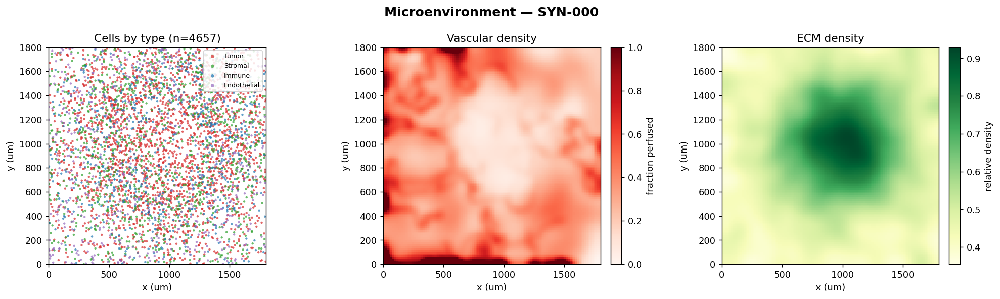
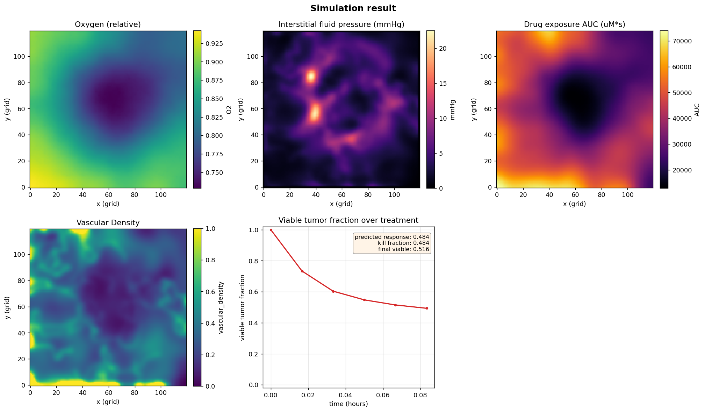
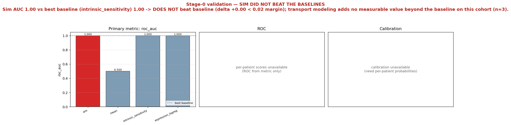

# tmesim — Stage 0 kill-test report

*Does a mechanistic tumor-microenvironment + drug-transport simulation predict observed glioblastoma drug response better than a cheap, non-spatial baseline?* This report answers that question for the cohort that was run (3 patient-sample(s)), and shows the reconstruction, one simulation, and the head-to-head scoring behind the verdict.

## 1. Headline verdict

> ## ❌ FAIL — the mechanistic sim did NOT beat the baselines
>
> **Verdict:** Sim AUC 1.00 vs best baseline (intrinsic_sensitivity) 1.00 -> DOES NOT beat baseline (delta +0.00 < 0.02 margin); transport modeling adds no measurable value beyond the baseline on this cohort (n=3).

## 2. Metrics — sim vs. baselines

Primary metric: **`roc_auc`**. Scores below are cohort-level (cross-validated where a baseline needs training). A blank cell means that metric was not computed for that model.

| model | roc_auc (higher better, primary) | brier (lower better) | spearman (higher better) |
| --- | --- | --- | --- |
| **sim (mechanistic)** | 1.000 | 0.200 | 1.000 |
| `mean` | 0.500 | 0.224 | 0.000 |
| `intrinsic_sensitivity` | **1.000** | **0.117** | **1.000** |
| `expression_logreg` | 1.000 | 0.212 | 1.000 |

*Best baseline per metric is shown in **bold**. The Stage-0 bar is that the mechanistic sim must beat the best baseline on the primary metric (`roc_auc`).*

## 3. Example reconstructed microenvironment

**Figure 1.** Reconstructed microenvironment for `SYN-000` (4657 cells on a 120×120 grid, dx = 15 µm). Panels: cells colored by phenotype (tumor / stromal / immune / endothelial / necrotic); vascular density (the drug and oxygen source, sparser in the tumor core); ECM density (raises tortuosity and lowers effective drug diffusivity); and, when present, the derived oxygen and interstitial-fluid-pressure fields. This is the spatial input the mechanistic model uses and the non-spatial baselines throw away.

## 4. Example simulation

**Figure 2.** One drug-response simulation. Spatial panels show oxygen, interstitial fluid pressure, and the drug-exposure AUC (drug penetration) over the treatment course, alongside vascular density. The final panel is the viable-tumor-fraction-vs-time curve. Headline numbers for this run: predicted response = 0.484, kill fraction = 0.484, final viable tumor fraction = 0.516. Poor penetration into the hypoxic, high-IFP core is exactly the effect a non-spatial model cannot represent.

## 5. Validation

**Figure 3.** Stage-0 head-to-head. Left: the primary metric for the sim and every baseline, with the best-baseline reference line — the bar the sim must clear. Middle: the ROC curve for the sim predictions (drawn when per-patient scores are available). Right: the calibration / reliability diagram, i.e. whether predicted responses match observed responder fractions. The figure's title states plainly whether the sim beat the baselines.

## 6. Interpretation (read this before believing anything)

On this cohort the mechanistic sim **did not beat** the best baseline on the primary metric (`roc_auc`). Per the Stage-0 contract this is the honest, non-flattering outcome: the added mechanistic machinery did not earn its complexity here. That does **not** prove the mechanism is wrong — it may reflect the data, the cohort size, or unmodeled biology — but it does mean the idea is **not ready** on this evidence and should not be oversold.

### Stage-0 scope caveat
This is a **Stage-0 kill-test on synthetic / best-effort data**, not a clinical validation. The microenvironments and observed responses are synthetic (or best-effort open-data proxies); labels are a *noisy* function of the modeled biology, chosen so the test is fair rather than trivially solvable. Nothing here has been checked against real patient outcomes, no regulatory or clinical claim is implied, and the numbers above should be read as evidence about **whether the machinery is worth building further**, not as a measure of real-world predictive accuracy. A genuine validation would require controlled-access spatial and drug-screen data and prospective outcomes.
