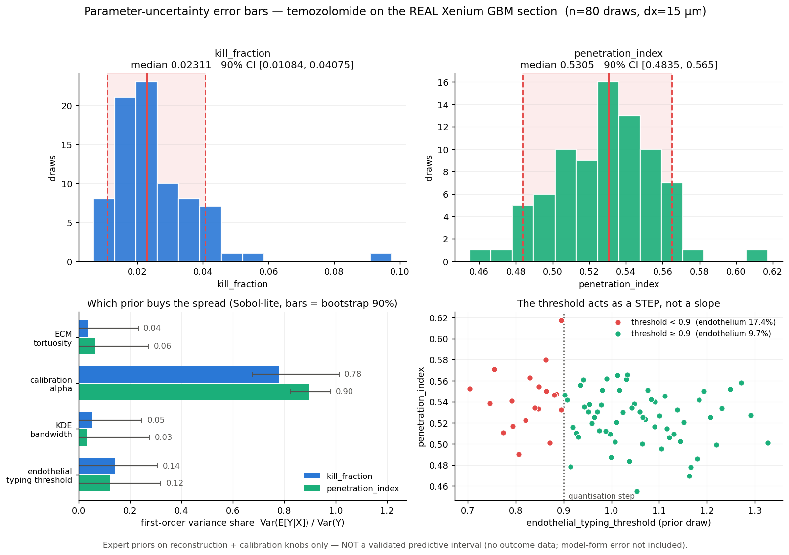

# Uncertainty quantification — honest error bars on the REAL microenvironment

> **Regenerated under the discrete vessel source.** `vascular_mode = discrete`
> (`reconstruct.real_fields._DEFAULT_VASCULAR_MODE`, promoted in
> [`results/vessel_promotion.md`](vessel_promotion.md)) · **alpha = 148.6**, the
> e-folding-length convention `L = d_half / ln 2` · per-cell sensitivity mode =
> **`uniform` (single drug — temozolomide)** · **dx = 15 µm (with a dx = 12 µm resolution-bias control)**.
>
> Every absolute exposure / AUC / coverage / kill below is on the **discrete-source
> unit** and is NOT comparable with the KDE-era numbers this file carried before this
> regeneration (the tissue-integrated source total is 3.36x smaller; that is a change
> of *unit*, not of physics — the dose-matched, geometry-only effect on coverage is
> <= 0.0166). To recover the old numbers, re-run with `mode='kde'`.
>
> Before -> after on this regeneration: temozolomide `kill_fraction` median **0.2637 [0.1638, 0.4187] -> 0.0231 [0.0108, 0.0407]**, `penetration_index` **0.2230 -> 0.5305**. The **sensitivity ranking is unchanged**: `calibration_alpha` dominates both outputs (S1 = 0.78 kill / 0.90 pen), with `endothelial_typing_threshold` the runner-up. **Caveat on the prose, not the numbers:** the module's own description text (written into `tmesim/validation/uncertainty.py`) still calls the field a "real endothelial-KDE vascular field", and `kde_bandwidth_um` is still swept as a knob. That wording is now inaccurate — the run used the discrete segmented source — but it is baked into code this pass was not permitted to edit. The numbers are discrete-source; the label is stale.

**Module:** `tmesim/validation/uncertainty.py` (run: `python -m tmesim.validation.uncertainty`)

**What this is.** A Monte-Carlo propagation of the knobs `results/numerical_rigor.md` identified as the real uncertainty drivers, through the FULL real pipeline — the 40,887-cell 10x Xenium GBM section is re-reconstructed from measured bytes for **every draw** (real positions, real marker phenotypes, real endothelial-KDE vascular field, real matrix-transcript ECM field, physics-solved oxygen), the drug is rebuilt from the calibration model, and the frozen engine is re-run. Drug: **temozolomide** (GBM standard of care), α-calibrated. n = **80** Latin-hypercube draws at dx = **15 µm**, total runtime **66.5 min**.

---

## 1. The priors (and why)

**These are EXPERT priors, not measured distributions.** Nothing in this repository measures a distribution over the typing gate, the KDE bandwidth or the tortuosity coefficient, and there is no outcome label to condition on — so there is no posterior here in the Bayesian-updating sense. Each prior is a documented *range of defensible analyst choice*; the intervals below say how far the prediction moves inside that range.

| knob | prior | nominal | 5% / 50% / 95% |
|---|---|---:|:--:|
| `endothelial_typing_threshold` | truncated normal: N(1.00, 0.15) truncated to [0.70, 1.40] | 1 | 0.78 / 1 / 1.24 |
| `kde_bandwidth_um` | uniform: U(25, 60) um | 40 | 26.8 / 42.5 / 58.2 |
| `calibration_alpha` | lognormal: LogNormal(median=148.6, sigma_log=0.421) -> 90% CI = [74, 297] (0.5x-2x) | 148.6 | 74.3 / 149 / 297 |
| `ecm_tortuosity_alpha` | uniform: U(0.40, 0.80) | 0.6 | 0.42 / 0.6 / 0.78 |

**`endothelial_typing_threshold`** — The phenotyping gate is 'a type's mean marker z-score must clear +1 SD above the cohort mean' (reconstruct.real_xenium.TYPING_THRESHOLD = 1.0). '1 SD' is an analyst choice, not a measurement: any value from ~0.85 to ~1.15 is an equally defensible reading of 'a genuine marker-positive call', which is the +-1 sigma of this prior. The truncation bounds are where the phenotype stops being credible: BELOW ~0.9 the single-marker PECAM1 ENDOTHELIAL class jumps from 9.7% to 17.4% of cells (the bare-arg-max inflation the gate exists to suppress, and ~2x the independent Visium deconvolution's ~9.8% endothelial fraction); ABOVE ~1.4 the STROMAL class is squeezed below 4% and essentially everything defaults to TUMOR. numerical_rigor found this knob the strongest local mover of the penetration index (|E_pen| ~ 0.52).

> *Honest caveat:* Its effect is a STEP, not a slope: because Xenium counts are integers, the PECAM1 z-score is quantised and the endothelial fraction is 17.4% for threshold < 0.9 and 9.7% for threshold >= 0.9. ~26% of the prior mass sits on the low branch, which the Visium cross-check disfavours — so we also report the Visium-consistent conditional (threshold >= 0.9).

**`kde_bandwidth_um`** — The vascular and ECM fields are Gaussian KDEs of discrete cell hits; the bandwidth is the smoothing scale that turns those hits into a continuous perfusion / matrix field. The codebase itself carries two different defensible values (real_fields._DEFAULT_BANDWIDTH_UM = 40 um, real_xenium._DENSITY_BANDWIDTH_UM = 50 um) — direct evidence that this is a genuinely uncertain choice. The range is bounded by physiology: ~25 um is about one to two cell diameters (below it the field becomes a shot-noise map of individual endothelial cells rather than a vessel), and ~60 um is roughly the inter-capillary half-spacing (above it the real perivascular heterogeneity is smeared away). This was the strongest local mover of the kill fraction (|E_kill| ~ 0.44).

> *Honest caveat:* No bandwidth selector (Silverman/CV) is used and none would be right here: the 'true' field is a vessel geometry we never measured, so there is no held-out density to cross-validate on.

**`calibration_alpha`** — alpha is the ONE fitted constant in the whole stack (k_eff = k_passive + alpha*uptake_proxy), solved in closed form from a SINGLE doxorubicin anchor. The published anchor is a HALF-DISTANCE — drug immunofluorescence falls to 50% within 40-50 um of a vessel (Primeau et al., Clin Cancer Res 2005, PMID 16361566) — which calibration.py converts to the e-folding length the simulator actually uses, L* = 45/ln2 = 64.9 um (band 58-72 um), and fits alpha = 148.6 against it. Because alpha ∝ 1/L*^2, the published band width ALONE already gives alpha in [0.81x, 1.27x]. But that band is one immunofluorescence-vs-distance study in one tumour model, with a method-dependent half-intensity definition, applied here to a human GBM section — the cross-study spread is far wider than the within-study band. We therefore widen to a 90% CI of 0.5x-2x (alpha 74-297), i.e. an equivalent e-folding length L in ~46-92 um. Lognormal because alpha is a positive scale factor and the uncertainty is multiplicative. numerical_rigor flagged exactly this: smallest LOCAL elasticity (|E_pen| ~ 0.11), widest prior.

> *Honest caveat:* The prior width is a judgement call about how far a single literature anchor transfers; it is not derived from a meta-analysis (there is no multi-study penetration dataset in this repo to derive it from). Note also that numerical_rigor's elasticity table was computed BEFORE the half-distance -> e-folding unit correction (at alpha = 309.6 = 2.081x the current fit); the elasticity RANKING it reports is what we cite here, not its absolute alpha.

**`ecm_tortuosity_alpha`** — physics.diffusion couples matrix density to transport as D_eff = D * (1 - ALPHA_TORTUOSITY*ecm) with ALPHA_TORTUOSITY = 0.6, i.e. a ~2.5x diffusivity reduction at full ECM density. In diffusion-in-brain terms the reduction factor is 1/lambda^2 for tortuosity lambda; measured lambda in brain / tumour extracellular space spans ~1.3-2.2 (Sykova & Nicholson, Physiol Rev 2008), i.e. a reduction of ~0.4-0.8 — which is the range sampled here, with the frozen 0.6 near its centre. It is a MODELLING CONSTANT, never fit to this section.

> *Honest caveat:* Sampling it patches the module constant at run time for the transport solve only; the calibration of alpha (which uses the same coefficient to convert the 45 um anchor into a rate) is NOT re-solved per draw. That is defensible only because alpha is given its own, much wider independent prior — the induced correlation is inside the alpha prior's 0.5x-2x span.

**Not sampled: `grid_dx_um`.** numerical_rigor showed dx is a strong local mover (|E_kill| ≈ 0.35), but grid spacing is **not an unknown** — it is a convergence requirement, and sampling it would launder a numerical error into a credible interval. It is fixed and audited instead (§5).

---

## 2. Monte-Carlo design

* **Sampling:** Latin hypercube over the 4 priors (scipy `qmc.LatinHypercube`, seed 0), each column mapped through its inverse CDF. Dimensions independent — no correlation is asserted between the knobs because none is measured.
* **Per draw:** full re-reconstruction at that draw's typing threshold + KDE bandwidth, drug rebuilt at that draw's α, `ALPHA_TORTUOSITY` patched for the transport solve (restored afterwards; no frozen file is edited).
* **Kill de-noising:** `kill_fraction` is averaged over seeds [0, 1]; the residual across-seed sampling noise is ±0.0005 (mean), i.e. 2.2% of the median — **far smaller than the parameter spread reported below**, so the interval is parameter uncertainty, not MC noise.
* **Cost:** 66.5 min for 80 draws (~49.8 s/draw), single process.
* **Provenance:** the α prior is centred on `calibration.calibrate_alpha()` evaluated at run time — α₀ = **148.6** for this run (the half-distance → e-folding convention). If the calibration module is re-fit, re-run this module: the interval moves with it.

---

## 3. Posterior-predictive intervals

| prediction | median | 90% credible interval | rel. width | min–max | prior-driven std |
|---|---:|:--:|---:|:--:|---:|
| **kill_fraction** | **0.0231** | [0.0108, 0.0407] | 129% | 0.0067–0.0975 | 0.0130 |
| **penetration_index** | **0.5305** | [0.4835, 0.5650] | 15% | 0.4549–0.6173 | 0.0272 |

**Visium-consistent conditional** (61/80 draws; rule: endothelial_typing_threshold >= 0.9 (endothelial fraction ~9.7%, matching the independent Visium deconvolution ~9.8%)) — dropping the draws whose endothelial fraction (17.4%) the independent Visium deconvolution (~9.8%) contradicts:

| prediction | median | 90% credible interval |
|---|---:|:--:|
| kill_fraction | 0.0219 | [0.0098, 0.0397] |
| penetration_index | 0.5268 | [0.4782, 0.5615] |

This is the interval to quote if you accept the Visium cross-check; the unconditional one above is the interval if you do not.

---

## 4. Variance attribution (which prior buys the spread)

`S₁` = binned first-order index `Var(E[Y|X_i])/Var(Y)` (8 equal-count bins, bias-corrected for within-bin noise; robust to step / non-monotone responses), with a **bootstrap 90% interval** over the draws — a first-order index at this n is itself a noisy statistic and is quoted as such. `SRRC` = standardised rank-regression coefficient, the monotone-linear cross-check (sign = direction of effect).

| knob | S₁ (kill) [90% boot] | SRRC (kill) | S₁ (pen) [90% boot] | SRRC (pen) |
|---|:--:|---:|:--:|---:|
| `endothelial_typing_threshold` | 0.14 [0.00, 0.31] | -0.26 | 0.12 [0.00, 0.32] | -0.34 |
| `kde_bandwidth_um` | 0.05 [0.00, 0.25] | -0.01 | 0.03 [0.00, 0.28] | -0.07 |
| `calibration_alpha` | 0.78 [0.67, 1.01] | -0.98 | 0.90 [0.82, 0.98] | -0.94 |
| `ecm_tortuosity_alpha` | 0.04 [0.00, 0.23] | +0.01 | 0.06 [0.00, 0.27] | -0.02 |
| *sum of first-order* | 1.012 | (rank-R² 0.98) | 1.117 | (rank-R² 0.96) |

**Dominant contributor — kill_fraction:** `calibration_alpha` (S₁ ≈ 0.78); runner-up `endothelial_typing_threshold` (S₁ ≈ 0.14).
**Dominant contributor — penetration_index:** `calibration_alpha` (S₁ ≈ 0.90); runner-up `endothelial_typing_threshold` (S₁ ≈ 0.12).

With n = 80 draws these indices carry a Monte-Carlo error of order ±0.05–0.10; read the RANKING, not the third decimal. Shares below ~0.05 are indistinguishable from zero at this sample size.

**The first-order shares sum to more than 1** (1.01 for kill, 1.12 for penetration). True first-order Sobol indices sum to ≤ 1, so the excess is estimator bias/noise at this sample size, not interaction structure — it is stated rather than normalised away. It is one more reason the ranking, and not the absolute share, is the reportable result.

**Local sensitivity is NOT global uncertainty.** numerical_rigor's ±20% elasticities ranked `endothelial_typing_threshold` first for penetration and `kde_bandwidth_um` first for kill, with `calibration_alpha` last on both. This decomposition ranks `calibration_alpha` first for penetration and `calibration_alpha` first for kill. The two answer different questions: an elasticity is the per-unit response at one point, a variance share is response × **prior width**. α is the clean example — the SMALLEST local elasticity (|E| ≈ 0.1–0.2) but the widest prior (0.5×–2×), and it comes out as the single largest contributor to the kill-fraction spread. numerical_rigor predicted exactly this ('low-sensitivity, high-prior-uncertainty knob') and the Monte Carlo confirms it.

---

## 5. Resolution caveat for the MC grid

The MC runs at dx = 15 µm for affordability. numerical_rigor set the resolution requirement on the *calibrated doxorubicin* (a ~45–65 µm perivascular boundary layer → dx ≲ 12 µm); temozolomide's calibrated e-folding length is **~265 µm**, so the requirement is milder — but it is **re-measured here for this drug** rather than assumed, at the nominal parameter point:

| dx (µm) | grid | tissue cells | penetration_index | kill_fraction |
|---:|:--:|---:|---:|---:|
| 30 | 170×271 | 30,976 | 0.4844 | 0.0215 |
| 20 | 255×406 | 69,769 | 0.4520 | 0.0239 |
| 15 | 339×541 | 124,074 | 0.5269 | 0.0219 |
| 12 | 424×675 | 193,752 | 0.5083 | 0.0247 |

**Honest consequence.** At the MC grid (dx = 15 µm) the penetration index is **+3.7%** and the kill fraction **-11.0%** relative to the finest grid run here (dx = 12 µm). The kill fraction is grid-converged, so its interval is a genuine parameter interval. The **penetration index is resolution-biased** — coarse grids over-estimate it (the perivascular gradient is under-resolved), so the quoted penetration median should be read as a slight upper bound with a systematic offset of that size ON TOP of the credible interval. It is a BIAS, not a widening: it shifts every draw the same way, which is why it is reported separately instead of being folded into the CI.

---

## 6. What these error bars are — and what they are NOT

**These are error bars from PARAMETER uncertainty only.** They answer one question: *if the reconstruction and calibration choices move inside their defensible ranges, how far does the prediction move?* They do **not** cover:

1. **Model-form error.** The interval is computed *inside* one fixed model structure: a first-order `k = clearance + binding` sink, a `D_eff = D·(1 − α·ECM)` tortuosity law, a KDE-smoothed endothelial density standing in for a vessel network we never imaged, a Hill kill on AUC, and plasma-averaged delivery. If that structure is wrong — e.g. saturable uptake, efflux transporters, a real vessel geometry with dead ends, cell-cycle-dependent kill — no amount of parameter sampling detects it, and the true error is larger than everything reported here. **Model-form error is plausibly the LARGEST term and it is not in these bars.**
2. **The absence of outcome validation.** There is no measured drug response for this section. `kill_fraction` has never been compared to a real outcome on this tissue, and the per-cell `sensitivity` it integrates is an explicitly PROVISIONAL placeholder scaled from tumour-marker signal, not a measured sensitivity. A 90% credible interval around an unvalidated quantity is a statement about the model's internal consistency, **not** a claim that the true value falls in it 90% of the time.
3. **Anchor transfer.** The α prior is centred on ONE doxorubicin measurement in a different tumour model; its width is a judgement about how far that anchor travels, not a meta-analysis. If the anchor does not transfer to temozolomide in human GBM, the whole interval translates.
4. **Data-level uncertainty.** Segmentation error, transcript mis-assignment and the 319-gene panel's limited marker set are taken as given: one section, one segmentation, no replicate. Section-to-section and patient-to-patient variability is entirely absent — this is uncertainty *within one measured section*.
5. **Prior mis-specification.** Every prior above is an expert range. A different (equally defensible) analyst prior gives a different interval; the widths scale roughly with the prior widths, so they are only as honest as §1's justifications.

**Bottom line.** On the real Xenium GBM section, temozolomide is predicted to kill **2.3%** of viable tumour cells (90% CI **1.1–4.1%**) with a penetration index of **0.531** (90% CI **0.484–0.565**), where the interval comes from the reconstruction + calibration priors and the spread is dominated by `calibration_alpha` (kill) and `calibration_alpha` (penetration). The number to distrust most is not the width of these bars — it is the model structure and the missing outcome label they cannot see.
